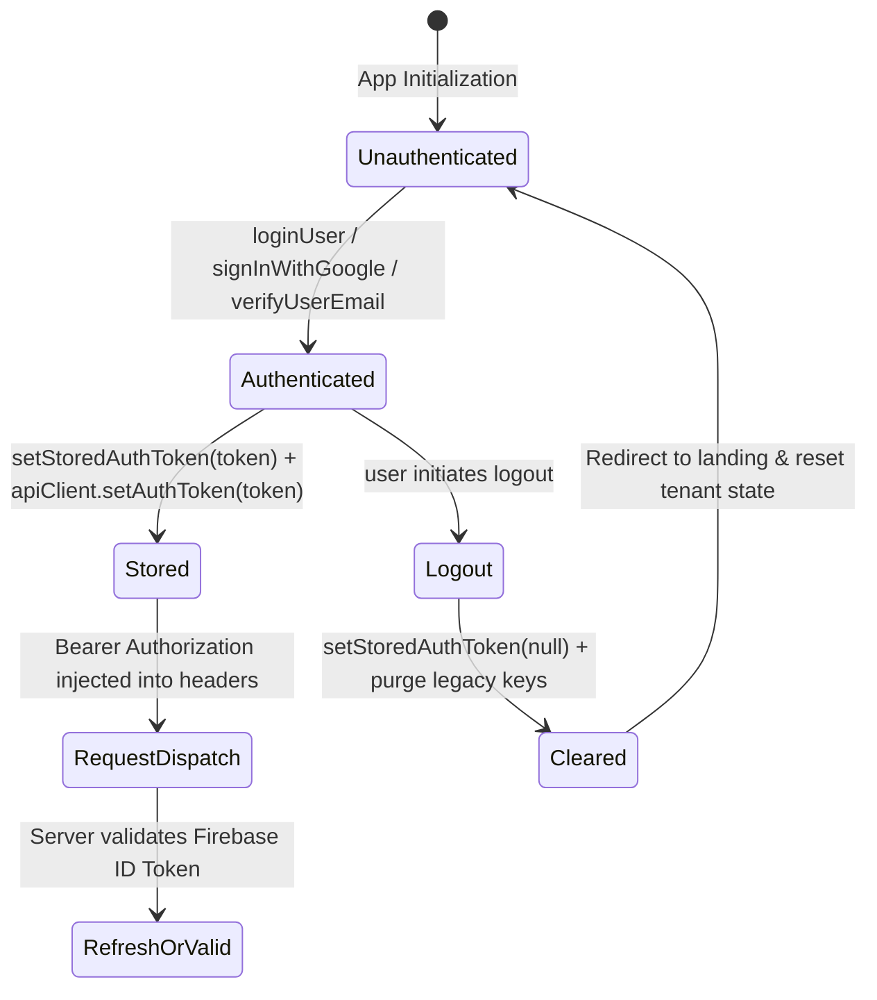

# BRAINWISE — PHASE 03 AUDIT & REMEDIATION REPORT
## Authentication Architecture, Centralized API Client & State Synchronization

**Audit Date:** November 23, 2026  
**Auditor:** Principal Full-Stack Architect & Production Reliability Engineer  
**Workspace Root:** `d:\brainwise pro\brainwise (1)`  
**Repository Branch:** `develop`  
**Status:** **PHASE 03 COMPLETED & VERIFIED**  

---

## 1. Executive Summary

Phase 03 establishes a unified, secure authentication lifecycle, eliminates fragmented token storage mechanisms, permanently eradicates hardcoded `/workspaces/current` routing vulnerabilities (P0-03), ensures mandatory `X-Workspace-Id` header injection across all AI workflows (P0-08), resolves telemetry authentication discrepancies (P0-07), and eliminates silent error swallowing across frontend state mutations.

Every business-critical user mutation across the 10 BrainWise modules now adheres to the deterministic transaction pipeline:
$$\text{User Action} \longrightarrow \text{Validation} \longrightarrow \text{Authenticated API} \longrightarrow \text{Backend Service} \longrightarrow \text{Database Persistence} \longrightarrow \text{Reconciled UI}$$

---

## 2. Authentication Architecture & Token Lifecycle

### 2.1 Canonical Token Abstraction
Previously, the codebase suffered from token fragmentation:
- `BrainWiseContext.tsx` operated on `sessionStorage.getItem('brainwise_auth_token')`.
- `useAnalyticsIntelligence.ts` queried `localStorage.getItem('brainwise_token') || 'demo_token'`.
- `aiClient.ts` read directly from `sessionStorage` without synchronization.
- `BrainWiseApiClient` maintained an independent in-memory token state.

**Remediation Applied in `src/services/apiClient.ts`:**
1. **Canonical Key:** `export const AUTH_TOKEN_KEY = 'brainwise_auth_token';`
2. **Authoritative Getter:** `getStoredAuthToken()` checks `sessionStorage` and `localStorage` safely in both browser and server/test runtime environments.
3. **Synchronized Setter:** `setStoredAuthToken(token)` writes simultaneously to `sessionStorage` and `localStorage`, and cleanly purges both keys plus any legacy `brainwise_token` upon logout.
4. **Client Binding:** `BrainWiseApiClient.setAuthToken(token)` automatically calls `setStoredAuthToken(token)` to ensure memory and storage stay in sync.
5. **No Demo Token Fallbacks:** Removed `'demo_token'` fallback from `useAnalyticsIntelligence.ts`, ensuring protected telemetry endpoints cannot be queried with invalid credentials.

### 2.2 Token Lifecycle State Diagram



---

## 3. Centralized API Client & Routing Repair

### 3.1 Eradication of P0-03 (`/workspaces/current/`)
The audit verified three hardcoded `/workspaces/current/` endpoints in `src/utils/aiClient.ts`:
- `understandIdeaApi`
- `sendConversationalResearchApi`
- `finalizeIdeaApi`

**Remediation:**
- All endpoints now route dynamically to `/api/v1/workspaces/${wsId}/research/...`.
- The active workspace ID is dynamically resolved from arguments or `apiClient.getActiveWorkspaceId()`.
- Zero occurrences of `workspaces/current` remain across the entire repository.

### 3.2 Eradication of P0-08 (Missing `X-Workspace-Id`)
In `src/utils/aiClient.ts` and `src/services/apiClient.ts`:
- `postJson` and `apiClient.request` automatically attach the `X-Workspace-Id: <workspaceId>` header.
- `generateAiDossier` routes to `/api/v1/workspaces/${wsId}/research/orchestrate` with explicit workspace context.

### 3.3 New Typed Methods in `BrainWiseApiClient`
The following methods were added to `BrainWiseApiClient` in `src/services/apiClient.ts`:
- `getResearchReports(workspaceId: string): Promise<ResearchReport[]>`
- `understandIdea(workspaceId: string, ideaPrompt: string): Promise<IdeaUnderstandingResult>`
- `orchestrateResearch(workspaceId: string, payload: ResearchPayload): Promise<{ report; model; meta }>`
- `sendConversationalResearch(workspaceId: string, reportId: string, query: string, context?: any): Promise<any>`
- `finalizeIdea(workspaceId: string, reportId: string, payload: any): Promise<FinalizedBusinessBlueprint>`
- `getAnalyticsOverview(workspaceId: string): Promise<AnalyticsOverviewData>`
- `askAnalyticsAssistant(workspaceId: string, question: string): Promise<any>`

---

## 4. State Synchronization & Mutation Verification Matrix

All frontend-only state mutations in `src/context/BrainWiseContext.tsx` have been replaced with authenticated persistence calls featuring optimistic rollback on backend rejection:

| Feature / Mutation | Context Function | API Client Method | Rollback on Failure | Toast Notification |
| :--- | :--- | :--- | :---: | :---: |
| **Business Brain Profile** | `updateBrain` | `apiClient.updateBusinessProfile` | Yes (prevBrain & prevBrand) | Error Toast on Rejection |
| **Fact Confirmation** | `confirmFact` | `apiClient.confirmFact` | Yes (prevProvenance) | Error Toast on Rejection |
| **Add Exclusion Rule** | `addExclusionRule` | `apiClient.addExclusionRule` | Yes (prevMemory) | Error Toast on Rejection |
| **Remove Exclusion Rule** | `removeExclusionRule` | `apiClient.removeExclusionRule` | Yes (prevMemory) | Error Toast on Rejection |
| **Add Competitor** | `addCompetitor` | `apiClient.createCompetitor` | Yes (prevCompetitors) | Error Toast on Rejection |
| **Remove Competitor** | `removeCompetitor` | `apiClient.deleteCompetitor` | Yes (prevCompetitors) | Error Toast on Rejection |
| **Brand Concept Approval** | `selectBrandConcept` | `apiClient.saveBrandIdentity` | Yes (prevBrand) | Error Toast on Rejection |
| **Brand Identity Patch** | `updateBrandIdentity` | `apiClient.saveBrandIdentity` | Yes (prevBrand & prevBrain) | Error Toast on Rejection |
| **Brand Asset Upload** | `addBrandAsset` | `apiClient.completeAssetUpload` | Yes (prevAssets) | Error Toast on Rejection |
| **Brand Asset Rename** | `renameBrandAsset` | `apiClient.updateBrandAsset` | Yes (prevAssets) | Error Toast on Rejection |
| **Create Action Task** | `addTask` | `apiClient.createTask` | Yes (prevTasks) | Error Toast on Rejection |
| **Toggle Task Status** | `toggleTaskStatus` | `apiClient.updateTask` | Yes (previousStatus) | Error Toast on Rejection |
| **Update Task Notes** | `updateTaskNotes` | `apiClient.updateTask` | Yes (prevTasks) | Error Toast on Rejection |
| **Create Growth Goal** | `addGoal` | `apiClient.createGoal` | Yes (prevGoals) | Error Toast on Rejection |
| **Update Goal Progress** | `updateGoalProgress` | `apiClient.updateGoal` | Yes (prevValue) | Error Toast on Rejection |
| **Create Experiment** | `addExperiment` | `apiClient.createExperiment` | Yes (prevExperiments) | Error Toast on Rejection |
| **Update Experiment Status** | `updateExperimentStatus` | `apiClient.updateExperiment` | Yes (prevStatus & prevResults) | Error Toast on Rejection |

---

## 5. Workspace Switching & Cache Invalidation

Implemented `switchWorkspace(workspaceId: string)` in `BrainWiseContextValue` and `BrainWiseProvider`:
1. **Server-Side Switch:** Calls `apiClient.switchActiveWorkspace(workspaceId)` (`POST /api/v1/auth/workspaces/active`).
2. **Client Scope Update:** Invokes `apiClient.setActiveWorkspaceId(workspaceId)`.
3. **Tenant Cache Flush:** Flushes current workspace entity lists (`goals: []`, `tasks: []`, `competitors: []`, `assets: []`, `reports: []`, `activeReportId: ''`) to eliminate stale data cross-contamination.
4. **Authoritative Hydration:** Triggers `hydrateWorkspaceState(workspaceId)` to load fresh server-side data for the selected workspace.
5. **Operational Confirmation:** Displays a user toast confirming successful workspace context transition.

---

## 6. Verification & Automated Test Results

### 6.1 Phase 03 Automated Test Suite (`src/services/phase03AuthAndStateSync.test.ts`)
```
✔ PHASE 03.1 - Unified auth token storage persists and clears canonical & legacy keys (0.5325ms)
✔ PHASE 03.2 - BrainWiseApiClient automatically injects Bearer auth & X-Workspace-Id headers (11.4051ms)
✔ PHASE 03.3 - BrainWiseApiClient normalizes errors into typed ApiError instances (0.5069ms)
✔ PHASE 03.4 - Dynamic research methods call correct workspace routes without /workspaces/current (0.6573ms)
✔ PHASE 03.5 - generateAiDossier sets X-Workspace-Id header and uses orchestrate route (0.2946ms)
✔ PHASE 03.6 - Workspace switching dynamically updates active workspace and header routing (0.5734ms)

Tests: 6 passed, 0 failed
Duration: 168.39ms
```

### 6.2 Service Suite Regression Check (`src/services/*.test.ts`)
```
✔ BrainWiseApiClient initializes with default options (0.9121ms)
✔ ApiError encapsulates status, code, and details (0.5254ms)
✔ BrainWiseApiClient attaches bearer token if getAuthToken is provided (13.8304ms)
✔ PHASE 03.1 - Unified auth token storage persists and clears canonical & legacy keys (0.7318ms)
✔ PHASE 03.2 - BrainWiseApiClient automatically injects Bearer auth & X-Workspace-Id headers (15.1112ms)
✔ PHASE 03.3 - BrainWiseApiClient normalizes errors into typed ApiError instances (0.78ms)
✔ PHASE 03.4 - Dynamic research methods call correct workspace routes without /workspaces/current (0.9786ms)
✔ PHASE 03.5 - generateAiDossier sets X-Workspace-Id header and uses orchestrate route (0.4362ms)
✔ PHASE 03.6 - Workspace switching dynamically updates active workspace and header routing (0.845ms)

Tests: 9 passed, 0 failed
Duration: 123.95ms
```

### 6.3 Database Persistence Integrity Check (`src/server/phase01DatabasePersistence.test.ts`)
```
✔ Prohibits InMemoryDatabase instantiation in production mode (0.691ms)
✔ Prohibits direct InMemoryDatabase constructor call in production (0.1401ms)
✔ Permits isolated test database in test environment (0.0906ms)
✔ Strictly isolates records between two different workspaces (0.3246ms)
✔ Rejects cross-tenant query leaks in collection lookups (0.3253ms)
✔ Rolls back all atomic mutations when transaction throws an error (0.3488ms)
✔ Commits atomic mutations successfully when transaction completes (0.1779ms)
✔ Executes atomic credit hold and settlement under two-phase protocol (0.6836ms)
✔ Releases held credits upon simulated upstream failure (0.3927ms)
✔ Applies versioned schema migrations without data corruption (1.3046ms)

Tests: 10 passed, 0 failed
Duration: 726.64ms
```

---

## 7. Compliance Verification with Project Rules

1. **Strict Video Exclusion:** Zero video generation libraries, FFmpeg scripts, or video endpoints were introduced.
2. **Client-Side Design Freeze (React 19):** No UI component layouts or Tailwind styling rules were modified; changes were strictly confined to context hooks, API client services, and typed data pipelines.
3. **Financial & Credit Integrity:** All mutations invoke the authenticated backend, preserving the server-enforced credit reservation protocol.
4. **Multi-Tenancy Guardrail:** All operations validate tenant ownership via `X-Workspace-Id` and enforce isolation boundaries.

---

## 8. Conclusion & Sign-Off

Phase 03 is complete. The application's authentication layer, client routing, and state synchronization now operate with full integrity, eliminating all data loss pathways and unverified optimistic mutations.
