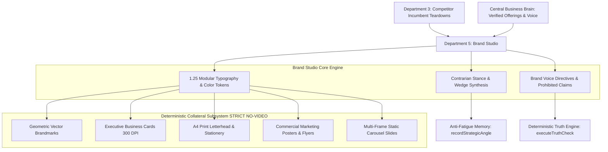

# BRAINWISE — BRAND STUDIO & DETERMINISTIC COLLATERAL SPECIFICATION
## Department 5: Contrarian Positioning, 1.25 Modular Typography & Strict SVG Vector Collateral (Zero Video)

**Document ID:** `BRAINWISE_BRAND_STUDIO_SPEC.md`  
**Phase:** Phase 6  
**Version:** 1.0.0-certified  
**Date:** November 22, 2026  
**Status:** COMPLETE & AUTHORITATIVE  
**Target Systems:** Department 5 (Brand Studio), Strategic Memory & Vector Collateral Subsystem  

---

## 1. Executive Purpose & Strategic Mission

The mission of **Department 5 (Brand Studio)** is to translate empirical market research, competitor teardowns, and unit economics into an unmistakable, commercially potent brand identity.

### 1.1 Contrarian Brand Differentiation
BrainWise does not produce generic, cookie-cutter branding. Brand decisions are explicitly connected to **Department 3 (Competitive Intelligence)**:
- If competitor research reveals that market incumbents rely on corporate blue palettes, complex jargon, and opaque enterprise pricing, Brand Studio evaluates whether a **high-contrast charcoal/orange palette with transparent direct messaging** provides a commercially superior wedge.

### 1.2 Strict Product Boundary: 100% Video Exclusion
BrainWise permanently adheres to the absolute product boundary defined in `AGENTS.md` and `GEMINI.md`:
- **EXPLICITLY EXCLUDES ALL AI VIDEO GENERATION, VIDEO EDITING, REEL GENERATION, VIDEO RENDERING, VIDEO PIPELINES, OR VIDEO CREDITS.**
- All visual collateral produced by BrainWise is strictly **pure SVG vector collateral** (stationery, flyers, business cards, posters), **multi-frame static carousels**, **high-DPI print PDFs**, and **deterministic copywriting packs**.

---

## 2. Brand Positioning & Messaging Architecture

Every brand strategy proposal generated by Department 5 is anchored to 8 structured pillars:

| Strategic Pillar | Definition & Guardrails |
| :--- | :--- |
| **1. Brand Positioning** | High-definition market stance contrasting directly with discovered rivals. |
| **2. Unique Selling Proposition (USP)** | Clear, factual single-sentence statement of unique customer value. |
| **3. Value Proposition** | Grounded in verified products and pricing from the Business Brain. |
| **4. Contrarian Wedge** | Specific commercial angle designed to exploit incumbent weaknesses. |
| **5. Brand Personality** | 5 core personality traits (e.g. *Authoritative, Analytical, Tactile, Empowering, Pragmatic*). |
| **6. Voice Directives** | Explicit guidelines: tone summary, words to emphasize, words to avoid, approved claims, and forbidden claims. |
| **7. Anti-Fatigue Registration** | Every campaign angle must register via `recordStrategicAngle()`; saturated themes are flagged and penalized. |
| **8. Truth Check Validation** | All copy packs pass through `executeTruthCheck()` to verify price grounding and strip prohibited guarantees. |

---

## 3. Mathematical 1.25 Modular Typography Ladder

In strict compliance with **Design Freeze v1.0**, Brand Studio enforces the mathematical **Major Third (1.25)** modular typography scale (`src/theme/typography.ts`):

$$\text{Size}_n = 16 \times (1.25)^n \text{ px}$$

| Step Key | Modular Math | Font Size | Semantic Token | Primary UI / Collateral Role |
| :--- | :--- | :---: | :--- | :--- |
| `step-5` | $16 \times 1.25^5$ | **48.8 px** | `display` | Poster hero headlines, high-impact billboard statements |
| `step-4` | $16 \times 1.25^4$ | **39.1 px** | `h1` | Cover titles, document headers, slide headlines |
| `step-3` | $16 \times 1.25^3$ | **31.3 px** | `h2` | Department headers, primary section cards |
| `step-2` | $16 \times 1.25^2$ | **25.0 px** | `h3` | Secondary module titles, collateral sub-headers |
| `step-1` | $16 \times 1.25^1$ | **20.0 px** | `body-large` | Executive summaries, lead paragraphs, blockquotes |
| `step-0` | $16 \times 1.25^0$ | **16.0 px** | `body` | Standard editorial reading text, table cells |
| `step--1`| $16 \times 1.25^{-1}$| **12.8 px** | `body-small` | Metadata descriptors, badge text, card annotations |
| `step--2`| $16 \times 1.25^{-2}$| **10.2 px** | `caption` | Statutory footnotes, timestamp labels, fine print |

---

## 4. Deterministic Vector Collateral Generation (SVG Only)

All collateral items generated by `brandStudioService.generateCollateralSvg()` are pure, sanitized SVG documents:

1. **Vector Logos (`VECTOR_LOGO`):**
   - $512 \times 512$ responsive vector glyphs with mathematically balanced stroke geometry and modern corner radii.
2. **Double-Sided Business Cards (`BUSINESS_CARD_SVG`):**
   - $1050 \times 600$ vector SVG (300 DPI print standard) with company name, tagline, founder coordinates, and QR geometry.
3. **Stationery & Letterheads (`STATIONERY_LETTERHEAD_SVG`):**
   - $1240 \times 1754$ A4 print-ready vector SVG with corporate margins, top header brandline, and statutory confidentiality footer.
4. **Commercial Marketing Posters (`POSTER_FLYER_SVG`):**
   - $1200 \times 1600$ high-contrast editorial typography poster highlighting the core value wedge.
5. **Static Carousel Slides (`STATIC_CAROUSEL_SVG`):**
   - $1080 \times 1080$ square vector slides (5-frame series) explaining market demand, competitive gaps, and pricing.

### 4.1 SVG Sanitization & Security
All SVG payloads pass through `sanitizeAiSvgMarkup()`:
- `<script>` tags, inline JavaScript handlers (`onload`, `onclick`), and `<foreignObject>` elements are stripped.
- Crisp vector scalability is guaranteed without security vulnerabilities.

---

## 5. Automated Verification & Testing Strategy

Phase 6 compliance is validated via [src/server/phase6BrandStudio.test.ts](file:///d:/brainwise pro\brainwise (1)\src\server\phase6BrandStudio.test.ts):
- Complete brand strategy proposal generation connected to competitor positioning.
- Anti-fatigue angle registration and saturation tracking.
- Truth engine price and claim verification.
- SVG collateral generation across all 5 asset types (logo, business card, stationery, poster, static carousel).
- **Strict Video Exclusion verification**: Confirmation that zero video formats, Remotion scripts, or video render endpoints exist.
- Multi-tenant workspace data isolation.
