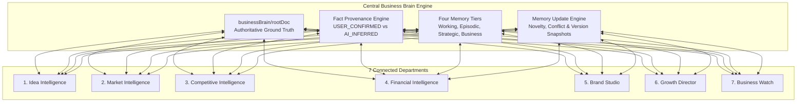
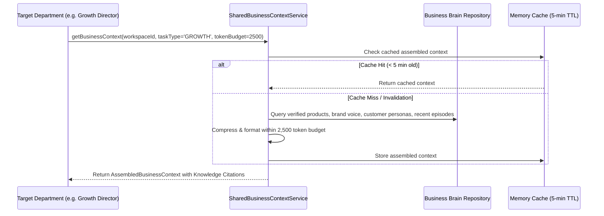

# BRAINWISE — CENTRAL BUSINESS BRAIN SPECIFICATION
## The Single Source of Truth for the 7 Connected Intelligence Departments

**Document ID:** `BRAINWISE_BUSINESS_BRAIN_SPEC.md`  
**Phase:** Phase 2  
**Version:** 1.0.0-certified  
**Date:** November 22, 2026  
**Status:** COMPLETE & AUTHORITATIVE  
**Target Systems:** Idea, Market, Competitive, Financial, Brand, Growth, and Watch Departments  

---

## 1. Executive Purpose & Architectural Core

The **Central Business Brain** is the single most important architectural asset of BrainWise. Rather than building seven disconnected AI tools or isolated report generators, BrainWise is an integrated **AI Business Intelligence & Growth Operating System** powered by a persistent, unified Business Brain.



### Core Invariant: The Shared Memory Promise
- A founder **never** inputs the same business fact twice.
- If the pricing of a product is updated in the Business Brain, the **Financial Intelligence Strategy Simulator**, the **Growth Director Acquisition Planning**, and the **Brand Studio Value Proposition** immediately ground themselves in that updated price.
- If a marketing experiment fails in the Growth Director, the **Central Business Brain remembers the failure** and prevents subsequent AI generations from proposing the same failed angle.

---

## 2. Business Memory Data Model

The Central Business Brain maintains a structured understanding of every enterprise across 14 memory domains stored under `workspaces/{workspaceId}/`:

```
workspaces/{workspaceId}/
  ├── businessBrain/rootDoc         (Unified profile, stage, offerings, positioning)
  ├── products/{productId}          (Verified product catalog, pricing, unit costs)
  ├── personas/{personaId}          (Target customer profiles, demographics, pain points)
  ├── brandIdentities/{id}          (Tone, voice, colors, modular typography ladder)
  ├── brandAssets/{assetId}         (Deterministic vector SVG collateral, NO VIDEOS)
  ├── competitors/{competitorId}    (Direct, indirect, emerging rivals, diff logs)
  ├── researchReports/{reportId}    (TAM/SAM/SOM market sizing, industry trends)
  ├── financialModels/{modelId}     (Unit economics, breakeven, pricing scenarios)
  ├── marketingTasks/{taskId}       (Sprint tasks, milestones, execution status)
  ├── experiments/{expId}           (Growth experiments, hypotheses, outcomes)
  ├── memories/working/{sessionId}  (Active turn-by-turn context with TTL)
  ├── memories/episodic/{episodeId} (Historical campaigns, decisions, learnings)
  ├── memories/strategic/{itemId}   (Long-term strategic shifts, priorities, exclusions)
  └── versions/{versionId}          (Immutable profile snapshots with audit trail)
```

### 2.1 Domain Memory Attributes

| Memory Domain | Core Attributes Stored | Grounding Impact |
| :--- | :--- | :--- |
| **1. Business Profile** | Name, tagline, stage, location, industry, overview | Grounding root for all department prompts |
| **2. Offerings & Products** | SKUs, names, features, benefits, prices, unit costs | Grounds financial simulations and copy packs |
| **3. Customer Personas** | Demographics, pain points, objections, motivations | Directs customer intelligence and targeting |
| **4. Objectives & Goals** | Quarterly milestones, ARR targets, founder goals | Sets success criteria for Growth Director |
| **5. Pricing & Revenue** | Pricing tiers, subscription models, gross margins | Enforces `executeTruthCheck` pricing integrity |
| **6. Competitor Roster** | Competitor URLs, pricing matrices, positioning gaps | Feeds Competitive Intelligence & Watch alerts |
| **7. Brand Identity** | Voice adjectives, words to avoid, approved claims | Constrains Brand Studio copy and collateral |
| **8. Financial Assumptions** | CAC estimates, LTV estimates, breakeven thresholds | Powers Financial Intelligence Simulator |
| **9. Strategic Memory** | Fatigued themes, used angles, explicit exclusions | Injects negative constraints into AI prompts |
| **10. Episodic Learnings** | Succeeded/failed campaigns, lessons learned | Prevents repeated tactical marketing mistakes |
| **11. Decision Register** | Documented founder decisions, strategic pivots | Maintains historical rationale over time |
| **12. Execution Progress** | Task completion percentages, roadmap phase | Feeds weekly execution director reviews |

---

## 3. Context Management & Token Budgeting

Before generating recommendations, the orchestrator retrieves task-specific context via `sharedBusinessContextService.getBusinessContext()`:



### Context Compression Rules:
1. **Fact Provenance Filtering:** `USER_CONFIRMED` facts receive top priority; `DERIVED_FROM_DOC` facts receive secondary priority; `AI_INFERRED` facts are included only when token budget permits.
2. **Redaction of Sensitive Financials:** Operational team members without financial permissions receive redacted unit margins (`UNKNOWN`), preventing internal data leaks.
3. **Strict Video Exclusion:** All brand directives inject `svgOnly: true` and prohibit video pipelines, adhering to `AGENTS.md`.

---

## 4. The 7-Step Memory Update System

When external research, a founder input, or a document upload reveals new information, the system executes the **Memory Update System** (`processMemoryUpdate()`):

```
       1. Novelty Check
          Is the new claim already recorded in the Business Brain with identical values?
          ├─ YES ──> Action: IGNORED_DUPLICATE (No state mutation)
          └─ NO  ──> Proceed to Step 2
                 │
       2. Discrepancy & Conflict Check
          Does an existing fact exist for this attribute?
          ├─ NO  ──> Action: CREATED_NEW (Proceed to Step 3)
          └─ YES ──> Does existing fact have USER_CONFIRMED provenance while new proposal is AI_INFERRED?
                 │   ├─ YES ──> Action: FLAGGED_CONFLICT (Preserve user fact; queue verification item)
                 │   └─ NO  ──> Action: UPDATED_EXISTING (Proceed to Step 3)
                 │
       3. Source & Provenance Attribution
          Record sourceTitle, sourceUrl, sourceType, verification timestamp, and confidence rating.
                 │
       4. Context Mutation with Version Increment
          Increment Business Brain version (vN -> vN+1).
                 │
       5. Immutable Version Snapshotting
          Create complete profile snapshot in businessBrainVersionRepository with change summary.
                 │
       6. Cross-Department Cache Invalidation
          Purge SharedBusinessContextService memory caches for this workspace.
                 │
       7. Event Bus Notification & Department Cascade
          Emit FACT_MUTATION event to trigger cascading alerts on active department drafts.
```

### Critical Guardrail: The Founder Primacy Rule
Under no circumstances may an automated AI crawler, web research summary, or LLM output silently overwrite a `USER_CONFIRMED` fact. If an AI inference disagrees with a founder-confirmed price, market territory, or product description, the system flags a discrepancy and routes it to the **Verification Queue**.

---

## 5. Automated Verification & Testing Strategy

Phase 2 compliance is verified across the following automated test suites:
- Profile creation, updating, and incremental versioning.
- Fact provenance tracking (`USER_CONFIRMED`, `AI_INFERRED`, `DERIVED_FROM_DOC`).
- Four memory tiers (working memory TTL, episodic campaign records, strategic items, business memory).
- Conflict prevention: verifying that AI proposals cannot silently overwrite user-confirmed facts.
- Cross-department cache invalidation upon fact mutation.
- Multi-tenant workspace security gates.
