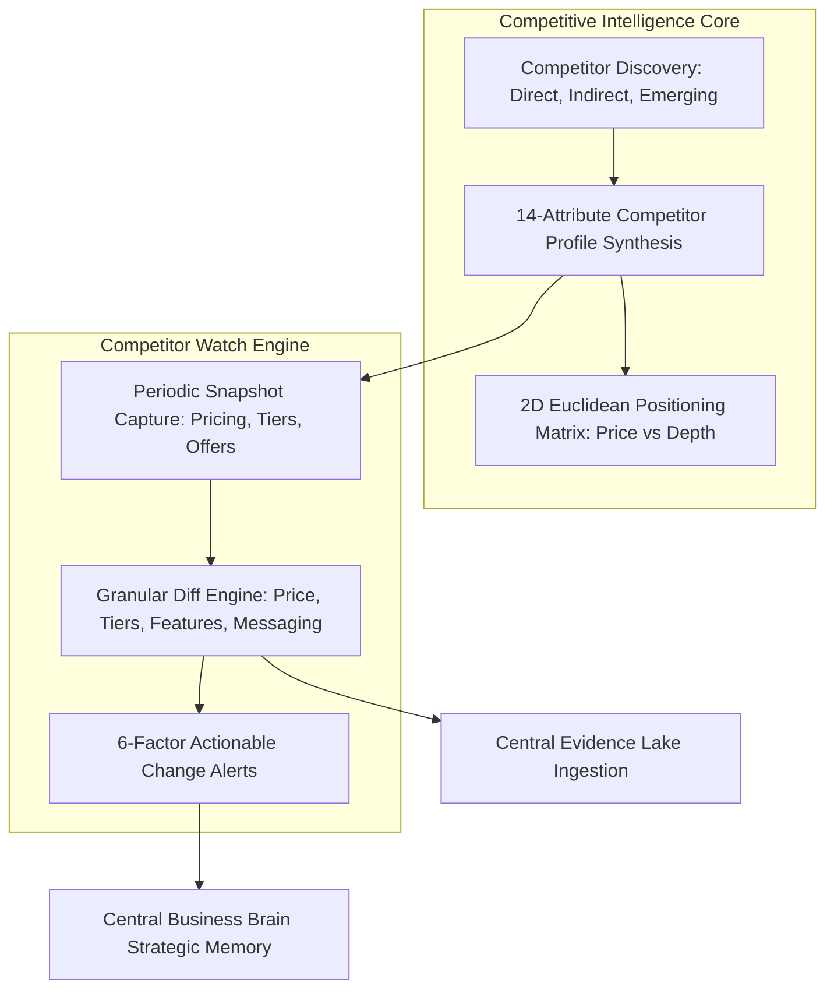

# BRAINWISE — COMPETITIVE INTELLIGENCE & COMPETITOR WATCH SPECIFICATION
## Department 3: Competitor Discovery, 2D Positioning Matrices, Snapshot Diffing & Actionable Change Alerts

**Document ID:** `BRAINWISE_COMPETITIVE_INTELLIGENCE_SPEC.md`  
**Phase:** Phase 4  
**Version:** 1.0.0-certified  
**Date:** November 22, 2026  
**Status:** COMPLETE & AUTHORITATIVE  
**Target Systems:** Department 3 (Competitive Intelligence) & Central Evidence Lake  

---

## 1. Executive Purpose & Department Mission

The primary mission of **Department 3 (Competitive Intelligence & Competitor Watch)** is to give founders and business leaders an unfair, continuous advantage over their market rivals.

Instead of one-time static teardowns or manual spreadsheets that go stale within weeks, BrainWise provides:
1. **Dynamic Competitor Profiling:** Deep structured intelligence across Direct, Indirect, and Emerging competitors.
2. **2D Euclidean Positioning Maps:** Mathematical distance calculations across Price vs. Feature Depth/Complexity.
3. **Operational Competitor Watch:** Automated snapshot diffing that detects price shifts, new product tiers, and messaging pivots.
4. **Actionable Alert Generation:** 6-factor alerts providing factual evidence, business impact, and strategic response options.

---

## 2. Comprehensive Competitor Profile Schema

Every competitor profiled in Department 3 maintains the following structured schema (`src/server/services/competitiveIntelligenceService.ts`):

| Attribute | Type | Description |
| :--- | :--- | :--- |
| `companyName` | `string` | Legal brand name of competitor. |
| `website` | `string` | Primary domain (validated with SSRF defense). |
| `classification` | `'DIRECT' \| 'INDIRECT' \| 'EMERGING'` | Competitive relationship tier. |
| `businessDescription`| `string` | Core operational summary. |
| `locationAndMarketCoverage`| `string` | Geographic territory (e.g. India Metro vs. Global Enterprise). |
| `targetAudience` | `string` | Primary ICP served by competitor. |
| `productsAndServices` | `Array<{ name, description, price }>` | Catalog breakdown. |
| `pricingTiers` | `Array<{ tierName, price, billingPeriod, features }>` | Granular pricing breakdown for automated diffing. |
| `positioning` | `string` | Hero marketing angle and brand stance. |
| `strengths` | `string[]` | Primary competitive advantages. |
| `weaknesses` | `string[]` | Structural flaws, complaints, and service gaps. |
| `customerSentiment` | `{ score, rating, commonPraises, topComplaints }` | Public review aggregations (G2, Google, Trustpilot). |
| `marketingChannels` | `string[]` | Discovered customer acquisition channels. |
| `differentiation` | `string` | How competitor contrasts with market incumbents. |
| `potentialThreats` | `string[]` | Direct risks posed to the BrainWise founder. |
| `opportunitiesForUser`| `string[]` | Exploitable weaknesses and whitespace wedges. |

---

## 3. Mathematical 2D Positioning Matrix

The positioning engine calculates the exact Euclidean distance between the user's business coordinates $(x_{\text{user}}, y_{\text{user}})$ and each competitor's coordinates $(x_i, y_i)$ across normalized $0-100$ axes:

$$\text{Distance}_i = \sqrt{(x_{\text{user}} - x_i)^2 + (y_{\text{user}} - y_i)^2}$$

- **X-Axis (Price):** $0$ (Free / Ultra-Budget) to $100$ (High-Ticket Enterprise).
- **Y-Axis (Feature Depth):** $0$ (Lightweight Single-Purpose Tool) to $100$ (Comprehensive Operating System).

### Strategic Value:
1. **Identifies Nearest Competitor:** The competitor with the minimum Euclidean distance poses the immediate conversion threat.
2. **Reveals Whitespace Opportunities:** Highlights uncrowded quadrants (e.g. High Depth + Affordable Pricing tailored for Indian SMEs).

---

## 4. Competitor Watch & Continuous Monitoring Engine

Competitor Watch is **not a simulated marketing promise**; it is an active operational pipeline implemented in `competitorTrackingService.ts` and `competitiveIntelligenceService.ts`:

### 4.1 Monitored Triggers
Where technically and legally permitted, the engine monitors:
1. **Pricing Shifts:** Price increases, drops, or newly introduced tiers.
2. **Offer & Messaging Pivots:** Changes in landing page hero headlines or value propositions.
3. **Feature Launches:** Newly published feature flags, integrations, or module additions.
4. **Customer Sentiment Swings:** Spikes in public complaints or review rating drops.

### 4.2 The 6-Factor Actionable Alert Format
Every alert generated by Competitor Watch contains:
1. **What Changed:** Exact summary of the detected difference (e.g. *Competitor Alpha dropped Standard tier price by 25% from ₹799 to ₹599*).
2. **When It Changed:** Accurate timestamp of detection.
3. **Evidence Supporting the Change:** Primary URL, domain authority, and extracted before/after quotation.
4. **Why It Matters:** Strategic context (e.g. *Competitor is attempting to undercut entry-level acquisition*).
5. **Business Impact:** Direct assessment of founder risk (conversion pressure, churn liability).
6. **Recommended Response:** Actionable counter-strategy (e.g. *Emphasize superior factual accuracy and transparent ROI rather than entering an unsustainable price war*).

---

## 5. Crawl Safety, Privacy & Ethical Compliance

1. **SSRF Defense:** All target competitor domains undergo mandatory IP resolution checks (`validateSafeExternalUrl`). Private IPs (`127.0.0.1`, `10.0.0.0/8`, `169.254.169.254`) are permanently blocked.
2. **Robots.txt & Rate Limiting:** Outgoing requests respect target `robots.txt` disallows, employ exponential backoff, and restrict request concurrency.
3. **Strict Video Exclusion:** Competitor multimedia scraping strictly excludes video parsing, YouTube downloading, or video render pipelines.
4. **Evidence Lake Mirroring:** Every detected diff is fingerprinted and stored in the **Central Evidence Lake** as an immutable `COMPETITOR_DIFF` record.

---

## 6. Automated Verification & Testing Strategy

Phase 4 compliance is verified via [src/server/phase4CompetitiveIntelligence.test.ts](file:///d:/brainwise%20pro/brainwise%20(1)/src/server/phase4CompetitiveIntelligence.test.ts):
- Complete 14-attribute competitor profile synthesis.
- 2D Euclidean positioning distance calculation.
- Automated snapshot diffing (detecting price drops, increases, and offer changes).
- 6-factor actionable alert generation.
- SSRF prevention on malicious/private competitor URLs.
- Multi-tenant workspace data isolation.
