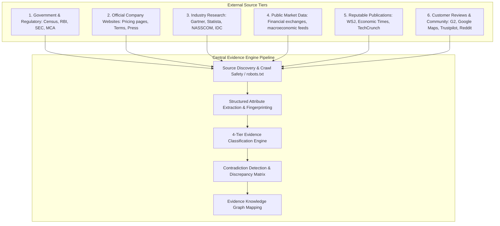
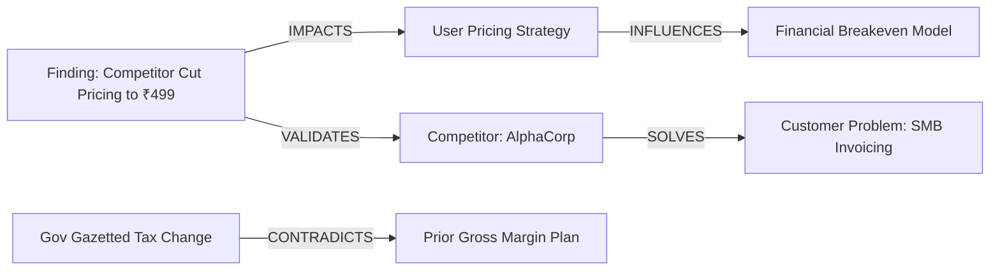

# BRAINWISE — CENTRAL EVIDENCE ENGINE SPECIFICATION
## Authoritative Architecture, Extraction Contracts, Classification & Contradiction Resolution

**Document ID:** `BRAINWISE_EVIDENCE_ENGINE_SPEC.md`  
**Phase:** Phase 1  
**Version:** 1.0.0-certified  
**Date:** November 22, 2026  
**Status:** COMPLETE & AUTHORITATIVE  
**Target Systems:** All 7 Connected Intelligence Departments & Central Business Brain  

---

## 1. Executive Vision & Architectural Mission

The **BrainWise Central Evidence Engine** is the foundational trust layer of the platform. Its primary mission is to ensure that no AI department produces ungrounded claims, fabricated statistics, phantom citations, or arbitrary scores.

Every insight, TAM/SAM/SOM calculation, competitor pricing tier, and growth recommendation rendered in BrainWise must be anchored to verifiable evidence, with explicit confidence scoring, origin provenance, and automated contradiction reconciliation.

---

## 2. Source Discovery & Multi-Channel Ingestion

The Evidence Engine continuously discovers and indexes external evidence across 11 discrete source classes:



### 2.1 Ingestion Security & Crawl Ethics
- **Strict SSRF Defense:** Private IPv4/IPv6 networks (`127.0.0.1`, `10.0.0.0/8`, `192.168.0.0/16`, AWS/GCP metadata IP `169.254.169.254`) are systematically rejected before fetch dispatch.
- **Robots.txt & Terms Adherence:** Automated requests respect target `robots.txt` disallow rules, rate limits, and public accessibility policies.
- **Zero Video Pipeline:** Consistent with `AGENTS.md` and `GEMINI.md`, multimedia ingestion is strictly text, SVG, structured JSON, and PDF documents. All video URLs, transcript video pipelines, and video rendering tools are excluded.

---

## 3. Evidence Data Contract & Extraction Schema

For every empirical finding captured by the engine, the following immutable schema is enforced (`src/server/types/evidence.ts`):

| Attribute | Type | Description |
| :--- | :--- | :--- |
| `findingId` | `string` | Unique deterministic identifier (`ev_find_<timestamp>_<hex>`). |
| `workspaceId` | `string` | Multi-tenant parent boundary (`workspaces/{workspaceId}`). |
| `topic` | `string` | Specific research topic (e.g. `B2B SaaS Pricing Tiers`). |
| `sourceTitle` | `string` | Exact headline or document name. |
| `sourceUrl` | `string` | Fully qualified source URL for 1-click inspection. |
| `sourceType` | `EvidenceFindingSourceType` | Enumerated source class (Gov, Official, Industry, Review, etc.). |
| `publicationDate` | `string` (ISO 8601) | When the finding was originally published by the source. |
| `retrievalDate` | `string` (ISO 8601) | Timestamp of when BrainWise extracted the data. |
| `extractedEvidence`| `string` | Cleaned factual claim or quantitative data point. |
| `quoteOrSummary` | `string` | Direct contextual quotation from the source. |
| `geographicRelevance`| `string` | Territory boundary (e.g. `IN`, `GLOBAL`, `US`, `MH-MUMBAI`). |
| `evidenceConfidence` | `number` (0.0 to 1.0) | Calibrated confidence rating. |
| `classification` | `EvidenceClassification` | Formal 4-tier truth classification. |
| `relatedDepartment`| `EvidenceDepartment` | Target consumer department (Idea, Market, Competitor, Financial, etc.). |
| `extractedMetrics` | `Record<string, string\|number>` | Parsed quantitative variables (e.g. `{ cagr: "14%", tam: "$12B" }`). |

---

## 4. The 4-Tier Evidence Classification Framework

The Evidence Engine applies a deterministic 4-tier classification algorithm:

```
                  ┌──────────────────────────────────────────────┐
                  │ Does the finding originate from an official  │
                  │ company website, government publication, or  │
                  │ regulatory authority with confidence >= 85%? │
                  └──────────────────────┬───────────────────────┘
                                         │
                         YES ────────────┴──────────── NO
                          │                            │
                          ▼                            ▼
                   ┌──────────────┐      ┌─────────────────────────────┐
                   │   VERIFIED   │      │ Are there 2+ independent    │
                   └──────────────┘      │ credible sources confirming │
                                         │ with confidence >= 70%?     │
                                         └─────────────┬───────────────┘
                                                       │
                                       YES ────────────┴──────────── NO
                                        │                            │
                                        ▼                            ▼
                                ┌──────────────┐       ┌─────────────────────────────┐
                                │ CORROBORATED │       │ Is it computed from an      │
                                └──────────────┘       │ explicit formula / model    │
                                                       │ or stated assumptions?      │
                                                       └─────────────┬───────────────┘
                                                                     │
                                                     YES ────────────┴──────────── NO
                                                      │                            │
                                                      ▼                            ▼
                                              ┌──────────────┐              ┌──────────────┐
                                              │  ESTIMATED   │              │  UNVERIFIED  │
                                              └──────────────┘              └──────────────┘
```

1. **VERIFIED (Primary Truth):**
   - Direct primary documents: official pricing tables, regulatory filings, registered company certificates, government statistical gazettes.
   - Confidence: $\ge 0.85$.
   - Display: Green badge with ShieldCheck icon.
2. **CORROBORATED (Multi-Source Consensus):**
   - Independent confirmation from $\ge 2$ reliable third-party sources (e.g. Statista + Gartner, or G2 + Capterra customer reviews).
   - Confidence: $\ge 0.70$.
   - Display: Orange badge with CheckCircle2 icon.
3. **ESTIMATED (Explicit Mathematical Modeling):**
   - Derived TAM/SAM/SOM calculations, CAC payback horizons, and unit economics based on stated assumptions.
   - Methodology is visible; assumptions are editable.
   - Display: Amber badge with Calculator icon.
4. **UNVERIFIED (Plausible but Unconfirmed):**
   - Emerging signals from single community threads, uncorroborated blog posts, or preliminary search snippets.
   - Display: Neutral badge with HelpCircle icon; explicitly flagged as needing user confirmation.

---

## 5. Contradiction Detection & Discrepancy Resolution Engine

When research findings disagree on a metric, pricing tier, or market size, the system triggers the **Contradiction Detection Engine** (`src/server/services/contradictionService.ts`):

### 5.1 Discrepancy Dimensions
1. **Numerical Divergence:** When two or more quantitative metrics for the same metric diverge by $> 25\%$.
2. **Temporal Decay:** Comparing `publicationDate` across sources. A 2026 report supersedes a 2023 report on dynamic metrics (e.g. AI market adoption).
3. **Geographic Scope Divergence:** Explaining that a \$10B Global TAM and a ₹1,200 Cr India SOM represent territory differences, not measurement failure.
4. **Credibility Hierarchy:** Primary government and company sources outrank third-party aggregators and unverified social discussions:
   - Level 1 (Weight 0.95): `GOVERNMENT_PUBLICATION`, `REGULATORY_SOURCE`
   - Level 2 (Weight 0.90): `OFFICIAL_WEBSITE`
   - Level 3 (Weight 0.85): `INDUSTRY_REPORT`, `PUBLIC_MARKET_DATA`
   - Level 4 (Weight 0.70): `NEWS_PUBLICATION`, `PRODUCT_DOCUMENTATION`
   - Level 5 (Weight 0.50): `CUSTOMER_REVIEWS`, `COMMUNITY_DISCUSSION`, `SEARCH_RESULTS`

### 5.2 Resolution Actions
- **PREFER_NEWER:** Automatically annotates that newer research accounts for recent market shifts.
- **FLAG_DISAGREEMENT:** Renders an inline `ContradictionCard` showing both claims and explaining the conflict to the founder.
- **PRESENT_RANGE:** Converts conflicting estimates into a safe bounding range (e.g. ₹800 Cr – ₹1,200 Cr) rather than fabricating false single-point precision.

---

## 6. The Evidence Knowledge Graph

Findings do not sit in isolation. They form directed edges in the **Evidence Knowledge Graph**:



### Supported Edge Relationships:
- `VALIDATES`: Finding confirms an existing Business Brain fact or competitor claim.
- `CONTRADICTS`: Finding conflicts with a current business assumption or prior report.
- `IMPACTS`: Finding directly alters pricing, marketing channels, or unit economics.
- `SOLVES`: Competitor or product feature addresses a documented customer pain point.
- `INFLUENCES`: External trend guides a strategic recommendation or experiment.

---

## 7. Frontend Integration & UI Components

The Evidence Engine provides three tactile React 19 UI components:

1. **`EvidenceBadge` (`src/components/intelligence/EvidenceBadge.tsx`):**
   - Inline badge with status indicator dot, icon, tier label, confidence percentage, and click-to-inspect trigger.
2. **`SourceInspectorDrawer` (`src/components/intelligence/SourceInspectorDrawer.tsx`):**
   - Accessible slide-out inspection panel displaying the source domain, full quotation, publication date, retrieval timestamp, and primary external URL.
3. **`ContradictionCard` (`src/components/intelligence/ContradictionCard.tsx`):**
   - Warning card outlining conflicting findings, temporal shifts, and geographic scope differences.

---

## 8. Automated Verification & Testing Strategy

Phase 1 compliance is validated through comprehensive test suites:
- Deduplication via deterministic fingerprints.
- 4-Tier classification logic under primary, multi-source, and estimation conditions.
- Discrepancy detection across numerical variance, temporal shifts, and geographic differences.
- Multi-tenant workspace data isolation.
- Integration endpoints for ingestion, retrieval, reconciliation, and graph linking.
