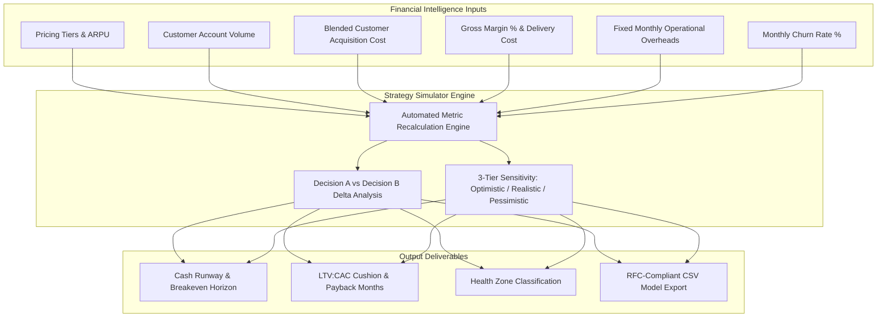

# BRAINWISE — FINANCIAL INTELLIGENCE & STRATEGY SIMULATOR SPECIFICATION
## Department 4: Unit Economics, Startup Cost Modeling, Interactive Pricing Simulation & 3-Tier Parametric Bands

**Document ID:** `BRAINWISE_FINANCIAL_INTELLIGENCE_SPEC.md`  
**Phase:** Phase 5  
**Version:** 1.0.0-certified  
**Date:** November 22, 2026  
**Status:** COMPLETE & AUTHORITATIVE  
**Target Systems:** Department 4 (Financial Intelligence), Strategy Simulator & Evidence Engine  

---

## 1. Executive Purpose & Department Mission

The mission of **Department 4 (Financial Intelligence)** is to provide founders with uncompromising economic clarity. Rather than generating vanity hockey-stick forecasts or ungrounded financial multiples, BrainWise models the true unit economics of commercial enterprises:

1. **Deterministic Unit Economics:** Exact mathematical relationships between price, gross contribution, customer acquisition costs (CAC), retention horizons, and payback periods.
2. **Interactive Strategy Simulator:** Enables founders to simulate business decisions (e.g. *“What happens if I price at ₹499 instead of ₹799?”*) with instant recalculation of dependent variables.
3. **Startup Cost & Runway Calculator:** Segregates Capital Expenditures (CapEx) from monthly operational burn (OpEx), projecting working capital requirements for 6-month safety runways.
4. **Transparent 3-Tier Parametric Sensitivity:** Renders Optimistic, Realistic, and Pessimistic scenario bands with explicit assumption disclosures.



---

## 2. Unit Economics & Dependent Calculation Formulas

To maintain strict mathematical rigor without black-box AI fabrication, the financial engine enforces the following deterministic formulas (`src/server/services/financialIntelligenceService.ts`):

| Metric | Mathematical Formula | Description |
| :--- | :--- | :--- |
| **Monthly Revenue** | $\text{Price} \times \text{Volume}$ | Gross monthly contracted billings. |
| **Annual Run Rate (ARR)** | $\text{Monthly Revenue} \times 12$ | Annualized top-line revenue rate. |
| **Gross Profit** | $\text{Revenue} \times \left(\frac{\text{Gross Margin \%}}{100}\right)$ | Gross profit before operational and ad spend. |
| **Contribution Margin** | $\text{Gross Profit} - \text{Marketing Budget}$ | Net contribution toward fixed overheads. |
| **Break-Even Customers** | $\left\lceil \frac{\text{Monthly OpEx} + \text{Marketing Budget}}{\text{Price} \times \text{Margin Fraction}} \right\rceil$ | Minimum active accounts needed to achieve zero burn. |
| **Customer Lifetime** | $\frac{100}{\text{Monthly Churn \%}}$ (months) | Expected retention duration per acquired customer. |
| **Customer LTV** | $(\text{Price} \times \text{Margin Fraction}) \times \text{Lifetime Months}$ | Lifetime gross profit contribution per account. |
| **LTV:CAC Ratio** | $\frac{\text{Customer LTV}}{\text{CAC}}$ | Unit efficiency multiple ($\ge 3.0\times$ healthy). |
| **Payback Horizon** | $\frac{\text{CAC}}{\text{Monthly Gross Profit per Unit}}$ (months) | Time required to recoup customer acquisition cash. |
| **Working Capital Runway** | $\text{Net Monthly Burn} \times 6 \text{ months}$ | Required cash buffer to withstand delayed acquisition. |

---

## 3. The Interactive Strategy Simulator

The Strategy Simulator allows founders to stress-test decisions before entering the market:

### 3.1 Example: Comparing ₹499/mo (Option A) vs. ₹799/mo (Option B)

```
STRATEGY COMPARISON: ₹499/mo vs ₹799/mo (Indian SME Market)

Metric                        Option A (₹499 Starter)      Option B (₹799 Pro)          Variance Delta
──────────────────────────────────────────────────────────────────────────────────────────────────────
Target Customer Volume        150 accounts                 90 accounts                  -60 accounts
Blended Acquisition CAC       ₹950                         ₹1,450                       +₹500 (+52%)
Gross Margin                  75% (₹374/unit)              80% (₹639/unit)              +₹265/unit
Monthly Revenue               ₹74,850                      ₹71,910                      -₹2,940 (-3.9%)
Gross Profit Monthly          ₹56,138                      ₹57,528                      +₹1,390 (+2.5%)
Monthly Marketing Spend       ₹20,000                      ₹20,000                      ₹0
Contribution Margin           ₹36,138                      ₹37,528                      +₹1,390 (+3.8%)
Break-Even Customers          67 accounts                  40 accounts                  -27 accounts (-40%)
Customer LTV (at 3% churn)    ₹12,467                      ₹21,300                      +₹8,833 (+70.8%)
LTV:CAC Ratio                 13.1x                        14.7x                        +1.6x
CAC Payback Horizon           2.5 months                   2.3 months                   -0.2 months
Health Zone                   Healthy                      Healthy                      Stable

STRATEGIC VERDICT:
Option B (₹799/mo) delivers a 40% lower breakeven hurdle (40 accounts vs 67 accounts) and 70% higher LTV,
enabling the business to comfortably absorb higher digital acquisition costs as ad channels scale.
```

---

## 4. 3-Tier Parametric Sensitivity Bands

Because future business outcomes are inherently uncertain, the Strategy Simulator models three operational bands:

1. **Optimistic Scenario (+20% Volume, -15% CAC, -20% Churn):**
   - High organic word-of-mouth referral and rapid brand trust adoption.
2. **Realistic Scenario (Base Case):**
   - Empirical baseline anchored in verified Business Brain facts and industry benchmarks.
3. **Pessimistic Scenario (-20% Volume, +30% CAC, +40% Churn):**
   - Ad channel inflation, competitive price pressure, and customer onboarding drop-offs.
   - Highlights the minimum runway required to avoid insolvency.

---

## 5. Startup Cost & Working Capital Engine

The startup cost engine breaks down expenditure into actionable categories tailored for Indian and Global SME environments:

### 5.1 CapEx (One-Time Setup)
- MCA Company Incorporation, DIN/DSC, and PAN/TAN registration.
- Intellectual Property: Class 35/42 Trademark filing.
- Digital infrastructure, SSL certificates, and secure cloud setup.

### 5.2 OpEx (Monthly Recurring Burn)
- Production cloud server & database hosting in `asia-south1` (Mumbai).
- Cashfree payment gateway platform fees and transaction reserves.
- Statutory GST compliance and monthly chartered accounting fees.
- Initial paid customer acquisition experiments.

---

## 6. Statutory Disclaimer & Integrity Rules

1. **No Guaranteed Returns:** All financial calculations are explicitly prefaced with the statutory disclaimer:
   > *"Financial model projections represent parametric mathematical calculations based on explicit user assumptions. They do not constitute guaranteed commercial returns, investment advice, or bankable commitments."*
2. **Truth Engine Price Enforcement:** No pricing recommendation may contradict verified prices in the user's Business Brain without explicit founder confirmation.
3. **Zero Video Cost Pollution:** In strict adherence to `AGENTS.md`, zero line items for video rendering compute, FFmpeg server licenses, or video credit tiers are permitted.
