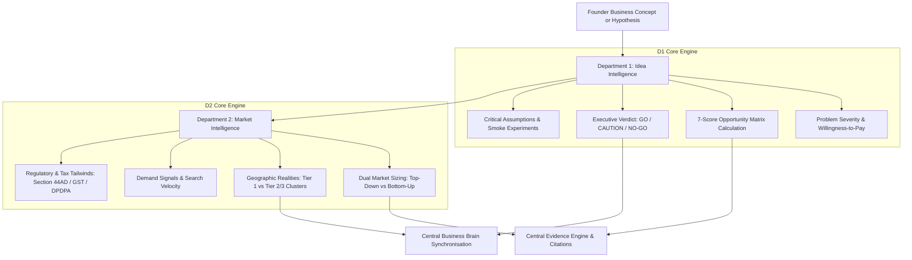

# BRAINWISE — IDEA & MARKET INTELLIGENCE SPECIFICATION
## Departments 1 & 2: Commercial Opportunity Validation, Top-Down/Bottom-Up Sizing & Indian Market Dynamics

**Document ID:** `BRAINWISE_IDEA_MARKET_INTELLIGENCE_SPEC.md`  
**Phase:** Phase 3  
**Version:** 1.0.0-certified  
**Date:** November 22, 2026  
**Status:** COMPLETE & AUTHORITATIVE  
**Target Systems:** Department 1 (Idea Intelligence) & Department 2 (Market Intelligence)  

---

## 1. Executive Purpose & Department Missions

### Department 1 — Idea Intelligence
The primary objective of **Idea Intelligence** is to save founders years of wasted capital and effort by rigorously determining whether an initial concept or new product line represents a commercially viable, scalable opportunity before significant execution investment.

### Department 2 — Market Intelligence
The primary objective of **Market Intelligence** is to replace vanity market numbers with empirical, transparent TAM/SAM/SOM sizing, customer demand velocity tracking, and regulatory ground realities.



---

## 2. Department 1: Idea Intelligence Architecture

### 2.1 The 7-Score Opportunity Matrix
To prevent arbitrary scores, every rating is governed by a documented, transparent mathematical formula:

| Score Metric | Weight | Mathematical Basis & Input Factors |
| :--- | :---: | :--- |
| **Market Score** | 25% | Category growth rate (CAGR), addressable market band, and macro tailwinds. |
| **Demand Score** | 25% | Problem frequency (daily vs. occasional), severity rating, and customer search velocity. |
| **Financial Score** | 20% | Gross margin potential, self-serve willingness-to-pay, and CAC/LTV payback efficiency. |
| **Execution Score** | 15% | Minimum Viable Product complexity, distribution barriers, and technical dependencies. |
| **Risk Score** | 15% | Downside liability, platform dependency, customer switching friction, and regulatory risk. |
| **Overall Opportunity** | **100%** | $\text{Composite} = (\text{Market} \times 0.25) + (\text{Demand} \times 0.25) + (\text{Financial} \times 0.20) + (\text{Execution} \times 0.15) + ((100 - \text{Risk}) \times 0.15)$ |

### 2.2 Executive Verdict Logic
1. **GO (Score $\ge 75$ AND Risk $\le 45$):**
   - Strong category tailwinds, clear willingness-to-pay, low structural friction.
   - Action: Proceed directly to live smoke test experiment and customer onboarding.
2. **CAUTION (Score $55 - 74$ OR Risk $46 - 65$):**
   - High potential with customer need, but 2+ critical unverified assumptions require smoke testing before capital commitment.
   - Action: Execute recommended 14-day validation experiment.
3. **NO_GO (Score $< 55$ OR Risk $> 65$):**
   - Incumbent saturation, negative unit economics, or insurmountable regulatory barriers.
   - Action: Strategic pivot recommended; kill switches triggered.

---

## 3. Department 2: Market Intelligence Architecture

### 3.1 Dual-Methodology Market Sizing (Top-Down vs. Bottom-Up)
Market estimates must never present fabricated single-point certainty. BrainWise models both paradigms:

```
TOP-DOWN SIZING PARADIGM:
Macro Category Industry Expenditure (e.g. ₹25,000 Cr)
       │
       ▼ (Segment Filtering: e.g. 14.0% Digital MSMEs)
Serviceable Addressable Market (SAM: ₹3,500 Cr)
       │
       ▼ (Capture Filtering: 1.28% Year 1-3 Target)
Serviceable Obtainable Market (SOM: ₹45 Cr)

BOTTOM-UP SIZING PARADIGM:
Total Registered Target Entities (e.g. 6,500,000 GST MSMEs)
       │
       ▼ (Multiplied by ₹5,988 Average Annual Contract Value)
Total Addressable Market (TAM: ₹3,892 Cr)
       │
       ▼ (Digitally Active Establishments: 850,000 entities * ₹5,988 ARR)
Serviceable Addressable Market (SAM: ₹509 Cr)
       │
       ▼ (Attainable Paying Customers: 15,000 subscribers * ₹5,988 ARR)
Serviceable Obtainable Market (SOM: ₹8.98 Cr)
```

### 3.2 Mandatory Attribute Schema for Every Market Estimate
Every estimate rendered in the UI or exported to CSV contains:
1. `level`: `TAM` | `SAM` | `SOM`
2. `label`: Clean display title with methodology tag
3. `valueDisplay` & `valueNumeric`: Formatted currency string and raw numerical value
4. `definition`: Plain-language scope boundary
5. `calculationMethodology`: `TOP_DOWN` vs. `BOTTOM_UP`
6. `methodologyFormula`: Explicit formula string
7. `statedAssumptions`: Array of bulleted assumptions
8. `isVerified`: Boolean indicating whether values derive from official primary gazettes
9. `confidenceScore`: Calibrated metric between $0.0$ and $1.0$
10. `sourceReferences`: Primary citations linking to external evidence URLs and publication dates

---

## 4. Indian Geography & SME Market Dynamics

When the business operates in India, the Market Intelligence department prioritizes India-specific economic conditions:

1. **Tier 1 vs. Tier 2/3 Bifurcation:**
   - **Tier 1 (Bengaluru, NCR, Mumbai, Hyderabad):** High digital maturity, willingness to pay via corporate cards and UPI autopay, premium branding receptivity.
   - **Tier 2/3 Commercial Hubs (Surat, Pune, Jaipur, Coimbatore, Indore):** High transaction volume, price sensitivity, reliance on WhatsApp-native workflows, seeking immediate ROI proof.
2. **Statutory & Taxation Considerations:**
   - Presumptive taxation under **Section 44AD** (up to ₹3 Crore turnover threshold).
   - Mandatory B2B GST e-invoicing compliance thresholds.
   - Statutory compliance with the **Digital Personal Data Protection Act (DPDPA 2023)** requiring domestic data residency (`asia-south1` Mumbai).
3. **Digital Infrastructure Tailwinds:**
   - **UPI Autopay:** Dramatically reduces recurring billing friction over credit cards.
   - **ONDC (Open Network for Digital Commerce):** Expanding decentralized distribution access.
   - **India Stack:** Frictionless identity verification and payment infrastructure.

---

## 5. Automated Verification & Testing Strategy

Phase 3 compliance is verified via [src/server/phase3IdeaMarketIntelligence.test.ts](file:///d:/brainwise%20pro/brainwise%20(1)/src/server/phase3IdeaMarketIntelligence.test.ts):
- 7-score opportunity matrix formula execution.
- Executive verdict assignment (`GO`, `CAUTION`, `NO_GO`) matching risk and opportunity bounds.
- Top-down and bottom-up TAM/SAM/SOM calculation variance and conservative baseline recommendation.
- Mandatory schema validation across all market sizing outputs.
- India-specific economic tailoring (UPI, GST, MSME thresholds).
- Multi-tenant workspace data isolation.
