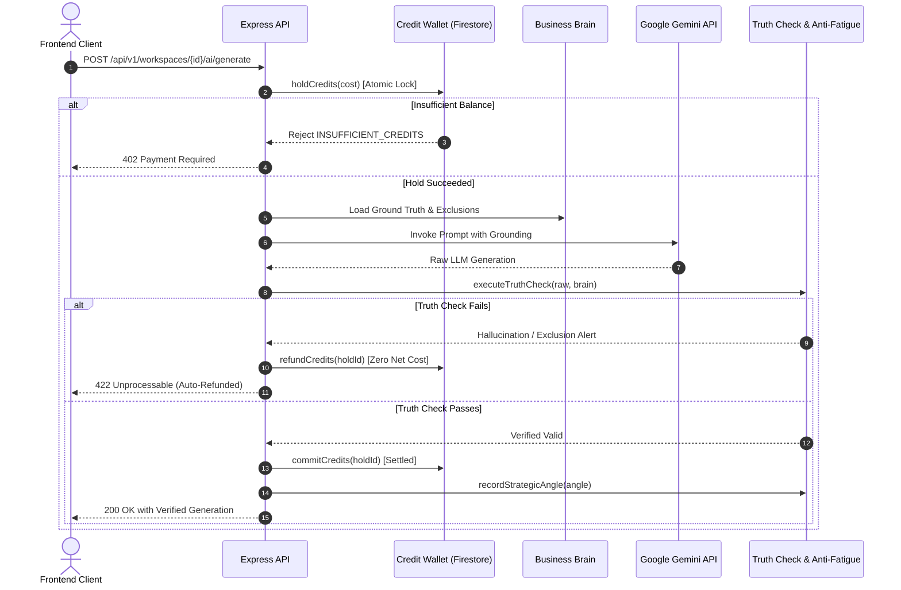

# BrainWise AI Orchestration & Guardrail Architecture

## 1. AI Orchestration Pipeline
BrainWise orchestrates generative AI via **Google Gemini** (`@google/genai` with model `gemini-2.5-flash`). All prompt construction, credential management, credit reservations, grounding injection, and post-generation guardrails occur exclusively on the backend in `src/server/services/aiOrchestrationService.ts`.

---

## 2. Dynamic Grounding & Context Assembly
Prompt construction incorporates four distinct contextual pillars:
1. **Department Mission & System Directives:** Domain guidelines tailored to the specific department (e.g. Brand Studio, Competitive Intelligence, Growth Director).
2. **Authoritative Ground Truth:** Explicit facts from `business_profiles/default` including verified offerings, actual pricing, target personas, and core value propositions.
3. **Anti-Fatigue Directives:** Directives instructing the model to avoid topics listed in `strategicMemory.fatiguedThemes`.
4. **Explicit Exclusions:** Strict negative constraints from `strategicMemory.explicitExclusions` (e.g. "Do not mention discounts", "Do not claim guaranteed returns").

---

## 3. Strict Scope Enforcement: Video Generation Ban
In strict compliance with Master Project Rules:
- The AI Orchestration Service possesses **NO prompts, parameters, workers, or tools for video generation**.
- Any prompt attempting to invoke video rendering, reel generation, or video scripting triggers an immediate validation rejection.
- All visual outputs are strictly limited to vector SVG graphics (`image/svg+xml`), static carousel cards, and structured typography layouts.
