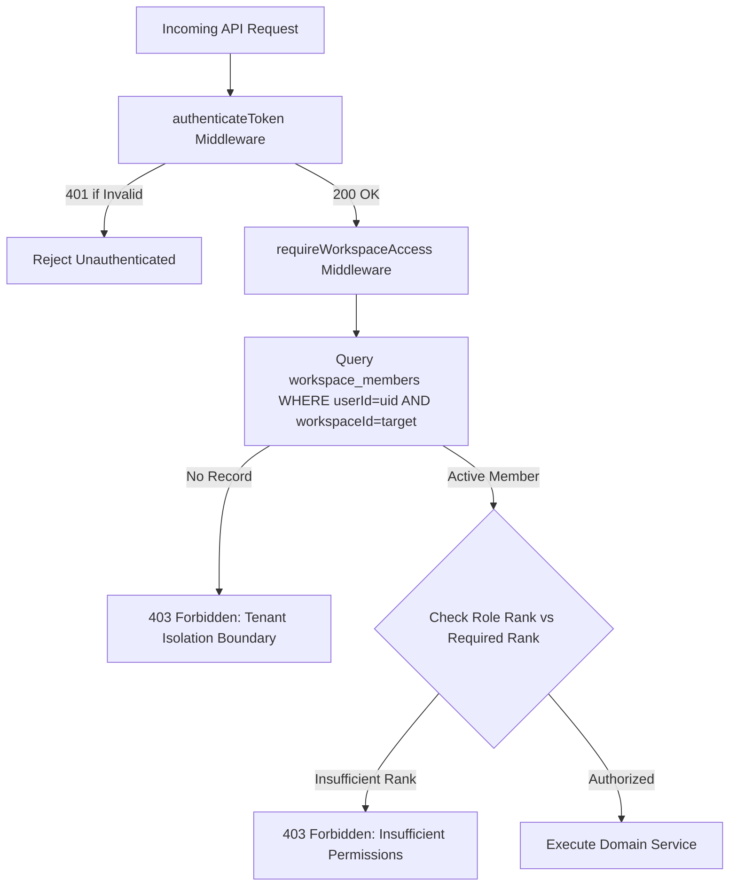

# BrainWise Authentication and Authorization Specification

## 1. Authentication Architecture (Firebase Authentication)
Authentication is delegated to **Firebase Authentication**. The client application signs users in via email/password, magic link, or Google OAuth, acquiring a cryptographically signed JSON Web Token (Firebase ID Token).

### Token Verification Flow
1. Client issues HTTP request with header: `Authorization: Bearer <id_token>`.
2. Backend Express middleware (`src/server/middleware/auth.ts`) extracts and verifies the token using the `firebase-admin` Auth service:
   - Validates RS256 signature against Google's public x509 keys.
   - Enforces expiration (`exp`), issuance (`iat`), and project audience (`aud`).
   - Rejects missing, malformed, or expired tokens with standard 401 envelopes.
3. Upon validation, sets `req.user = { uid, email, displayName, photoUrl }`.
4. Dev/Test mode: When `serverConfig.nodeEnv !== 'production'` and the token matches `test-token-<id>`, the middleware bypasses network calls to Google Auth servers and synthesizes an authoritative test user identity for deterministic automated unit and integration tests.

---

## 2. Authorization & Multi-Tenant Role-Based Access Control (RBAC)
Workspace isolation and authorization are enforced by `src/server/middleware/workspace.ts`.

### Hierarchy of Roles
BrainWise defines four explicit hierarchical roles within each workspace:
1. `owner`: Full administrative authority, billing controls, workspace deletion, member management, and resource ownership.
2. `admin`: Member invitations, strategic management, credit usage, integrations, and asset operations.
3. `member`: Day-to-day operations, Business Brain fact confirmations, goal updates, task execution, AI generation, and asset uploads.
4. `viewer`: Read-only access to dashboards, reports, and strategic intelligence. Cannot invoke AI generation, reserve credits, or modify business profiles.

---

## 3. Defense-in-Depth Security Guardrails
1. **Never Trust Browser Headers:** Even if a request specifies `X-Workspace-Id`, access is immediately denied unless an active record exists in `workspace_members` linking the authenticated `req.user.uid` to that workspace.
2. **Dual-Layer Enforcement:** Authorization is enforced in Express route middleware *and* mirrored in Firestore Security Rules (`firestore.rules`) to guarantee that direct database operations are strictly constrained even if backend services are bypassed.
3. **Audit Logging:** Every administrative role change, invitation, and workspace mutation produces an append-only audit record in `audit_logs`.
