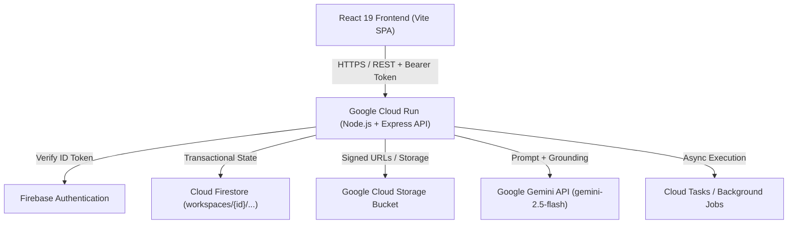

# BrainWise Backend Architecture Specification

## 1. Executive Summary & Architectural Overview
BrainWise is an AI-powered business growth and marketing intelligence SaaS application. The backend is designed as a secure, stateless, modular serverless monolith deployed on **Google Cloud Run**, orchestrated with **Cloud Firestore** as the authoritative document database, **Google Cloud Storage (GCS)** for private object storage, **Firebase Authentication** for identity verification, and **Google Gemini** for generative AI reasoning.

---

## 2. Layered Modular Structure
The backend codebase located in `src/server/` adheres to strict separation of concerns across distinct layers:

1. **Transport / Entry Layer (`server.ts`, `src/server/app.ts`, `src/server/routes/`):**
   - Express application initialization, security headers (`X-Content-Type-Options: nosniff`, `X-Frame-Options: DENY`, `X-XSS-Protection: 1`, `Referrer-Policy: strict-origin-when-cross-origin`).
   - Strict CORS policy (`src/server/middleware/cors.ts`).
   - In-memory rate limiting with sliding-window protection (`src/server/middleware/rateLimit.ts`).
   - JSON parsing with 2MB limits.
   - Routing trees partitioned under `/api/v1` and `/api` health endpoints.

2. **Middleware & Security Gates (`src/server/middleware/`):**
   - `auth.ts`: Validates Bearer ID tokens against Firebase Auth Admin SDK (with support for offline deterministic test tokens in dev/test). Attaches verified `req.user`.
   - `workspace.ts`: Multi-tenant boundary enforcer. Resolves workspace ID from path parameter or `X-Workspace-Id` header, verifies user membership in Firestore `workspace_members`, enforces Role-Based Access Control (RBAC: `owner`, `admin`, `member`, `viewer`), and attaches `req.membership`.
   - `validate.ts`: Enforces strict request body, query, and parameter schema validation using Zod.
   - `error.ts`: Standardized error interception, mapping business and validation exceptions to RFC-compliant JSON envelopes.

3. **Domain Service Layer (`src/server/services/`):**
   - `authService.ts`: Profile synchronization and workspace lifecycle.
   - `workspaceService.ts`: Tenant creation, member invitations, role management, and credit wallet initialization.
   - `businessBrainService.ts`: Core persistent Business Brain management, fact provenance enforcement, exclusion rule management, and anti-fatigue memory.
   - `creditService.ts`: Two-Phase Credit Reservation Protocol (ADR-006) managing atomic holds, commits, and refunds.
   - `aiOrchestrationService.ts`: Grounded Gemini LLM invocation with deterministic server-side Truth Check and Strategic Anti-Fatigue verification.
   - `storageService.ts`: Secure signed upload and download URL generation with workspace prefix partitioning and MIME type validation.
   - `backgroundJobService.ts`: Asynchronous AI job queuing, state machine transitions, polling, and cancellation.
   - `auditService.ts`: Immutable security audit logging for workspace actions.

4. **Repository Data Layer (`src/server/repositories/`):**
   - High-cohesion, typed repositories abstracting Firestore operations: `userRepository`, `workspaceRepository`, `memberRepository`, `businessProfileRepository`, `goalRepository`, `competitorRepository`, `researchRepository`, `recommendationRepository`, `experimentRepository`, `taskRepository`, `brandAssetRepository`, `integrationRepository`, `subscriptionRepository`, `creditWalletRepository`, `aiJobRepository`, `auditLogRepository`.

5. **Database Driver Layer (`src/server/db/firestore.ts`):**
   - Dual-mode Firestore adapter supporting live production Cloud Firestore via `firebase-admin/firestore` and deterministic in-memory transactional database emulation for testing and offline development.

---

## 3. Strict Product Boundary: Video Exclusion
As defined in project directives:
- BrainWise **EXPLICITLY EXCLUDES ALL VIDEO GENERATION, VIDEO PIPELINES, VIDEO STORAGE, VIDEO WORKERS, OR VIDEO CREDITS**.
- Storage service rejects all `video/*` MIME types with HTTP 400.
- Firestore security rules deny all write attempts containing video attributes.
- No video processing background workers or credit rules exist.
