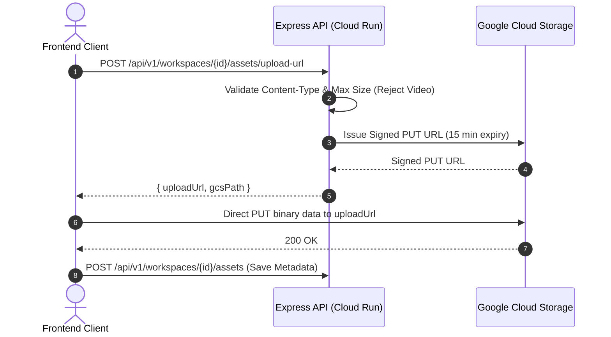

# BrainWise Cloud Storage Architecture Specification

## 1. Storage Overview
All binary marketing collateral, brand identity files, SVG graphics, and business documents are persisted in private **Google Cloud Storage (GCS)** buckets managed by `src/server/services/storageService.ts`. Direct public access to the GCS bucket is blocked by default (`uniformBucketLevelAccess = true`).

---

## 2. Path Partitioning & Multi-Tenant Isolation
All storage object keys are strictly scoped by workspace ID:
```
gs://<storage-bucket>/workspaces/{workspaceId}/assets/{assetId}.svg
gs://<storage-bucket>/workspaces/{workspaceId}/logos/{logoId}.svg
gs://<storage-bucket>/workspaces/{workspaceId}/documents/{docId}.pdf
```

The backend verifies tenant membership before issuing signed URLs and forcibly injects `workspaces/${workspaceId}/` into the object prefix. Clients can never request or upload files into another workspace's directory.

---

## 3. Signed Upload & Download URL Protocol
To prevent heavy binary payloads from bottlenecking the Express API server, files are transferred directly between the client browser and Google Cloud Storage via V4 signed URLs.



---

## 4. Strict Security Guardrails & Video Exclusion

### 4.1 Permitted File Formats & Size Limits
- **Vector Graphics:** `image/svg+xml` (Max 5MB).
- **Raster Imagery:** `image/png`, `image/jpeg`, `image/webp` (Max 15MB).
- **Documents / Reports:** `application/pdf` (Max 25MB).

### 4.2 Absolute Video Rejection
In accordance with Master Project Directives:
- Any upload request specifying `video/mp4`, `video/webm`, `video/quicktime`, or any `video/*` MIME type is **instantly rejected with HTTP 400 Bad Request**.
- Automated test `src/server/storage.test.ts` validates that attempts to request upload URLs for video files fail immediately.
- Cloud Storage Security Rules (`storage.rules`) provide secondary defense-in-depth, explicitly matching and denying video content types.
