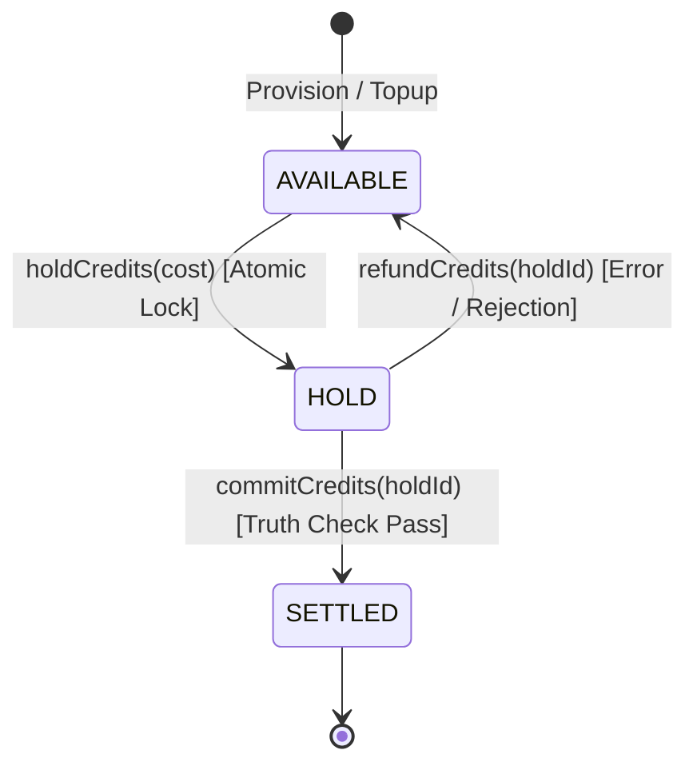

# BrainWise Credit & Job Lifecycle (Two-Phase Reservation Protocol)

## 1. Architectural Authority: ADR-006 Two-Phase Reservation Protocol
In high-throughput multi-user SaaS environments, naive credit deduction protocols (such as deducting credits prior to calling an LLM or deducting credits after completion) suffer from critical vulnerabilities:
- **Deducting Upfront:** If an AI provider times out or outputs a hallucination that fails validation, the user loses credits unfairly, necessitating manual support interventions.
- **Deducting Afterwards:** Race conditions allow concurrent browser requests to double-spend zero-balance accounts before credit deductions settle.

BrainWise permanently solves this via the **Two-Phase Credit Reservation Protocol (ADR-006)** executed via atomic Cloud Firestore transactions in `src/server/services/creditService.ts`.

---

## 2. Protocol States & Lifecycle Transitions

### 2.1 Phase 1: The Credit Hold (Reservation)
1. Within an atomic Firestore transaction on `/workspaces/{workspaceId}/credit_wallets/default`:
   - Checks `balance >= cost`.
   - If false, aborts transaction immediately and returns HTTP 402 `INSUFFICIENT_CREDITS`.
   - If true, decrements `balance` by `cost` and increments `reserved` by `cost`.
   - Generates unique `holdId` (UUID v4) and writes a `RESERVATION` transaction record.
2. The user's available balance is immediately reduced, preventing concurrent double-spends across open browser tabs.

### 2.2 Phase 2A: Commit (Settlement)
1. Following successful generation and positive Truth Check verification:
   - Within an atomic transaction, decrements `reserved` by `cost` and increments `lifetimeUsed` by `cost`.
   - Writes a `COMMIT` transaction record.
2. The hold is permanently settled.

### 2.3 Phase 2B: Release (Automatic Refund)
1. If the upstream Gemini API throws an error, or if the server-side Truth Check catches price hallucinations or forbidden claims:
   - Within an atomic transaction, decrements `reserved` by `cost` and increments `balance` by `cost`.
   - Writes a `REFUND` transaction record noting the failure code.
2. The user suffers zero net credit deduction.

---

## 3. Asynchronous AI Job Lifecycle
For long-running intelligence tasks (such as deep competitor audits or market dossier synthesis), execution is managed asynchronously via `src/server/services/backgroundJobService.ts`:
1. **`QUEUED`:** Job record created in `ai_jobs`, credit hold locked.
2. **`RUNNING`:** Cloud Task or background worker starts model execution.
3. **`COMPLETED`:** Output passes validation, results stored in `result`, credits committed.
4. **`FAILED`:** Error caught, failure reason logged in `error`, credits automatically refunded.
5. **`CANCELLED`:** User cancels active job prior to completion, credits immediately refunded.
