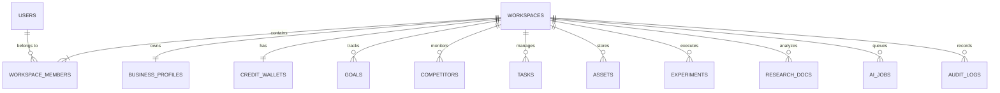

# BrainWise Database Schema Specification (Firestore)

## 1. Overview
The BrainWise persistence layer is implemented on **Cloud Firestore** utilizing hierarchical subcollections rooted under `/workspaces/{workspaceId}` for strict multi-tenant isolation, combined with top-level collections for global user identity and global workspace indexes.

---

## 2. Top-Level Collections

### 2.1 `users/{uid}`
Stores global user account state linked to Firebase Authentication UID.
- `uid` (string, PK): Firebase Authentication UID.
- `email` (string): User email address.
- `displayName` (string): User display name.
- `photoUrl` (string, optional): Profile avatar URL.
- `accountStatus` (string): `'active' | 'suspended' | 'deleted'`.
- `emailVerified` (boolean): Whether email is confirmed.
- `activeWorkspaceId` (string, optional): Currently selected workspace.
- `preferences` (map): Non-sensitive UI preferences (theme, notification toggles).
- `createdAt` (Timestamp): Record creation timestamp.
- `updatedAt` (Timestamp): Last update timestamp.

### 2.2 `workspaces/{workspaceId}`
Root document for each tenant.
- `workspaceId` (string, PK): Unique workspace identifier (UUID v4 or slug).
- `name` (string): Business / Workspace name.
- `slug` (string, unique): Human-readable workspace slug.
- `ownerUserId` (string): UID of the workspace owner.
- `industry` (string): Primary business sector.
- `country` (string): ISO country code.
- `timezone` (string): e.g. `'Asia/Kolkata'`, `'UTC'`.
- `currency` (string): ISO 4217 currency code (e.g. `'INR'`, `'USD'`).
- `status` (string): `'active' | 'archived' | 'suspended'`.
- `createdAt` (Timestamp): Creation timestamp.
- `updatedAt` (Timestamp): Modification timestamp.

### 2.3 `workspace_members/{membershipId}`
Global lookup collection for workspace memberships (indexed by `[userId, workspaceId]`).
- `membershipId` (string, PK): Composite or UUID key.
- `workspaceId` (string): Reference to workspace.
- `userId` (string): Reference to user UID.
- `role` (string): `'owner' | 'admin' | 'member' | 'viewer'`.
- `status` (string): `'active' | 'invited' | 'revoked'`.
- `invitedBy` (string, optional): UID of inviting member.
- `joinedAt` (Timestamp, optional): Timestamp of acceptance.
- `createdAt` (Timestamp): Membership creation timestamp.
- `updatedAt` (Timestamp): Role change timestamp.

---

## 3. Workspace-Scoped Subcollections (`workspaces/{workspaceId}/...`)

### 3.1 `business_profiles/default`
The authoritative persistent Business Brain document for the workspace.
- `businessName` (string): Official trading name.
- `description` (string): Business summary.
- `industry` (string): Industry vertical.
- `stage` (string): Business maturity stage.
- `offerings` (array of maps):
  - `id` (string): Unique offering ID.
  - `name` (string): Product or service title.
  - `type` (string): `'product' | 'service'`.
  - `price` (number): Verified offering price.
  - `currency` (string): Price currency.
  - `description` (string): Scope description.
- `targetAudience` (map):
  - `segments` (array of strings): Target customer personas.
  - `painPoints` (array of strings): Primary customer problems solved.
  - `locations` (array of strings): Geographic focus markets.
- `brandPositioning` (map):
  - `tone` (string): Communication voice (e.g. authoritative, playful).
  - `valueProposition` (string): Core value proposition.
  - `usps` (array of strings): Unique selling propositions.
- `provenance` (map of string -> map): Fact verification records (`status: 'USER_CONFIRMED' | 'AI_INFERRED'`, `source`, `updatedAt`).
- `strategicMemory` (map):
  - `usedAngles` (array of strings): Campaign angles historically deployed.
  - `fatiguedThemes` (array of strings): Themes reaching saturation.
  - `explicitExclusions` (array of strings): Negative constraints forbidden from AI copy.
  - `lastUpdated` (Timestamp): Last anti-fatigue update.
- `version` (number): Monotonically increasing schema version.

### 3.2 `credit_wallets/default`
Authoritative credit balance and two-phase transaction ledger.
- `balance` (number): Available, unreserved credit units.
- `reserved` (number): Credit units currently locked in active AI jobs.
- `lifetimeGranted` (number): Total credits ever provisioned.
- `lifetimeUsed` (number): Total credits settled.
- `currency` (string): Balance denomination (`'CREDIT'`).
- `lastUpdated` (Timestamp): Timestamp of last ledger transaction.

#### Subcollection: `credit_wallets/default/transactions/{txId}`
- `transactionId` (string, PK): Unique transaction ID.
- `amount` (number): Credit delta.
- `type` (string): `'RESERVATION' | 'COMMIT' | 'REFUND' | 'TOPUP' | 'SUBSCRIPTION_GRANT'`.
- `jobId` (string, optional): Associated AI job ID.
- `description` (string): Ledger narrative.
- `createdAt` (Timestamp): Transaction timestamp.

### 3.3 `goals/{goalId}`
Strategic business and marketing targets.
- `goalId` (string, PK): Goal ID.
- `title` (string): Objective statement.
- `metric` (string): Key Performance Indicator identifier.
- `targetValue` (number): Target threshold.
- `currentValue` (number): Current measured progress.
- `deadline` (Timestamp): Target completion date.
- `status` (string): `'on_track' | 'at_risk' | 'behind' | 'achieved'`.

### 3.4 `competitors/{competitorId}`
Competitive intelligence tracking entity.
- `competitorId` (string, PK): Unique competitor ID.
- `name` (string): Competitor business name.
- `website` (string): Domain URL.
- `threatLevel` (string): `'high' | 'medium' | 'low'`.
- `strengths` (array of strings): Identified competitive strengths.
- `weaknesses` (array of strings): Identified competitive weaknesses.
- `pricingModel` (string): Competitor pricing structure.
- `lastTrackedAt` (Timestamp): Last intelligence refresh timestamp.

### 3.5 `tasks/{taskId}`
Actionable operational and growth execution items.
- `taskId` (string, PK): Task ID.
- `title` (string): Action summary.
- `department` (string): 1 of 14 BrainWise departments.
- `priority` (string): `'high' | 'medium' | 'low'`.
- `estimatedMinutes` (number): Execution duration.
- `completed` (boolean): Completion state.
- `dueDate` (Timestamp, optional): Execution deadline.

### 3.6 `assets/{assetId}`
Marketing collateral metadata (SVG and static image files).
- `assetId` (string, PK): Asset ID.
- `title` (string): Asset name.
- `type` (string): `'logo' | 'brand_card' | 'social_graphic' | 'stationery'`.
- `format` (string): `'svg' | 'png' | 'pdf'`.
- `gcsPath` (string): Google Cloud Storage path (`workspaces/{workspaceId}/assets/...`).
- `svgContent` (string, optional): Raw validated SVG markup.
- `dimensions` (map): `{ width: number, height: number }`.

### 3.7 `experiments/{experimentId}`
Growth experimentation backlog and test results.
- `experimentId` (string, PK): Experiment ID.
- `name` (string): Growth experiment hypothesis.
- `channel` (string): Marketing channel tested.
- `status` (string): `'idea' | 'running' | 'completed' | 'abandoned'`.
- `impact` (number): ICE impact score (1-10).
- `confidence` (number): ICE confidence score (1-10).
- `ease` (number): ICE ease score (1-10).
- `score` (number): Composite ICE score.

### 3.8 `ai_jobs/{jobId}`
Asynchronous background generation tracking records.
- `jobId` (string, PK): Job ID.
- `type` (string): `'CONTENT_GENERATION' | 'RESEARCH_SYNTHESIS' | 'STRATEGY_AUDIT'`.
- `status` (string): `'QUEUED' | 'RUNNING' | 'COMPLETED' | 'FAILED' | 'CANCELLED'`.
- `creditCost` (number): Reserved credit cost.
- `reservationId` (string): Transaction lock ID.
- `result` (map, optional): Completed generation payload.
- `error` (map, optional): Failure reason and code.
- `createdAt` (Timestamp): Queue time.
- `completedAt` (Timestamp, optional): Finalization time.

### 3.9 `audit_logs/{logId}`
Append-only compliance log.
- `logId` (string, PK): Unique audit event ID.
- `userId` (string): Operator UID.
- `action` (string): e.g. `'WORKSPACE_CREATED'`, `'ROLE_UPDATED'`, `'CREDIT_HOLD'`.
- `resource` (string): Target resource identifier.
- `details` (map): Event metadata and contextual parameters.
- `timestamp` (Timestamp): Immutable creation timestamp.
