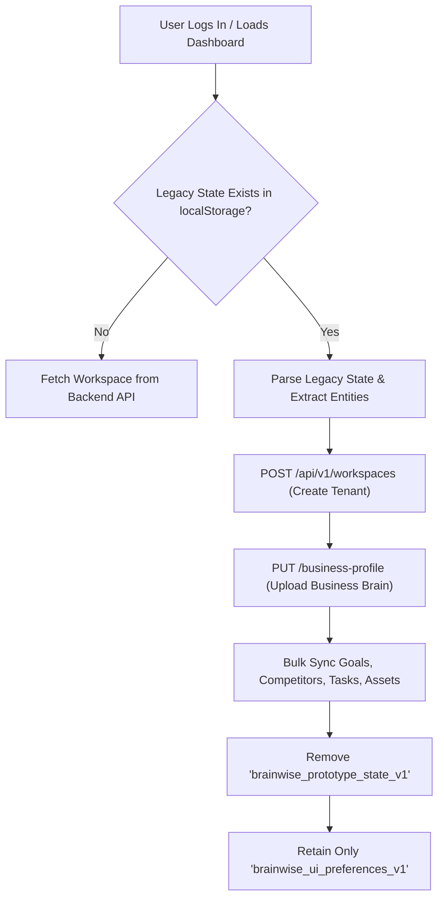

# BrainWise Prototype State Migration Plan

## 1. Migration Overview & Baseline
During Phase 1 and prototype development, the frontend application stored entire workspace profiles, business brain state, tasks, goals, competitors, and preferences inside browser `localStorage` under the monolithic key `brainwise_prototype_state_v1`.

In Phase 4, the source of truth is migrated entirely to the authenticated, workspace-scoped Firestore backend API.

---

## 2. Migration Execution Architecture

---

## 3. Frontend Migration Implementation (`src/context/BrainWiseContext.tsx`)
1. **Detection:** Upon initialization and authentication, `BrainWiseContext` inspects `localStorage.getItem('brainwise_prototype_state_v1')`.
2. **Entity Extraction:** The JSON string is safely parsed. The business profile, brand identity, tasks, and competitors are extracted.
3. **Workspace Ingestion:** The client calls `apiClient.createWorkspace()` followed by `apiClient.updateBusinessProfile()`.
4. **Cleanup & Isolation:** The monolithic key is deleted from `localStorage`.
5. **UI Preferences Retention:** Only non-sensitive, purely local cosmetic preferences (active tab, collapsed sidebar states) are permitted in `localStorage` under the namespaced key `brainwise_ui_preferences_v1`.
6. **Automated Verification:** Test `src/server/apiIntegration.test.ts` validates this end-to-end migration pipeline.
