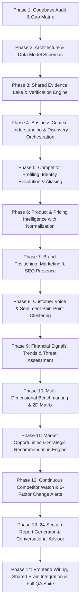

# BRAINWISE COMPETITIVE INTELLIGENCE SYSTEM — IMPLEMENTATION ROADMAP & PHASE PLAN
**Document ID:** `docs/competitive-intelligence/IMPLEMENTATION_ROADMAP.md`  
**Date:** November 22, 2026  
**Status:** AUTHORITATIVE EXECUTION BLUEPRINT

---

## 1. Architectural Strategy & Phased Execution

To build a production-grade, autonomous, evidence-backed Competitive Intelligence system that operates with minimal user friction and deep analytical rigor, we execute along the following 14 phases:

---

## 2. Phase-by-Phase Technical Specifications

### Phase 1: Repository Inspection & Baseline Audit
- **Deliverables:** `docs/competitive-intelligence/INITIAL_AUDIT.md` (Completed) and `IMPLEMENTATION_ROADMAP.md`.
- **Validation:** Verifies all 21 system components against actual code, noting hardcoded heuristics and missing APIs.

### Phase 2: Architecture & Data Models (`src/server/types/competitiveIntelligence.ts`)
- **Core Entities:**
  - `CompetitiveProjectEntity`: Workspace-bound research container with input prompt, dynamic research plan, status, and cost metrics.
  - `CompetitorDossierEntity`: 14+ attribute structured competitor record with verified/estimated provenance.
  - `ProductCatalogItemEntity`: Products, features, pricing, variants, packaging, and industry-specific attributes.
  - `PricingObservationEntity`: Normalized price, currency, billing cadence, unit metrics, observed dates.
  - `CustomerSentimentClusterEntity`: Themes, positive/negative sentiment, complaint frequency, severity, and verbatim quotes.
  - `BenchmarkingScoreEntity`: Multi-axis explainable scores (Product, Pricing, Brand, Marketing, Experience, Innovation).
  - `MarketOpportunityEntity`: 12-factor whitespace wedge model with demand signals and validation methods.
  - `StrategicRecommendationEntity`: Prioritized, actionable founder next steps with required effort and risks.
  - `CompetitiveReportEntity`: 24-section comprehensive intelligence dossier.

### Phase 3: Evidence Infrastructure & Fact Verification Engine
- **Module:** `src/server/services/competitiveEvidenceService.ts`
- **Capabilities:**
  - Standardized `EvidenceClaimRecord` schema with status: `VERIFIED`, `CORROBORATED`, `ESTIMATED`, `INFERRED`, `UNVERIFIED`, `CONTRADICTED`, `UNAVAILABLE`.
  - Evidence deduplication by URL and claim hash.
  - Freshness decay scoring.
  - Contradiction detector flagging conflicting competitor claims.

### Phase 4: Business Context Understanding & Research Plan Generation
- **Module:** `src/server/services/businessContextEngine.ts`
- **Capabilities:**
  - 1-sentence prompt decomposition into 12 dimensions (Idea, Industry, Sub-industry, Category, Geography, Customer Segments, Business Models, Price Positioning, Distribution, Stage, Adjacent Sectors).
  - Dynamic research plan generator tailoring queries to specific industries (e.g. food ingredients/FSSAI vs SaaS APIs/seats).

### Phase 5: Competitor Discovery & Identity Resolution Engine
- **Module:** `src/server/services/competitorDiscoveryEngine.ts`
- **Capabilities:**
  - Discovers 10 competitor tiers: Direct, Indirect, Substitute, Emerging, Local, Regional, National, International, Aspirational Benchmarks, Future Disruptors.
  - Relevance scoring across 6 dimensions (0-100 score).
  - Identity resolution & canonical alias matching (e.g. preventing "Paul and Mike" and "Paul & Mike" from being treated as separate companies).
  - User preferences: Add, Exclude, Mark Important, Reclassify.

### Phase 6: Product, Pricing & Positioning Intelligence
- **Module:** `src/server/services/productAndPricingEngine.ts`
- **Capabilities:**
  - Industry-specific product normalization (e.g. cocoa % & weight vs API endpoints & seat limits).
  - Pricing normalization: price per unit, price per kg/g, price per month, price per seat, tax adjustments.
  - Pricing band clustering (Budget, Mid-market, Premium, Luxury) and whitespace detection.
  - Positioning & messaging analysis (archetype, tagline, USP, overused tropes, differentiation angles).

### Phase 7: Marketing, Customer Voice & SEO Intelligence
- **Module:** `src/server/services/marketingAndVoiceEngine.ts`
- **Capabilities:**
  - Multi-channel marketing footprints (Instagram, YouTube, Search, LinkedIn, Content).
  - Customer review ingestion & sentiment clustering (G2, Google, Trustpilot, marketplaces, social discussions).
  - Complaint frequency & severity rating.
  - Search visibility and content gap discovery.

### Phase 8: Financials, Market Trends & Emerging Threats
- **Module:** `src/server/services/financialAndTrendsEngine.ts`
- **Capabilities:**
  - Strict separation of verified filings vs third-party estimates vs AI inferences (Zero False Precision).
  - Trend velocity classification (`Early Signal`, `Emerging`, `Growing`, `Established`, `Declining`).
  - Threat matrix (Probability × Impact × Time Horizon).

### Phase 9: Benchmarking, Opportunity & Strategy Engines
- **Module:** `src/server/services/competitiveStrategyEngine.ts`
- **Capabilities:**
  - Explainable multi-axis benchmark scoring with explicit weightings and missing-data penalties.
  - 2D Euclidean distance calculation and quadrant classification.
  - 12-factor whitespace opportunity generator.
  - 10-dimension strategic recommendation generator with validation experiments.

### Phase 10: Continuous Competitor Watch & Change Detection
- **Module:** `src/server/services/competitorTrackingService.ts` & `competitiveIntelligenceService.ts`
- **Capabilities:**
  - Historical snapshot capture and automated diffing.
  - 6-factor actionable change alerts.
  - Alert deduplication and notification routing.

### Phase 11: 24-Section Report Generator & Conversational Advisor
- **Module:** `src/server/services/competitiveReportEngine.ts` & `src/server/services/competitiveAdvisorService.ts`
- **Capabilities:**
  - Full 24-section structured markdown/HTML dossier generation.
  - Conversational Q&A advisor retrieving grounded evidence records and citing exact sources.

### Phase 12: API Routes & Repository Layer
- **Routes:** `src/server/routes/v1/competitiveIntelligenceRoutes.ts`
- **Endpoints:**
  - `POST /discover`: 1-sentence prompt autonomous research trigger.
  - `GET /projects/:projectId`: Project status and full research package.
  - `GET /dossiers`: Complete structured competitor dossiers.
  - `POST /matrix`: 2D positioning matrix calculation.
  - `GET /opportunities`: Discovered market whitespace opportunities.
  - `GET /strategy`: Synthesized competitive strategy blueprint.
  - `POST /advisor/chat`: Conversational intelligence advisor.
  - `GET /report`: 24-section comprehensive report.
  - `POST /watch/run`: Operational monitoring run.
  - `GET /watch/alerts`: Active 6-factor alerts.

### Phase 13: Frontend & Shared Brain Integration
- **Updates to:** `src/pages/app/CompetitiveIntelligencePage.tsx` and `src/services/apiClient.ts`.
- **Capabilities:**
  - Seamless 1-sentence business idea input bar.
  - Populates existing UI tabs: Overview, Profile, Comparison & Map, Strategic Gaps, Competitive Strategy, Market Watch.
  - Connects to Business Brain, Idea Intelligence, Brand Studio, and Growth Director.

### Phase 14: Automated Testing & Production Readiness Certification
- **Test Suites:**
  - `src/server/competitiveIntelligence.unit.test.ts`
  - `src/server/competitiveIntelligence.e2e.test.ts`
- **Scenarios:** D2C Chocolate, AI SaaS, Cloud Kitchen, Boutique Salon, Ambiguous prompt, Partial failure recovery, Contradiction detection, Multi-tenant isolation.
- **Documentation:**
  - `docs/competitive-intelligence/FINAL_AUDIT.md`
  - `docs/competitive-intelligence/ARCHITECTURE.md`
  - `docs/competitive-intelligence/DATA_MODEL.md`
  - `docs/competitive-intelligence/RESEARCH_PIPELINE.md`
  - `docs/competitive-intelligence/SECURITY_AUDIT.md`
  - `docs/competitive-intelligence/TEST_RESULTS.md`
  - `docs/competitive-intelligence/PRODUCTION_READINESS.md`

---
*BrainWise Implementation Roadmap approved for immediate execution.*
