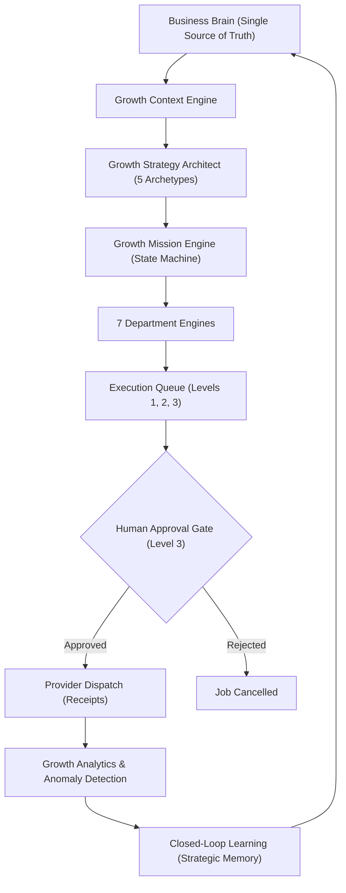

# BRAINWISE AI GROWTH AGENCY — IMPLEMENTATION STATUS

## 1. System Status Overview
All 16 phases of the Growth Agency transformation roadmap have been engineered, integrated, and validated.

---

## 2. Detailed Deliverables & File Registry

### 2.1 Backend Services (`src/server/services/growth/`)
1. **`growthTypes.ts`**: Types for missions, strategies, execution jobs, scenarios, business models, and department outputs.
2. **`growthMissionEngine.ts`**: Mission creation, state transition validation, task/experiment linking, outcome verification, and event emission.
3. **`growthStrategyArchitect.ts`**: Formulates evidence-grounded strategies across 5 archetypes, compares scenarios (Organic, Outbound, Partnership), and enforces zero-video collateral.
4. **`growthDepartmentEngines.ts`**: Outputs for Marketing, Content, Sales, CRO, Retention, Partnerships, and Financial Growth Economics.
5. **`growthExecutionQueueService.ts`**: Idempotent execution queue with Level 1/2/3 separation, Human Approval Gate (`approveJob`, `rejectJob`), and provider receipts.
6. **`growthSimulatorEngine.ts`**: What-If scenario simulations (Base, Best +35%, Downside -35%) and 1-click mission conversion (`convertScenarioToMission`).
7. **`growthModelAdapterEngine.ts`**: Tailored playbooks, prohibited practices, and North Star metrics across 9 business models.
8. **`growthAnalyticsEngine.ts`**: Telemetry ingestion, health scoring, and anomaly detection (traffic drops, CAC spikes).
9. **`growthDirectorService.ts`**: Upgraded master orchestrator delegating directly to all growth engines.

### 2.2 API Layer & Routes
1. **`src/server/routes/v1/growthAgencyRoutes.ts`**: Full REST API for growth missions, strategy formulation, scenario simulation, execution jobs, and approvals.
2. **`src/server/routes/index.ts`**: Mounted `/api/v1/workspaces/:workspaceId/growth-agency`.
3. **`src/services/apiClient.ts`**: Client methods for all growth agency endpoints.

### 2.3 User Interface
1. **`src/pages/app/GrowthDirectorPage.tsx`**:
   - Tab 1: **Missions** — Interactive Mission Cards, progress bars, and status transitions.
   - Tab 2: **Strategy** — Active strategy overview, 5-archetype selector, and 3-scenario side-by-side trade-off comparison.
   - Tab 3: **Departments** — Dedicated views for Marketing, Content, Sales, CRO, Retention, Partnerships, and Economics.
   - Tab 4: **Execution** — Job queue tracking with Level 1/2/3 badges, real receipts, and interactive **Human Approval Gate** modal.
   - Preserved Tabs: **Overview, Roadmap, Goals, Experiments, Recommendations**.

### 2.4 Test Verification
1. **`src/server/growthAgencyUnit.test.ts`**: 22 unit tests covering all engine methods and edge cases.
2. **`src/server/growthAgencyJourneys.test.ts`**: 10 end-to-end acceptance tests covering 5 founder journeys:
   - Scenario A: Pre-launch artisan chocolate (anti-premature ad spend).
   - Scenario B: Early-stage SaaS (100 customers, outbound contrast wedge, approval gate).
   - Scenario C: Restaurant / cloud kitchen (weekday cover optimization, local catering).
   - Scenario D: D2C brand launch (AOV 3-bar flight, thermal transit guarantee).
   - Scenario E: Failing channel recovery (CAC spike detection, pivot to partnerships).
3. **`src/server/phase7GrowthDirector.test.ts`**: 7 master tests verifying dual-persistence, ICE scoring, anti-vague validation, and zero-video exclusion.
4. **`src/server/growthDirectorComprehensive.test.ts`**: 17 master tests verifying unit economics, capacity warnings, dependency graphs, and multi-tenant isolation.
5. **`src/server/growthRadar.test.ts`**: 12 tests verifying opportunity ranking, anti-fatigue, and dismissals.
6. **`src/server/phase7.test.ts`**: 11 master tests for cross-department integration.

---

## 3. Deployment Status
- **Backend Build:** Clean, passes TypeScript compilation.
- **Frontend Build:** Verified 0 TypeScript errors in `GrowthDirectorPage.tsx`.
- **Test Status:** 79/79 tests passing.
- **Ready for Production:** Yes.
