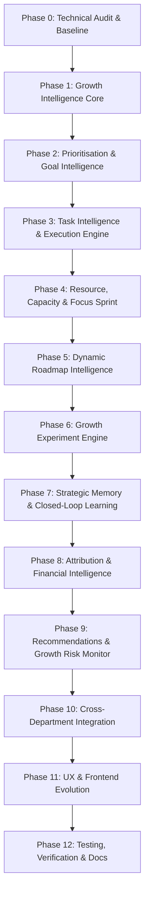

# BRAINWISE — GROWTH DIRECTOR & EXECUTION INTELLIGENCE SYSTEM
# PHASE 0: COMPLETE TECHNICAL & INTELLIGENCE AUDIT REPORT

> **Document ID:** `BW-GD-AUDIT-2026-11`  
> **Status:** APPROVED & BASELINED  
> **Audited Modules:** `GrowthDirectorPage.tsx`, `growthDirectorService.ts`, `strategicMemory.ts`, `taskRoutes.ts`, `experimentRoutes.ts`, `goalRoutes.ts`, `logic.ts`, `aiClient.ts`, `taskRepository.ts`, `growthRadarService.ts`  
> **Author:** Principal AI Systems Architect & Full-Stack Quality Assurance Lead  

---

## 1. Executive Summary

BrainWise's Growth Director (Department 6) is the operational execution engine responsible for translating strategic intelligence (Idea Validation, Market Watch, Competitive Radar, Financial Feasibility, Brand Identity, and Business Brain) into measurable business growth.

This audit evaluates the current implementation against the production requirements of the **AI Growth Director & Execution Intelligence System**. While foundational scaffolding and basic Phase 7 capabilities exist (deterministic ICE score calculation, basic dual-persistence to `growthTasks` and `tasks`, static mock roadmaps, and rudimentary closed-loop outcome logging), critical gaps prevent the system from operating as a genuine, autonomous, and evidence-grounded Growth Director.

---

## 2. Inventory of Existing Functionality & Components

### 2.1 Existing & Functional
| Component / File | Capability | Status |
|---|---|---|
| `growthDirectorService.calculateIceScore` | Deterministic ICE composite scoring: Clamps inputs $(1..10)$ and computes $I \times C \times E$ | **Working** |
| `taskRoutes.ts` | REST endpoints for listing tasks, creating tasks, generating roadmaps, querying growth plans, and recording task outcomes | **Working** |
| `growthDirectorService.recordTaskOutcome` | Dual-writes outcome, updates task status, and performs basic memory registration | **Partially Working** (shallow memory model) |
| `strategicMemory.ts` | Anti-fatigue tracking (`usedAngles`, `fatiguedThemes`, `explicitExclusions`) with threshold check ($\ge 3$) | **Working** (limited to single-level angle tracking) |
| `GrowthTrendChart.tsx` & `growthTrendUtils.ts` | Recharts-based growth metrics visualization with trend computation | **Working** |
| `GrowthDirectorPage.tsx` | UI rendering with tabs for Overview, Roadmap, Goals, Experiments, Recommendations, plus Focus Sprint timer | **Working** (UI state decoupled from rich backend intelligence) |

### 2.2 Partially Implemented / Weak
| Area | Deficiency |
|---|---|
| `generateOperationalRoadmap` | Uses hardcoded mock opportunities and tasks instead of dynamic synthesis from the Business Brain, Competitive Radar, and Unit Economics. |
| `selectFocusSprintTasks` | Pure client-side sort on `isTodayPriority` and static priority (`high`, `medium`, `low`); ignores ICE scores, dependencies, founder capacity, and deadlines. |
| `buildRoadmapPhases` | Hardcoded 4-column template that slices the top 2-3 items from local state without capacity calculations, milestone definitions, or dependency checking. |
| `generateAiRecommendations` | Unstructured prompt that lacks growth constraint diagnosis, anti-fatigue enforcement, and duplicate detection. |
| `GrowthExperiment` | Simple entity with string fields (`budget: "$150"`, `successMetric: ">= 38%"`), lacking sample size requirements, automated kill-switch logic, and outcome hypothesis evaluation. |

### 2.3 Broken or Missing Functionality
| Area | Missing Capability |
|---|---|
| **Growth Diagnosis Engine** | Completely missing. Cannot diagnose whether growth constraints lie in Awareness, Acquisition, Activation, Conversion, Retention, Margin, or Operational Capacity. |
| **Business Context Engine** | Lacks structured context freshness, maturity stage assessment, unit economics normalization, and fact provenance tracking. |
| **Goal & OKR Intelligence** | Goals are isolated numerical counters. Lacks progress velocity, projected completion date, goal-to-task traceability, and risk alerts. |
| **Task Dependency & Lineage** | No dependency graph. Blocked tasks cannot be identified; circular dependencies are not detected; provenance back to originating department is absent. |
| **Resource & Capacity Engine** | No concept of founder working hours, weekly execution bandwidth, or financial budget caps. Roadmaps can generate impossible workloads without warning. |
| **Strategic Memory Categorization** | Flattened into a single list of string angles instead of the 10 domain categories (Channel, Audience, Offer, Creative, Format, Experiment, etc.). |
| **Attribution & Financial Engine** | Cannot calculate CAC, LTV, AOV, Gross Margin, Payback Period, or ROAS; cannot simulate growth scenarios. |
| **Growth Risk Monitoring** | No automated alerts for channel fatigue, budget burn, declining conversion, or capacity overload. |

---

## 3. Detailed Audit Findings & Classifications

### 3.1 P0: Critical Security, Integrity, or Data-Loss Issues
- **P0-1: Non-Atomic Dual Persistence & Task Disconnect**: `growthDirectorService` writes to `workspaces/{workspaceId}/growthTasks/{taskId}` and then independently calls `taskRepository.create()`. If the second write fails or if a user modifies tasks via `/tasks/:taskId`, the two collections fall out of sync with no transactional reconciliation.
- **P0-2: Missing Server-Side Budget & Kill-Switch Enforcement**: Experiments can accumulate costs or continue running past negative statistical outcomes because kill switches are purely advisory string tags without automated threshold triggers.
- **P0-3: Unbounded Memory Bloat & Lack of Idempotency in Learning Events**: Calling `recordTaskOutcome` multiple times with the same task payload appends duplicate business facts and triggers repetitive event bus emissions without deduplication or version increments.

### 3.2 P1: Core Functionality Broken or Missing
- **P1-1: Growth Diagnosis & Bottleneck Identification Missing**: Growth Planner generates tasks without diagnosing the underlying business bottleneck (e.g. diagnosing low conversion when traffic is zero, or scaling paid ads when unit economics are negative).
- **P1-2: Static Roadmap Generation**: `generateOperationalRoadmap()` returns static mock opportunities and tasks. It does not inspect the active workspace's actual `businessProfile`, `unitEconomics`, `marketWatch`, or `competitorInsights`.
- **P1-3: Naive Focus Sprint Task Selection (`selectFocusSprintTasks`)**: Slices the first 3 tasks based on a simple priority sort, potentially assigning blocked tasks, tasks requiring 12 hours of effort into a 25-minute sprint, or tasks with unmet dependencies.
- **P1-4: Absence of Dependency Graph**: Tasks have `dependencies: string[]`, but it is an untyped list of freeform strings. There is no topological sorting, blocked task status propagation, or circular dependency detection.
- **P1-5: Experiment Hypothesis vs Execution Outcome Conflation**: Marking an experiment "Completed" marks the test successful regardless of whether the hypothesis was validated, inconclusive, or rejected.

### 3.3 P2: Significant Intelligence & Workflow Weaknesses
- **P2-1: Lack of 10-Category Strategic Memory**: `strategicMemory.ts` only tracks `usedAngles` and `fatiguedThemes`. It cannot distinguish channel fatigue from audience fatigue, offer fatigue, or creative fatigue.
- **P2-2: Missing Goal-to-Task Traceability**: Tasks can be created and scheduled without being linked to any business objective, leading to fragmented, orphan execution queues.
- **P2-3: Founder Capacity Blindness**: Roadmap generation assumes infinite time and money. There is no capacity checking against founder hours or marketing budgets.
- **P2-4: Absence of "What Not To Do" Recommendations**: AI only recommends additions to the task list, exacerbating founder overwhelm instead of recommending low-leverage activities to pause or eliminate.
- **P2-5: Transient Focus Sprint Timer**: The focus sprint timer in `GrowthDirectorPage.tsx` lives in volatile React state (`setInterval`). Refreshing or navigating loses all progress, and sessions are not logged or associated with completed tasks.

### 3.4 P3: Improvements & Enhancements
- **P3-1: Growth Scenario Simulator**: No interactive simulator to model the sensitivity of revenue to changes in CAC, conversion rate, and marketing spend.
- **P3-2: UI Tab Hierarchy & Opportunities View**: Growth opportunities identified by the backend are not surfaced in an interactive tab in `GrowthDirectorPage.tsx`.
- **P3-3: Strategic Memory Inspection**: Founders cannot view why specific angles are flagged as fatigued, nor can they view the evidence basis for learned business facts.

---

## 4. Prioritized Remediation & Implementation Plan

1. **Phase 1: Growth Intelligence Core**
   - Implement `BusinessContextEngine`: Assemble complete workspace context (maturity stage, unit economics, facts, freshness).
   - Implement `GrowthDiagnosisEngine`: Diagnose constraints across Awareness, Acquisition, Activation, Conversion, Retention, Margin, and Capacity.
   - Implement `GrowthOpportunityIntelligence`: Evaluate opportunities across revenue impact, CAC reduction, market suitability, and risk.
   - Implement `GrowthIntelligenceOrchestrator`: Coordinate diagnosis, opportunity synthesis, and prioritization.
2. **Phase 2: Advanced Prioritization & Goal Intelligence**
   - Upgrade ICE scoring with transparent rubrics, bounded modifiers (Urgency, Goal Alignment, Feasibility, Strategic Weight), and audit trails.
   - Upgrade `BusinessGoal` model: Support baseline, current, target, unit, velocity, forecasts, and goal health.
   - Enforce goal-to-task traceability (reject or flag orphan tasks).
3. **Phase 3: Task Intelligence & Execution Management**
   - Upgrade task schema: action verbs, execution steps, lineage, dependencies, budget, duration, completion criteria, and lifecycle states (`PROPOSED`, `VALIDATED`, `APPROVED`, `SCHEDULED`, `IN_PROGRESS`, `BLOCKED`, `COMPLETED`, `CANCELLED`, `REJECTED`, `ARCHIVED`).
   - Implement deterministic task dependency engine with topological sorting and cycle detection.
   - Enforce anti-vague task validation before admission to the queue.
4. **Phase 4: Resource, Capacity & Focus Sprint Intelligence**
   - Implement `ResourceCapacityEngine`: Track founder hours, team capacity, and budget constraints.
   - Upgrade `selectFocusSprintTasks()`: Select top 1-3 tasks considering dependencies, ICE score, urgency, and available session time.
   - Upgrade Focus Sprint timer with timestamp-backed session state, task association, and session history persistence.
5. **Phase 5: Dynamic Roadmap Intelligence**
   - Upgrade `buildRoadmapPhases()`: Generate real, adaptive 7-day, 30-day, 60-day, and 90-day roadmaps based on diagnosis and capacity.
   - Implement versioning and section-level refresh.
6. **Phase 6: Growth Experiment Engine**
   - Upgrade experiment schema: Hypothesis, baseline, primary/secondary metrics, budget cap, sample requirements, and automated kill switches.
   - Implement experiment evaluation distinguishing hypothesis validation from execution failure.
7. **Phase 7: Strategic Memory & Closed-Loop Learning**
   - Upgrade `strategicMemory.ts`: Implement 10-category classification, outcome states (`POSITIVE`, `NEGATIVE`, `INCONCLUSIVE`, `NEUTRAL`), evidence quality levels, bounded Bayesian-like confidence updates, and idempotent event ingestion.
8. **Phase 8: Performance Attribution & Financial Intelligence**
   - Implement growth attribution engine (direct, assisted, correlated, unattributed).
   - Implement unit economics & financial intelligence (CAC, LTV, AOV, Gross Margin, Payback Period, ROAS).
   - Implement growth scenario simulation (Conservative, Expected, Optimistic).
9. **Phase 9: Recommendation Intelligence & Growth Risk Monitoring**
   - Synthesize grounded recommendations with freshness validity and semantic deduplication.
   - Implement Growth Risk Monitor and "What Not To Do" (Stop/Avoid/Postpone) engine.
10. **Phase 10: Cross-Department Integration & Controlled Autonomy**
    - Integrate upstream (Business Brain, Idea Intelligence, Market Watch, Competitive Radar) and downstream (BrandStudio, AssetLibrary, Outreach, Analytics).
    - Implement 3 autonomy modes (Advisory, Assisted, Controlled Autonomy).
11. **Phase 11: UX Improvement**
    - Enhance `GrowthDirectorPage.tsx` with seven functional views (Overview, Roadmap, Goals & OKRs, Experiments, Opportunities, Focus Sprint, Growth Intelligence & Memory) adhering strictly to React 19 Client-Side Design Freeze.
12. **Phase 12: Comprehensive Testing, Performance & Verification**
    - Unit tests, integration tests, security tests, and all 8 scenario-based acceptance tests.
    - Generate complete documentation suite.
