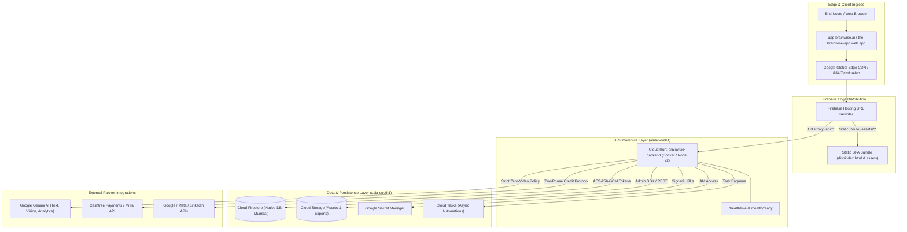

# BRAINWISE — CLOUD ARCHITECTURE & ENVIRONMENT MATRIX
**Classification:** Production Infrastructure Specification  
**Authority:** Phase 11 Cloud Architecture Baseline  
**Target Region:** `asia-south1` (Mumbai)  

---

## 1. High-Level Architecture Overview

BrainWise implements a **Unified Dual-Edge Hybrid Cloud Architecture** leveraging Google Cloud Run for containerized backend services and Firebase Hosting for edge-cached Single-Page Application (SPA) distribution.

---

## 2. Environment Isolation Matrix

To guarantee financial integrity, security, and stability, all three environments are isolated into separate GCP projects:

| Architectural Component | Development (`DEV`) | Staging (`STAGING`) | Production (`PROD`) |
| :--- | :--- | :--- | :--- |
| **GCP Project ID** | `brainwise-development` | `brainwise-ai-marketing-engine` | `the-brainwise-app` |
| **Project Number** | `878438618031` | `691254604957` | `242928977092` |
| **Primary Region** | `asia-south1` (Mumbai) | `asia-south1` (Mumbai) | `asia-south1` (Mumbai) |
| **Firebase Hosting Target** | `brainwise-development` | `brainwise-ai-marketing-engine` | `the-brainwise-app` |
| **Primary URL** | `https://brainwise-development.web.app` | `https://brainwise-ai-marketing-engine.web.app` | `https://app.brainwise.ai` |
| **Cloud Run Service** | `brainwise-backend-dev` | `brainwise-backend` | `brainwise-backend` |
| **Cloud Run Scaling** | 0 to 3 instances | 0 to 10 instances | **1 to 50 instances (Warm Base)** |
| **Cloud Run Sizing** | 1 vCPU, 512 MB RAM | 1 vCPU, 512 MB RAM | **2 vCPU, 1 GB RAM** |
| **Firestore Database** | Native (`asia-south1`) | Native (`nam5`) | **Native (`asia-south1` - Mumbai)** |
| **Firestore PITR** | Disabled (Ephemeral) | Enabled (7-Day Retention) | **Enabled (7-Day Continuous Backup)** |
| **Storage Bucket** | `brainwise-development.appspot.com` | `brainwise-ai-marketing-engine.firebasestorage.app` | `the-brainwise-app.firebasestorage.app` |
| **Payment Gateway** | Cashfree Sandbox | Cashfree Sandbox / Pre-Prod | **Cashfree Production (`api.cashfree.com`)** |
| **CI/CD Deployment** | Manual / Branch testing | Auto-deploy on `push` to `develop` | **Auto-deploy on Release + Manual Gate** |

---

## 3. Identity and Access Management (IAM) & Least Privilege

All production access follows the principle of least privilege. Workloads execute under designated Service Accounts without broad owner permissions.

### 3.1 Service Account Topography

1. **Production Runtime Service Account:**
   - **Email:** `brainwise-backend-sa@the-brainwise-app.iam.gserviceaccount.com`
   - **Assigned Roles:**
     - `roles/datastore.user` (Cloud Firestore read/write access)
     - `roles/storage.objectAdmin` (GCS bucket management for workspace assets)
     - `roles/secretmanager.secretAccessor` (Decryption of runtime secrets)
     - `roles/cloudtasks.enqueuer` (Cloud Tasks dispatch for async jobs)
     - `roles/logging.logWriter` (Structured JSON logging to Cloud Logging)
     - `roles/monitoring.metricWriter` (Custom telemetry and latency metrics)

2. **CI/CD GitHub Actions Deployer:**
   - **Email:** `github-actions-deployer@the-brainwise-app.iam.gserviceaccount.com`
   - **Assigned Roles:**
     - `roles/run.admin` (Cloud Run deployment and revision traffic management)
     - `roles/artifactregistry.writer` (Push container images to Artifact Registry)
     - `roles/firebasehosting.admin` (Deploy SPA static bundles and rewrite rules)
     - `roles/iam.serviceAccountUser` (ActAs runtime service account)

---

## 4. Secret Management & Secure Key Injection

Secrets are stored strictly in Google Cloud Secret Manager. No production keys or credentials are ever checked into git or baked into Docker container images.

| Secret Name | Purpose | Injected To |
| :--- | :--- | :--- |
| `GEMINI_API_KEY` | Google GenAI SDK for strategic intelligence | Cloud Run Runtime Environment |
| `CASHFREE_APP_ID` | Merchant authentication identifier | Cloud Run Runtime Environment |
| `CASHFREE_SECRET_KEY` | Merchant private signature key | Cloud Run Runtime Environment |
| `CASHFREE_WEBHOOK_SECRET` | HMAC signature validation for webhooks | Cloud Run Runtime Environment |
| `AES_CREDENTIAL_KEY` | Symmetric AES-256-GCM OAuth token encryption | Cloud Run Runtime Environment |

---

## 5. Network Routing & Edge Optimization

1. **Edge SSL & Caching:**
   - Firebase Hosting automatically provisions and auto-renews free Google-managed SSL certificates for both standard domains (`the-brainwise-app.web.app`) and custom domains (`app.brainwise.ai`).
   - Static JavaScript, CSS, and SVG assets located under `/assets/**` are served directly from Cloud CDN points-of-presence worldwide with 1-year immutable caching.

2. **Cloud Run Ingress & API Rewrites:**
   - Firebase Hosting rewrites `/api/**` to Cloud Run service `brainwise-backend` in `asia-south1`.
   - Client and server communicate over low-latency Google internal network backbones.
