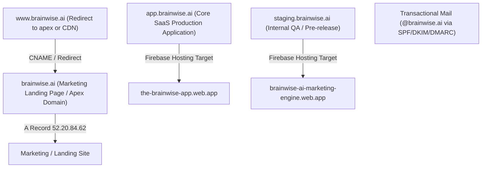

# BRAINWISE — DOMAIN, DNS, SSL & EMAIL DELIVERABILITY GUIDE
**Domain Authority:** `brainwise.ai`  
**Classification:** DevOps / Network Engineering Specification  
**Authority:** Phase 11 DNS & Domain Activation  

---

## 1. Domain Architecture Topography

The BrainWise public presence is structured across dedicated subdomains to isolate marketing, application workloads, and transactional services:



---

## 2. Master DNS Records Specification

Configure the following authoritative records at your DNS Registrar (Cloudflare, AWS Route 53, GoDaddy, or Namecheap):

### 2.1 Core Application Routing & Verification

| Hostname / Name | Record Type | TTL | Target / Destination Value | Description |
| :--- | :--- | :--- | :--- | :--- |
| `app` | **CNAME** | 300 (5 min) | `the-brainwise-app.web.app.` | Production BrainWise SaaS application frontend & API |
| `app` | **TXT** | 300 | `firebase=the-brainwise-app` *(Firebase Verification)* | Domain ownership verification token issued by Firebase Console |
| `staging` | **CNAME** | 300 | `brainwise-ai-marketing-engine.web.app.` | Staging environment frontend & integration endpoint |
| `@` (apex) | **A** | 3600 (1 hr) | `52.20.84.62` | Root marketing / landing page host |
| `www` | **CNAME** | 3600 | `brainwise.ai.` | Canonical hostname redirect to apex domain |

---

### 2.2 Transactional Email Security (SPF, DKIM, DMARC)

To prevent transactional receipts, invoice notifications, and password reset emails from landing in spam folders, the following SPF, DKIM, and DMARC records must be active:

| Hostname / Name | Record Type | TTL | Target / Destination Value | Purpose |
| :--- | :--- | :--- | :--- | :--- |
| `@` (apex) | **TXT** | 3600 | `v=spf1 include:_spf.google.com include:sendgrid.net ~all` | Sender Policy Framework (SPF) |
| `google._domainkey` | **TXT** | 3600 | `v=DKIM1; k=rsa; p=MIGfMA0GCSqGSIb3DQEBAQUAA4GNADCBiQ...` | Google Workspace DKIM Key |
| `_dmarc` | **TXT** | 3600 | `v=DMARC1; p=reject; rua=mailto:dmarc-reports@brainwise.ai; pct=100; sp=reject` | Domain-based Message Authentication (DMARC) |

---

## 3. Step-by-Step Firebase Custom Domain Activation

To link `app.brainwise.ai` to the production project `the-brainwise-app`:

### Step 1: Add Custom Domain in Firebase Console / CLI
Run via Firebase CLI or open [Firebase Console > Hosting](https://console.firebase.google.com/project/the-brainwise-app/hosting/sites):
1. Click **Add custom domain**.
2. Enter `app.brainwise.ai`.
3. Select **Redirect to an existing website** (Unchecked - this is the primary app host).

### Step 2: Ownership Verification
Firebase provides a TXT record for verification (e.g., `firebase=the-brainwise-app`).
1. In your DNS provider dashboard, add the TXT record for `app`.
2. Wait 2–5 minutes for DNS propagation.
3. Click **Verify** in the Firebase Console.

### Step 3: Add CNAME or A Records
Once verified, Firebase Hosting instructs you to point your DNS:
- For `app.brainwise.ai`, set CNAME to `the-brainwise-app.web.app.` (or the two Google A records: `199.36.158.100`).

---

## 4. Google-Managed SSL Certificate Lifecycle

- **Certificate Authority:** Google Trust Services / Let's Encrypt.
- **Provisioning Time:** Automatic within 15–60 minutes after DNS records propagate.
- **Renewal Mechanism:** Fully automated with zero operator intervention. Certificates renew 30 days prior to expiration.
- **HSTS Enforcement:** Enforced via `Strict-Transport-Security: max-age=31536000; includeSubDomains; preload` header in [`firebase.json`](file:///d:/brainwise%20pro/brainwise%20%281%29/firebase.json).

---

## 5. DNS Verification & Health Check Commands

Once DNS changes are submitted at your registrar, run these empirical validation commands:

```powershell
# 1. Verify app.brainwise.ai CNAME resolution
Resolve-DnsName -Name app.brainwise.ai -Type CNAME

# 2. Verify root apex A record
Resolve-DnsName -Name brainwise.ai -Type A

# 3. Verify DMARC and SPF policies
Resolve-DnsName -Name _dmarc.brainwise.ai -Type TXT
Resolve-DnsName -Name brainwise.ai -Type TXT

# 4. Verify HTTP -> HTTPS Redirection and SSL Handshake
curl -I -s https://app.brainwise.ai/health/live
```
