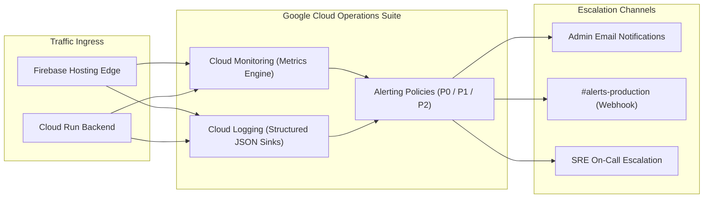

# BRAINWISE — MONITORING, ALERTING & INCIDENT RESPONSE PLAYBOOK
**Classification:** Site Reliability Engineering (SRE) / Operations  
**Authority:** Phase 11 Operational Readiness  
**Target Region:** `asia-south1` (Mumbai)  

---

## 1. Observability Framework Overview

BrainWise operations follow the **Four Golden Signals of SRE**:
1. **Latency:** Duration taken to serve requests (P50, P95, P99).
2. **Traffic:** Demand placed on the system (requests per second).
3. **Errors:** Rate of requests that fail (HTTP 5xx, uncaught exceptions).
4. **Saturation:** Resource utilization against ceilings (CPU, memory, database connections).



---

## 2. Production Alert Policies (P0 / P1 / P2)

All policies are configured in Google Cloud Monitoring for project `the-brainwise-app`:

| Severity | Alert Rule Name | Metric / Filter Condition | Evaluation Window | Threshold | Notification Channel |
| :--- | :--- | :--- | :--- | :--- | :--- |
| **P0** | `CRITICAL_HTTP_5XX_SPIKE` | `run.googleapis.com/request_count` with `response_code_class="5xx"` | 3 minutes | > 1% of total traffic | PagerDuty + Slack + Email |
| **P0** | `CRITICAL_P95_LATENCY_DEGRADED` | `run.googleapis.com/request_latencies` (95th percentile) | 5 minutes | > 1500 ms | PagerDuty + Slack |
| **P0** | `CRITICAL_PAYMENT_WEBHOOK_FAILURE` | Log metric: `jsonPayload.event="PAYMENT_WEBHOOK_ERROR"` | 5 minutes | > 2 occurrences | PagerDuty + Billing Lead |
| **P0** | `CRITICAL_CREDIT_LOCK_DEADLOCK` | Log metric: `jsonPayload.error="CREDIT_RESERVATION_TIMEOUT"` | 5 minutes | > 5 occurrences | PagerDuty + Lead Dev |
| **P1** | `HIGH_CONTAINER_MEMORY_SATURATION` | `run.googleapis.com/container/memory/utilizations` | 5 minutes | > 85% sustained | Slack + Email |
| **P1** | `HIGH_CONTAINER_CPU_SATURATION` | `run.googleapis.com/container/cpu/utilizations` | 5 minutes | > 85% sustained | Slack + Email |
| **P1** | `GEMINI_AI_RATE_LIMIT_429` | Log metric: `jsonPayload.provider="gemini" AND status=429` | 5 minutes | > 10 occurrences | Slack + Email |
| **P2** | `FIRESTORE_WRITE_QUOTA_ELEVATION` | `firestore.googleapis.com/document/write_count` | 15 minutes | > 80% daily quota | Email |

---

## 3. Incident Severity Levels & Escalation Matrix

| Level | Definition | Response SLA | Primary Responder | Escalation Contact |
| :--- | :--- | :--- | :--- | :--- |
| **P0 (Critical)** | Core app outage, data corruption risk, payment failure, credit discrepancies. | **< 15 minutes** | Primary On-Call SRE | Engineering Lead / CTO |
| **P1 (High)** | Degradation of non-essential features, AI provider rate limits, memory leaks. | **< 1 hour** | Senior Backend Engineer | SRE Lead |
| **P2 (Medium)** | Minor UI styling glitch, non-blocking background job delay, quota warning. | **< 4 hours** | Supporting Engineer | Product Manager |

---

## 4. Operational Incident Runbooks

### 4.1 Runbook 1: High 5xx Server Error Spike
1. **Triage:** Open Cloud Logging with query:
   ```text
   resource.type="cloud_run_revision"
   resource.labels.service_name="brainwise-backend"
   severity>=ERROR
   ```
2. **Examine Stack Trace:** Identify if errors originate from Firestore timeouts, Gemini API failures, or unhandled exceptions.
3. **Emergency Rollback:** If errors began immediately after a new deployment:
   ```bash
   gcloud run services update-traffic brainwise-backend \
     --to-revisions=PREVIOUS_KNOWN_GOOD_REVISION=100 \
     --region=asia-south1 \
     --project=the-brainwise-app
   ```
4. **Verify Health:** Verify that `/health/live` returns HTTP 200.

---

### 4.2 Runbook 2: Payment Webhook Failure / HMAC Signature Discrepancies
1. **Triage:** Inspect failed webhook requests in Cloud Logging:
   ```text
   jsonPayload.endpoint="/api/v1/billing/webhook"
   severity>=WARNING
   ```
2. **Validate Secret Synchronization:** Check if `CASHFREE_WEBHOOK_SECRET` in Secret Manager matches the active webhook signature key in Cashfree Merchant Dashboard.
3. **Trigger Manual Reconciliation:** Run the scheduled payment reconciler task to catch any pending subscriptions or credit purchases:
   ```bash
   gcloud tasks queues execute RECONCILIATION_QUEUE --project=the-brainwise-app
   ```
4. **Two-Phase Credit Safety:** Note that under ADR-006, unverified webhooks will NEVER debit or credit wallets without valid cryptographic signatures.

---

### 4.3 Runbook 3: Gemini AI Rate Limit (429) Spike
1. **Triage:** Check quota consumption in Google Cloud Console > APIs & Services > Gemini API.
2. **Mitigation:**
   - Verify that exponential backoff and jitter logic in `src/server/services/aiOrchestrator.ts` are active.
   - If user request volume exceeds tier quotas, request temporary quota increase in GCP Console or switch the primary model to `gemini-2.5-flash` with higher throughput thresholds.
