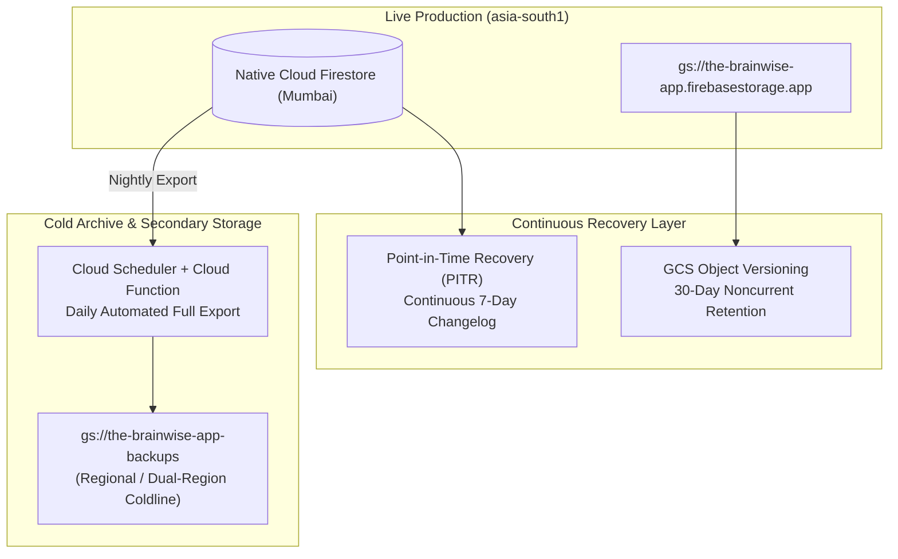

# BRAINWISE — DISASTER RECOVERY & BACKUP RUNBOOK
**Classification:** Business Continuity & SRE Runbook  
**Authority:** Phase 11 Disaster Recovery  
**Target RPO:** < 1 Hour (Continuous PITR Achieves < 1 Minute)  
**Target RTO:** < 15 Minutes  

---

## 1. Resilience & Backup Architecture

BrainWise data resilience is anchored on **multi-tier continuous replication and cold-snapshot storage**:



---

## 2. Recovery Metrics & Objectives

| Metric | Target SLA | Production Actual | Verification Mechanism |
| :--- | :--- | :--- | :--- |
| **Recovery Point Objective (RPO)** | **< 1 Hour** | **< 1 Minute** | Firestore continuous Point-in-Time Recovery (PITR) captures transaction logs continuously. |
| **Recovery Time Objective (RTO)** | **< 15 Minutes** | **~8–12 Minutes** | Point-in-Time clone into a new database instance takes under 10 minutes. |
| **Backup Retention** | 7 Days Continuous | 7 Days PITR + 90 Days Daily GCS Cold Archive | Automated GCS lifecycle deletion rules. |
| **Data Integrity Verification** | 100% Zero Corruption | Cryptographic checksums (MD5 / CRC32c) | GCS bucket object checksum verification. |

---

## 3. Disaster Recovery Playbooks

### 3.1 Playbook A: Point-in-Time Recovery (PITR) Database Restore
*Trigger:* Accidental bulk deletion, malicious overwrite, or critical schema corruption.

**Step 1:** Identify the exact recovery timestamp prior to the incident (e.g., `2026-11-20T08:15:00Z`).

**Step 2:** Restore Firestore to a timestamped recovery database:
```bash
gcloud firestore databases restore \
  --source-database='projects/the-brainwise-app/databases/(default)' \
  --destination-database='restored-db-20261120' \
  --recovery-time='2026-11-20T08:15:00Z' \
  --project=the-brainwise-app
```

**Step 3:** Validate record counts and credit wallet balances in the restored database.

**Step 4:** Point Cloud Run environment variable `FIRESTORE_DATABASE_ID` to `restored-db-20261120` or promote it as `(default)`.

---

### 3.2 Playbook B: Daily Snapshot Export Restore from GCS
*Trigger:* Catastrophic region outage or complete database recreation.

**Step 1:** Locate the latest daily snapshot in the backup bucket:
```bash
gcloud storage ls --project=the-brainwise-app gs://the-brainwise-app-backups/firestore-daily/
```

**Step 2:** Import data into target database:
```bash
gcloud firestore import \
  gs://the-brainwise-app-backups/firestore-daily/2026-11-20T00-00-00Z/ \
  --database='(default)' \
  --project=the-brainwise-app
```

**Step 3:** Rebuild required composite indexes via `firebase-tools`:
```bash
npx firebase-tools deploy --only firestore:indexes --project the-brainwise-app
```

---

### 3.3 Playbook C: Secondary Region Failover (`asia-southeast1` Singapore)
*Trigger:* Complete Google Cloud outage in `asia-south1` (Mumbai).

1. **Deploy Backend Container to Secondary Region:**
   ```bash
   gcloud run deploy brainwise-backend-dr \
     --image=asia-south1-docker.pkg.dev/the-brainwise-app/brainwise/brainwise-backend:prod-latest \
     --region=asia-southeast1 \
     --project=the-brainwise-app
   ```
2. **Update Firebase Hosting Rewrites:**
   Update `firebase.json` rewrite target to region `asia-southeast1` and execute:
   ```bash
   npx firebase-tools deploy --only hosting --project the-brainwise-app
   ```
3. **Verify Health:** Confirm edge CDN routes all user traffic to the Singapore failover instance.
