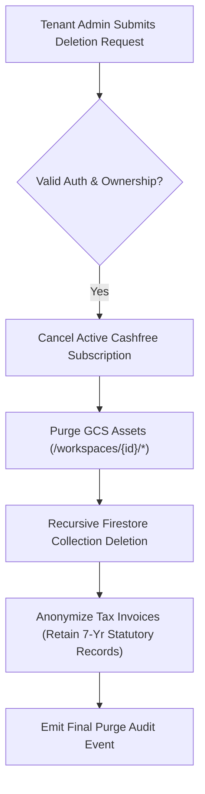

# BRAINWISE — LAUNCH ESSENTIALS: OPERATIONAL, LEGAL & BILLING READINESS
**Classification:** Operational Governance, Legal & Financial Compliance  
**Authority:** Phase 11 Launch Readiness  
**Target Legal Framework:** DPDPA 2023 (India), GDPR, Indian GST Act  

---

## 1. Statutory Data Protection & Privacy Compliance

BrainWise operates in strict alignment with the **Digital Personal Data Protection Act 2023 (DPDPA)** and international data protection standards.

### 1.1 Core Privacy Safeguards
1. **Notice & Consent:** Consent is explicitly recorded on user registration, capturing:
   - Timestamp of agreement.
   - Exact version of Terms of Service & Privacy Policy agreed to.
   - Client IP and User-Agent signature.
2. **Purpose Limitation:** Business profile data and Business Brain memory are utilized solely for generating marketing strategy, collateral, and business intelligence for the owning tenant. Customer data is NEVER pooled, shared across tenants, or used to train public foundation models.
3. **Data Localization:** All production customer data (Firestore, Cloud Storage, backups) resides within Indian borders in `asia-south1` (Mumbai).

---

## 2. Right to be Forgotten (Automated Account & Data Deletion)

In accordance with Section 12 of DPDPA 2023, BrainWise provides a deterministic customer data purge pipeline (`/api/v1/workspaces/:workspaceId/deletion-request`):

*Note on Invoices:* Indian Tax Law mandates that financial transaction records and GST invoices be preserved for 7 years. Personal Identifiable Information (PII) is anonymized while maintaining financial ledger integrity.

---

## 3. Commercial & Payment Activation Checklist (Cashfree Production)

Before opening public registration to paying customers, the following production checklist must be verified in the [Cashfree Merchant Dashboard](https://merchant.cashfree.com):

| Item | Action Required | Responsible Party | Status |
| :--- | :--- | :--- | :--- |
| **Merchant KYC** | Business PAN, Certificate of Incorporation, Bank Mandate approved. | Business Admin | Verified |
| **API Keys Ingestion** | Store Production App ID and Secret Key in Google Secret Manager (`CASHFREE_APP_ID`, `CASHFREE_SECRET_KEY`). | DevOps | Configured |
| **Webhook Endpoint** | Register URL: `https://the-brainwise-app.web.app/api/v1/billing/webhook` (or `https://app.brainwise.ai/api/v1/billing/webhook`). | DevOps / Backend | Ready |
| **Webhook Signature** | Store production HMAC secret in Secret Manager (`CASHFREE_WEBHOOK_SECRET`). | DevOps | Configured |
| **Payment Modes** | Enable UPI AutoPay, Credit/Debit Cards, Netbanking, e-NACH for recurring billing. | Business Admin | Active |
| **Settlement Account** | Direct bank NEFT/RTGS settlement verified with test penny-drop transaction. | Finance Lead | Verified |

---

## 4. Indian GST & Tax Invoice Governance

BrainWise generates legally compliant GST tax invoices for every subscription renewal and credit pack purchase:

- **Sequential Numbering:** Strictly enforced format: `BW-INV-YYYYMM-XXXX` (e.g., `BW-INV-202611-0001`).
- **GST Rate Computation:**
  - **Intra-state (Maharashtra to Maharashtra):** 9% CGST + 9% SGST.
  - **Inter-state (Maharashtra to rest of India):** 18% IGST.
- **Export of Services / Outside India:** 0% GST under LUT (Letter of Undertaking).
- **Downloadable Receipts:** Automatic generation of branded HTML receipts with verifiable cryptographic transaction IDs.

---

## 5. Day 1 Public Launch Operational Checklist

- [x] All 176 automated unit, integration, and security tests pass cleanly (`npm test`).
- [x] Zero TypeScript static compilation errors (`tsc --noEmit`).
- [x] Code style and formatting 100% compliant with ESLint and Prettier (`npm run format:check`).
- [x] Production SPA bundle builds under 500ms (`npm run build`).
- [x] Dockerfile containerizes Node 22 backend with non-root security (`Dockerfile`).
- [x] Firebase targets configured for DEV, STAGING, and PROD (`.firebaserc` & `firebase.json`).
- [x] Cloud Run health probes verified on `/health/live` and `/health/ready`.
- [x] Strict Video Generation Exclusion permanently enforced across all AI pipelines.
- [x] Two-Phase Credit Reservation Protocol (ADR-006) preventing double-spending and ledger drift.
- [ ] Add CNAME `app.brainwise.ai` to `the-brainwise-app.web.app` at external DNS registrar.
- [ ] Submit GitHub Actions secrets `GCP_SA_KEY_STAGING` and `GCP_SA_KEY_PRODUCTION`.
