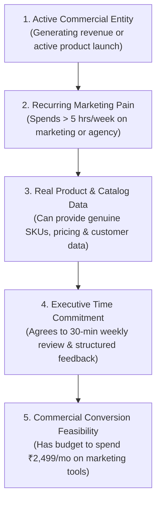

# BRAINWISE — BETA CUSTOMER SELECTION CRITERIA
**Classification:** Customer Success & Beta Strategy  
**Authority:** Phase 12.2 Closed Beta Customer Strategy  
**Cohort Target Size:** 15 Qualified Enterprises (10–20 Range)  

---

## 1. Selection Philosophy & Non-Negotiable Criteria

BrainWise strictly avoids vanity recruitment (such as personal friends or passive hobbyists who offer false praise). To validate genuine willingness to pay, every participant in the Closed Beta must meet five non-negotiable criteria:

---

## 2. Customer Segment Rubric & Quota Distribution

The 15 Closed Beta slots are distributed across five primary commercial verticals:

| Segment ID | Industry / Persona | Quota | Primary Business Problem to Solve | Key BrainWise Department |
| :---: | :--- | :---: | :--- | :--- |
| **Segment A** | **Startups & Tech Founders** | 3 Slots | Positioning against entrenched SaaS giants, investor pitch collateral, weekly growth roadmaps. | Growth Planner, Competitive Intel |
| **Segment B** | **Restaurants & Cloud Kitchens** | 3 Slots | High customer churn, seasonal menu promotions, food delivery platform differentiation. | Brand Studio, Market Watch |
| **Segment C** | **Salons & Service Businesses** | 3 Slots | Local client acquisition, appointment filling during off-peak hours, festive bridal packages. | Growth Planner, Brand Studio |
| **Segment D** | **D2C & Packaged Goods Brands** | 4 Slots | High customer acquisition costs on Meta/Google, ungrounded agency copy, retail pitch decks. | Business Brain, Analytics & Reports |
| **Segment E** | **Boutique Marketing Agencies** | 2 Slots | Multiple client context switching, slow creative turnaround, repetitive copywriting fatigue. | Multi-Tenant Workspaces, Asset Library |

---

## 3. Disqualification Rules (Zero False Positives)

A prospect is immediately rejected if:
1. They do not have an active commercial offering or concrete launch within 30 days.
2. They request automated AI video generation or video editing (Violates strict BrainWise product boundary).
3. They are unwilling to provide feedback during the 30-day testing window.
4. They demand perpetual free access without evaluating commercial upgrade tiers.
