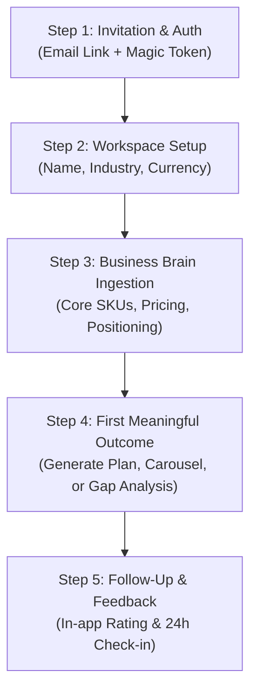

# BRAINWISE — CUSTOMER ONBOARDING WORKFLOW & JOURNEY
**Classification:** Product Experience & Customer Success Architecture  
**Authority:** Phase 12.3 Customer Onboarding  

---

## 1. Five-Step Customer Onboarding Pipeline

BrainWise employs an **Accelerated Time-to-Value (TTV) Onboarding Model** designed to guide a new business founder from initial sign-up to their first valuable business outcome in under 7 minutes.

---

## 2. Detailed Journey Specification

### Step 1: Authentication & Workspace Creation
- **UI Route:** `/signup` & `/onboarding`
- **Actions:** User signs up with email/password or Google OAuth; system sends email verification link; user enters workspace name and selects industry category.
- **Backend Telemetry:** Dispatches `SIGNUP_COMPLETED` and `WORKSPACE_CREATED`.

### Step 2: Business Profile Fast-Track (2 Minutes)
- **UI Route:** `/onboarding/business-profile`
- **Fields Collected (Strictly Essential):**
  1. Business Name & Tagline.
  2. Target Audience (e.g., "Urban professionals 25-45").
  3. Key Products or Services (at least 1 SKU with authentic pricing).
  4. Unique Selling Proposition (USP).
- **Friction Reduction:** Pre-populates industry defaults (e.g., D2C, B2B SaaS, Restaurant, Local Service) so the founder only customizes their distinct differentiators.

### Step 3: Business Brain Synthesis & Truth Anchoring
- **Backend Service:** `businessBrainService.ts`
- **Action:** Ingested products and rules are saved with `provenance: USER_CONFIRMED`.
- **Validation:** Automated Truth Check initializes to prevent downstream hallucinations.

### Step 4: First Meaningful Outcome Milestone (Crucial)
The founder is presented with three tailored "Instant ROI" action cards:
- **Card A (Strategy):** Generate a 90-day growth sprint tailored to their primary SKU.
- **Card B (Creative):** Generate a 5-slide Instagram carousel or promotional flyer SVG.
- **Card C (Research):** Generate a competitive gap analysis against their top 2 competitors.
- **Activation Definition:** The user successfully completes at least one generation and saves/exports the asset.

### Step 5: Post-Activation Follow-Up
- **Immediate:** In-app satisfaction modal ("Was this output directly usable in your business?").
- **T+24 Hours:** Automated transactional email offering tips to schedule or print the asset.
- **T+7 Days:** Structured invitation to review weekly metrics or schedule founder interview.
