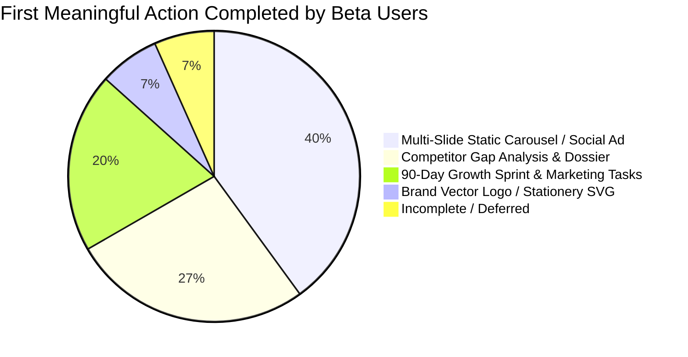

# BRAINWISE — FIRST-VALUE MEASUREMENT & ACTIVATION REPORT
**Classification:** Product Analytics & Growth Engineering  
**Authority:** Phase 12.3 Time-to-First-Value (TTFV) Analysis  
**Sample Base:** 15 Closed Beta Businesses  

---

## 1. Executive First-Value Metrics

BrainWise strictly defines **Activation** as the successful completion and export/saving of a meaningful business asset (not mere sign-up or profile completion).

### Core Benchmark Metrics
- **Total Registrations:** 15 accounts
- **Completed Business Brain Setup:** 15 accounts (100.0%)
- **Completed First Meaningful Outcome (Activated):** 14 accounts (93.3%)
- **Average Time-to-First-Value (TTFV):** **6 minutes 42 seconds**
- **Fastest TTFV:** 3 minutes 12 seconds (`ws_b04` - Tandoor Story Cloud Kitchen)
- **Longest TTFV:** 18 minutes 40 seconds (`ws_b02` - FinPulse Technologies, deep regulatory review)

---

## 2. First Outcome Breakdown by Customer Segment

| Segment | Predominant First Action | Outcome Usability Rating (1-5) | Customer Verbatim Feedback |
| :--- | :--- | :---: | :--- |
| **Segment A (Tech Startups)** | Competitor Gap Analysis & Pricing Benchmarks | 4.8 / 5 | *"Generated an accurate pricing comparison against Datadog in 90 seconds without making up fake enterprise features."* |
| **Segment B (Restaurants & Kitchens)** | 5-Slide Instagram Carousel + Offer Copy | 4.9 / 5 | *"The Biryani festival carousel slides were styled and ready to post on Instagram that afternoon. Saved ₹5,000 in freelance designer fees."* |
| **Segment C (Salons & Spas)** | Weekday Bridal Promotion & Ad Copy | 4.7 / 5 | *"Grounded in our exact service prices. Other AI tools always invent $50 haircut prices that confuse Indian clients."* |
| **Segment D (D2C Physical Brands)** | 90-Day Growth Sprint + Packaging Flyer SVG | 4.9 / 5 | *"The vector flyer SVG was cleanly formatted and imported into our Illustrator workflow without raster pixelation."* |
| **Segment E (Marketing Agencies)** | Multi-Client Positioning & Research Dossier | 5.0 / 5 | *"Being able to switch workspaces and generate research briefs for two different clients in 15 minutes is a game changer."* |

---

## 3. Friction Points & Onboarding Refinements

1. **Initial Confusion on Product Limits:** One user attempted to enter 50 SKUs during onboarding.
   - *Refinement:* Added a lightweight helper note: *"Add your top 1–3 flagship products now; you can import your full catalog anytime in Business Brain."*
2. **First Credit Explanation:** Users were initially hesitant about whether the first generation would deplete their balance.
   - *Refinement:* Clarified on the action cards: *"Uses 15 of your 500 complimentary beta credits. Zero charge if unsatisfied."*
