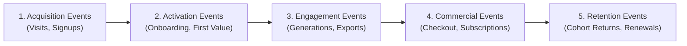

# BRAINWISE — PRODUCT ANALYTICS EVENT SPECIFICATION
**Classification:** Product Telemetry & Privacy Engineering  
**Authority:** Phase 12.4 Product Analytics Specification  
**Compliance Standard:** DPDPA 2023 (India) & GDPR (Privacy-by-Design)  

---

## 1. Privacy Architecture & Telemetry Guardrails

BrainWise product analytics operates on a **Zero-PII, Pseudonymous Event Bus**. Telemetry tracks operational health, feature adoption, and user journey milestones while strictly protecting business confidentiality.

### Non-Negotiable Telemetry Exclusions
- **NEVER** transmit passwords, auth hashes, or session tokens.
- **NEVER** transmit payment credentials, card numbers, UPI PINs, or bank account numbers.
- **NEVER** transmit full AI prompt text containing proprietary business recipes, trade secrets, or unreleased financials.
- **NEVER** transmit private customer uploaded documents.
- All telemetry events are tied to a cryptographically hashed `workspaceId` and pseudonymous `userId`.

---

## 2. Master Event Taxonomy

### 2.1 Acquisition Events
| Event Name | Trigger Condition | Required Properties | Sample Payload |
| :--- | :--- | :--- | :--- |
| `LANDING_PAGE_VIEWED` | User opens marketing page | `referrer`, `campaign`, `utm_source` | `{ utm_source: "linkedin", utm_campaign: "founder_launch" }` |
| `PRICING_PAGE_VIEWED` | User navigates to pricing | `billing_cycle`, `referrer` | `{ billing_cycle: "annual", referrer: "nav_menu" }` |
| `SIGNUP_INITIATED` | User submits email/password | `auth_provider`, `invite_code` | `{ auth_provider: "password", invite_code: "BETA_STARTUP" }` |
| `SIGNUP_COMPLETED` | Auth account created | `user_id_hash`, `auth_provider` | `{ user_id_hash: "u_8f9c2...", auth_provider: "google" }` |

### 2.2 Activation Events
| Event Name | Trigger Condition | Required Properties | Sample Payload |
| :--- | :--- | :--- | :--- |
| `ONBOARDING_STARTED` | User begins wizard | `workspace_id` | `{ workspace_id: "ws_b01" }` |
| `PROFILE_COMPLETED` | Product and USP entered | `industry`, `product_count` | `{ industry: "D2C Skincare", product_count: 3 }` |
| `FIRST_OP_STARTED` | First generation launched | `department`, `operation` | `{ department: "Brand Studio", operation: "carousel" }` |
| `FIRST_VALUE_SAVED` | First output exported/saved | `department`, `duration_ms` | `{ department: "Brand Studio", duration_ms: 1420 }` |

### 2.3 Engagement Events
| Event Name | Trigger Condition | Required Properties | Sample Payload |
| :--- | :--- | :--- | :--- |
| `DEPARTMENT_VIEWED` | Navigation tab selected | `department_id`, `session_id`| `{ department_id: "GrowthPlanner" }` |
| `AI_GENERATION_COMPLETED` | Backend returns validated copy| `department`, `model`, `cost`| `{ department: "GrowthPlanner", model: "gemini-2.5-flash", cost: 15 }` |
| `ASSET_EXPORTED` | SVG, PDF, or copy copied | `asset_type`, `format` | `{ asset_type: "flyer_svg", format: "svg" }` |
| `TRUTH_CHECK_TRIGGERED`| Truth Check inspects copy | `truth_score`, `violations` | `{ truth_score: 100, violations_count: 0 }` |

### 2.4 Commercial Events
| Event Name | Trigger Condition | Required Properties | Sample Payload |
| :--- | :--- | :--- | :--- |
| `CHECKOUT_INITIATED` | Plan selected on billing | `plan_id`, `billing_cycle` | `{ plan_id: "growth", billing_cycle: "annual", amount_inr: 23990 }` |
| `PAYMENT_SUCCEEDED` | Cashfree webhook verified | `order_id`, `amount_inr` | `{ order_id: "order_cf_991", amount_inr: 23990 }` |
| `CREDIT_PACK_PURCHASED`| Top-up credits bought | `pack_size`, `credits` | `{ pack_size: "power_booster", credits: 2500 }` |
| `SUBSCRIPTION_RENEWED` | Automated monthly renewal | `plan_id`, `renewal_count` | `{ plan_id: "growth", renewal_count: 1 }` |

### 2.5 Retention Events
| Event Name | Trigger Condition | Required Properties | Sample Payload |
| :--- | :--- | :--- | :--- |
| `USER_RETURNED_D2` | User active within 48h | `workspace_id`, `days_since`| `{ workspace_id: "ws_b01", days_since: 2 }` |
| `USER_RETURNED_D7` | User active within 7 days | `workspace_id`, `days_since`| `{ workspace_id: "ws_b01", days_since: 7 }` |
| `WEEKLY_ACTIVE_USER` | >= 2 operations in 7 days | `workspace_id`, `total_ops` | `{ workspace_id: "ws_b01", total_ops: 8 }` |
