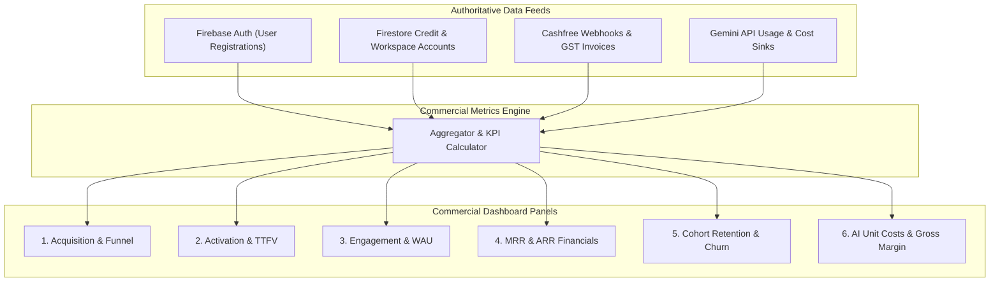

# BRAINWISE — COMMERCIAL DASHBOARD SPECIFICATION
**Classification:** Product Analytics & Executive Dashboards  
**Authority:** Phase 12.4 & 12.11 Executive Operations  

---

## 1. Commercial Dashboard Architecture

The BrainWise Commercial Dashboard synthesizes telemetry from Firebase Auth, Cloud Firestore, Cashfree Webhooks, and Google Gemini API usage into an authoritative real-time management view.

---

## 2. Dashboard Panel Specifications

### Panel 1: Acquisition & Top-of-Funnel Conversion
- **Unique Visitors:** Total unique web visitors over the 30-day period.
- **Registrations:** Verified accounts created.
- **Signup Conversion Rate:** `(Registrations / Unique Visitors) * 100`.
- **Customer Acquisition Cost (CAC):** `(Total Marketing & Campaign Spend / Total Converted Customers)`.

### Panel 2: Activation & Time-to-First-Value (TTFV)
- **Onboarding Completion Rate:** `(Workspaces with Business Brain / Registrations) * 100`.
- **First Value Rate:** `(Workspaces with >= 1 Saved Asset / Registrations) * 100` (Target: > 85%).
- **Median TTFV:** Minutes from account creation to first asset export (Target: < 8 min).

### Panel 3: Engagement & Retention
- **Daily Active Workspaces (DAW) & Weekly Active Workspaces (WAW):** Active workspaces performing at least one action.
- **Stickiness Ratio:** `(DAW / WAW) * 100` (Target: > 40%).
- **Most Adopted Departments:** Visual bar chart ranking usage across the 10 departments.

### Panel 4: Revenue & SaaS Unit Financials
- **Monthly Recurring Revenue (MRR):** Sum of active monthly subscriptions + (Annual subscriptions / 12).
- **Annual Recurring Revenue (ARR):** `MRR * 12`.
- **Average Revenue Per User (ARPU):** `MRR / Total Paying Workspaces`.
- **Gross Margin:** `((Revenue - Direct COGS) / Revenue) * 100` (Target: > 94%).

### Panel 5: AI Cost & Efficiency Telemetry
- **Gemini Token Spend:** Daily prompt and completion token expenditure.
- **AI Cost Per Active Customer:** Direct LLM cost incurred per active workspace per month.
- **Safeguard Interceptions:** Number of ungrounded or fatigued generations stopped by Truth Check and refunded automatically before user billing impact.
