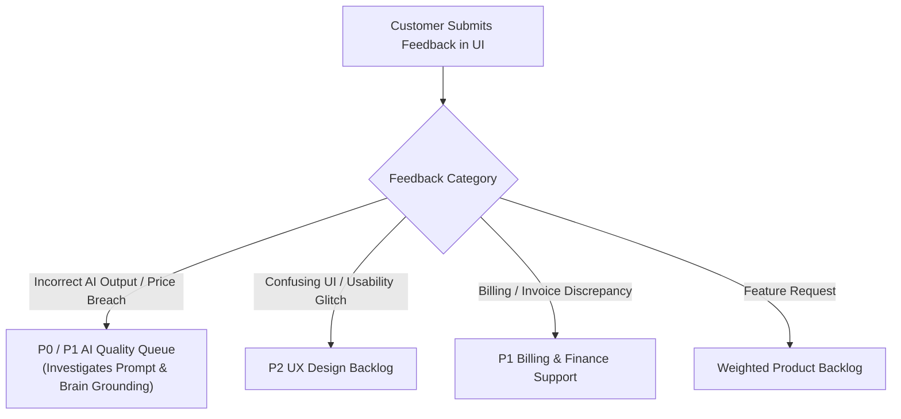

# BRAINWISE — IN-PRODUCT CUSTOMER FEEDBACK SYSTEM
**Classification:** Customer Experience & Continuous Quality Architecture  
**Authority:** Phase 12.5 Customer Feedback System  

---

## 1. System Architecture & Feedback Ingestion

BrainWise provides a native in-product feedback loop embedded into every department header and generation modal. Customers can flag quality defects, suggest enhancements, or report confusing interfaces directly from the context of their active work.



---

## 2. Ingested Feedback Data Schema

Every feedback record is stored in Firestore under `workspaces/{workspaceId}/feedback/{feedbackId}` with strict multi-tenant isolation:

```typescript
export interface CustomerFeedbackRecord {
  feedbackId: string;
  workspaceId: string;
  userId: string;
  productArea:
    | 'Business Brain'
    | 'Idea Intelligence'
    | 'Competitive Intel'
    | 'Growth Planner'
    | 'Brand Studio'
    | 'Analytics'
    | 'Billing & Credits';
  category:
    | 'INCORRECT_AI_OUTPUT'
    | 'POOR_RESEARCH'
    | 'UNUSABLE_CONTENT'
    | 'CONFUSING_UX'
    | 'MISSING_FEATURE'
    | 'BILLING_CONCERN';
  severity: 'CRITICAL' | 'HIGH' | 'MEDIUM' | 'LOW';
  title: string;
  description: string;
  generationContext?: {
    operation: string;
    model: string;
    creditsCharged: number;
    truthScore?: number;
  };
  status: 'OPEN' | 'INVESTIGATING' | 'REMEDIATED' | 'CLOSED';
  resolutionNotes?: string;
  createdAt: string;
  resolvedAt?: string;
}
```

---

## 3. Feedback Triage SLA & Operational Escalation

| Category | Severity | Response SLA | Target Resolution | Escalation Contact |
| :--- | :---: | :---: | :--- | :--- |
| **Billing / Payment / Overcharge** | CRITICAL | **< 2 Hours** | Immediate refund or credit correction | Billing Lead |
| **Price Hallucination in Copy** | CRITICAL | **< 4 Hours** | Truth Check regex & ground truth update | AI Orchestration Lead |
| **AI Output Quality / Tone Flaw** | HIGH | **< 24 Hours** | Prompt adjustment & anti-fatigue reset | Backend / Prompt Engineer |
| **UI Confusing / Broken Layout** | MEDIUM | **< 48 Hours** | Front-end fix deployed via staging CI | Front-End Lead |
| **Feature Request** | LOW | **Weekly Review**| Scored against weighted product backlog | Product Manager |

---

## 4. Privacy & Multi-Tenant Feedback Isolation

- Feedback records are strictly bound to the submitting workspace.
- Customers can never view feedback submitted by other enterprises.
- Product managers and support engineers access aggregated feedback via sanitized administrative dashboards where proprietary customer catalog details are anonymized.
