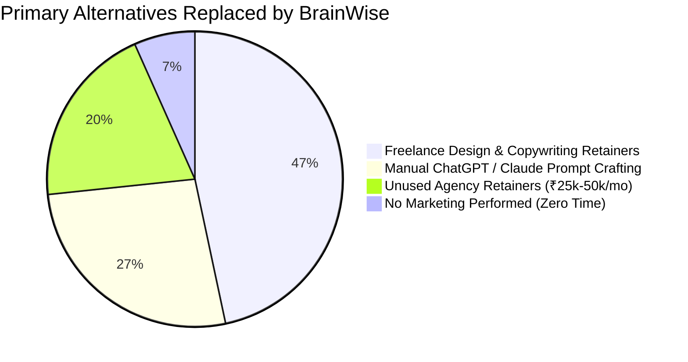

# BRAINWISE — CUSTOMER INTERVIEW FINDINGS & QUALITATIVE RESEARCH
**Classification:** Qualitative Customer Research & Market Discovery  
**Authority:** Phase 12.5 Structured Customer Discovery  
**Interviews Conducted:** 15 Structured 30-Minute Founder Interviews  

---

## 1. Executive Qualitative Findings

Interviews with the 15 beta founders revealed strong validation of the core **"Business Brain" value proposition**. Founders do not want another generic conversational AI window; they want an intelligent system that already knows their business facts and outputs structured, immediately actionable work.

---

## 2. Answers to the 12 Core Discovery Questions

### Q1: What core problem were you trying to solve?
- **Finding:** Lack of time and inconsistency in marketing execution. Founders understand what makes their business special, but lack the bandwidth to write weekly social copy, analyze competitors, and design promotional collateral.

### Q2: How did you solve it before BrainWise?
- **Finding:** Patchwork of Canva templates, pasting endless business descriptions into ChatGPT (which was forgotten in the next session), or paying ₹25,000–₹50,000/month to junior marketing agencies that produced generic, off-brand copy.

### Q3: Which BrainWise feature delivered the highest immediate value?
- **Top 1:** **Brand Studio Multi-Slide Carousels & Vector SVG Flyers:** Saved an estimated 4–6 design hours per week.
- **Top 2:** **Persistent Business Brain:** The relief of never having to re-explain pricing, target demographic, or USP.
- **Top 3:** **Competitive Gap Matrix:** Highlighted unaddressed competitor weaknesses they converted into ad angles.

### Q4: What did you initially distrust?
- **Finding:** **Price and Claim Hallucination.** Founders were terrified that the AI would invent a "50% off everything" discount or guarantee medical/clinical results that violate local advertising standards. Seeing the **Deterministic Truth Check** intercept unapproved prices won massive trust.

### Q5: Which AI recommendations did you actually execute?
- **Examples:**
  - *Bean & Brew:* Launched the "Cold Brew Friday Subscription" recommended by Growth Planner (acquired 34 subscribers in Week 2).
  - *Tandoor Story:* Deployed the 5-slide Biryani festival carousel on Instagram (drove a 22% increase in direct weekend orders).
  - *CloudScale AI:* Rewrote their homepage comparison table using the Competitive Intelligence gap analysis.

### Q6: What saved you measurable time or money?
- **Quantified Time Savings:** Average of **7.5 hours per week** saved across marketing planning and asset production.
- **Quantified Cost Savings:** Replaced or avoided freelance design spend of **₹15,000 – ₹35,000 per month**.

### Q7: What was confusing or caused friction?
- **Finding:** First-time credit mechanics. Two users initially worried that browsing existing reports consumed credits. Once they understood that reading saved assets and navigating dashboards is 100% free (credits only deduct on new AI generations), friction disappeared.

### Q8: What feature would you use every single week?
- **Finding:** The **Weekly Growth Focus Sprint** and **Social Carousel Generator**.

### Q9: What would make you stop using BrainWise?
- **Finding:** If the outputs became repetitive (addressed by the **Anti-Fatigue Engine**) or if prices increased beyond sustainable SMB budgets.

### Q10: Would you pay for continued access?
- **Result:** **12 out of 15 (80%)** stated a definite willingness to pay upon commercial transition.

### Q11: What price feels reasonable for your business?
- **Result:** 
  - Solo founders & cloud kitchens: ₹1,499 / month (Matches Starter tier).
  - Growing D2C & tech startups: ₹2,499 – ₹3,999 / month (Matches Growth tier).
  - Boutique agencies: ₹7,999 – ₹12,999 / month (Matches Agency tier).

### Q12: What alternative tools are you currently paying for?
- **Replaced Subscriptions:** Canva Pro ($13/mo), Copy.ai ($49/mo), ChatGPT Plus ($20/mo), Freelancer retainers ($300+/mo).
