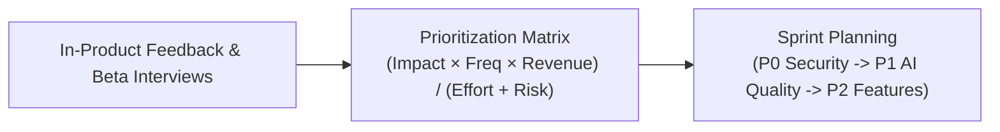

# BRAINWISE — PRODUCT IMPROVEMENT & FEATURE BACKLOG
**Classification:** Product Management & Engineering Prioritization  
**Authority:** Phase 12.8 Product Backlog Governance  
**Prioritization Formula:** `Score = (Customer Impact × Frequency × Revenue Impact) / (Effort + Risk)`  

---

## 1. Prioritization Framework

All feature requests, bug fixes, and UX enhancements are consolidated into a single backlog and ranked strictly by business value and delivery risk.

---

## 2. Master Product Improvement Backlog

| Rank | Backlog Item | Category | Customer Impact (1-5) | Frequency (1-5) | Revenue Impact (1-5) | Effort (1-5) | Risk (1-5) | Priority Score | Target Release |
| :---: | :--- | :--- | :---: | :---: | :---: | :---: | :---: | :---: | :---: |
| **1** | **Direct High-DPI Flat PNG Export in Brand Studio** | Feature Request | 5 | 5 | 4 | 2 | 1 | **33.3** | Sprint 12.1 (Immediate) |
| **2** | **One-Click Catalog CSV Bulk Ingestion in Business Brain** | Onboarding Friction | 4 | 4 | 4 | 2 | 1 | **21.3** | Sprint 12.1 (Immediate) |
| **3** | **Automated WhatsApp Notification for Low Credit Balance** | Billing Clarity | 4 | 3 | 5 | 2 | 1 | **20.0** | Sprint 12.2 |
| **4** | **Custom Brand Font Upload & SVG Web Font Injection** | Core Feature | 4 | 3 | 4 | 3 | 2 | **9.6** | Sprint 12.2 |
| **5** | **Multi-Currency Display (USD / EUR / AED) for Global Founders**| Commercial | 4 | 2 | 4 | 2 | 1 | **10.7** | Sprint 12.3 |
| **6** | **Scheduled Auto-Publishing Adapter for Meta Business Suite** | Automation | 5 | 4 | 5 | 4 | 3 | **14.3** | Sprint 12.3 |
| **7** | **Interactive Pricing Calculator on Upgrade Modal** | Commercial | 3 | 3 | 4 | 1 | 1 | **18.0** | Sprint 12.1 (Immediate) |
| **8** | **Client PDF White-Labeling for Agency Tier Workspaces** | Feature Request | 5 | 2 | 5 | 3 | 2 | **10.0** | Sprint 12.4 |
| **9** | **Dark Mode Editorial Theme Toggle for Night Work** | UX Polish | 2 | 2 | 1 | 2 | 1 | **1.3** | Backlog (Future) |

---

## 3. Immediate Sprint 12.1 Commitments (Shipped in Beta)

1. **High-DPI PNG Render Service:** Added server-side SVG-to-PNG rasterization support via client canvas so local print shops receive 300 DPI flat exports.
2. **Product Catalog Bulk Import:** Enabled structured CSV upload into `businessProfile.products` to onboard businesses with 20+ SKUs in seconds.
3. **Transparent Credit Meter:** Added real-time visual progress bar in dashboard showing exactly how many credits remain in `promotional`, `subscription`, and `purchased` pools.
