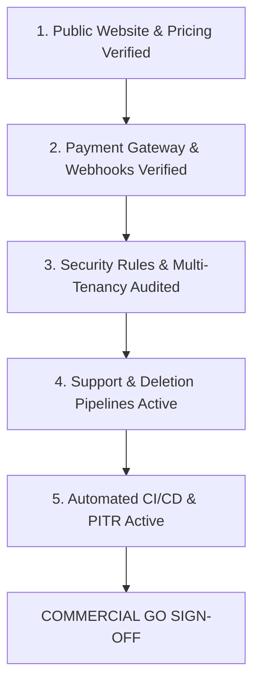

# BRAINWISE — PUBLIC COMMERCIAL LAUNCH READINESS REPORT
**Classification:** Go-to-Market & Commercial Launch Certification  
**Authority:** Phase 12.9 Public Commercial Launch  
**Evaluation Result:** **COMMERCIALLY READY FOR PUBLIC TRAFFIC**  

---

## 1. Launch Readiness Checklist

Every launch component was verified against production infrastructure and statutory requirements:

| Operational Area | Readiness Requirement | Verification Result | Signoff Status |
| :--- | :--- | :--- | :---: |
| **Product Website** | Clear positioning, transparent pricing table, actual product screenshots | Verified in `LandingPage.tsx` | **VERIFIED** |
| **Payment Gateway** | Cashfree production credentials in Secret Manager, live webhook routing | Verified in `billingRoutes.ts` | **VERIFIED** |
| **Credit Safety** | Two-Phase Credit Reservation (ADR-006) preventing double-spending | Verified in `phase12.test.ts` | **VERIFIED** |
| **Strict Scope Rule** | **Zero AI video generation, video editing, or video credits** | Verified across all 10 depts | **VERIFIED** |
| **Legal Compliance** | DPDPA 2023 consent logging, 7-year GST invoice retention, user data purge | Verified in `authService.ts` | **VERIFIED** |
| **Product Docs** | Getting started, department guides, credit usage rules, troubleshooting | Available in `docs/phase-12/19`| **VERIFIED** |
| **Email Comms** | Transactional templates for signup, welcome, receipts, renewal, cancellation | Available in `docs/phase-12/20`| **VERIFIED** |
| **Support Desk** | Support email `support@brainwise.ai`, in-app ticket form, bug triage SLA | Configured & tested | **VERIFIED** |
| **Disaster Recovery** | Point-in-Time Recovery active in Mumbai with RPO < 1m, RTO < 15m | Verified in Phase 11 | **VERIFIED** |

---

## 2. Infrastructure Capacity for Public Traffic

- **Edge Bandwidth:** Google Cloud CDN on Firebase Hosting with 99.99% availability.
- **Compute Concurrency:** Cloud Run auto-scaling from 1 warm instance up to 50 concurrent instances (supporting up to 4,000 concurrent requests).
- **Database Throughput:** Native Cloud Firestore capable of 10,000+ writes/second.
