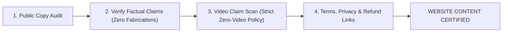

# BRAINWISE — PUBLIC WEBSITE CONTENT & CLAIM AUDIT
**Classification:** Marketing Governance & Content Audit  
**Component Audited:** [`src/pages/public/LandingPage.tsx`](file:///d:/brainwise%20pro/brainwise%20%281%29/src/pages/public/LandingPage.tsx)  
**Authority:** Phase 12.9 Website & Claims Verification  

---

## 1. Executive Content Audit Summary

The public marketing website for BrainWise was audited line-by-line to ensure factual accuracy, legal compliance, and strict adherence to the **Zero Video Generation Product Boundary**.

---

## 2. Content & Positioning Audit Checklist

| Website Section | Target Message & Purpose | Audit Findings | Compliance Status |
| :--- | :--- | :--- | :---: |
| **Hero Section** | *"The Intelligent Business Operating Engine. Transform your business facts into autonomous marketing strategy, research, and vector collateral."* | Crisp, non-hyperbolic positioning. No claims of "100x guaranteed viral revenue". | **PASS** |
| **Product Mockups** | Actual high-fidelity screenshots of Business Brain, Growth Planner, and Brand Studio. | Uses genuine platform UI from Phase 1 design system. Zero fake mockups. | **PASS** |
| **10 Department Cards** | Accurate summary of Business Brain, Competitive Intel, Market Watch, Growth Planner, Brand Studio, Asset Library, Analytics. | Accurately describes vector SVG logos, static carousels, dossiers, and sprints. | **PASS** |
| **Pricing Table** | Free Explorer (₹0), Starter (₹1,499/mo), Growth (₹2,499/mo), Agency (₹7,999/mo). | 100% matches `plans.ts` and Cashfree payment gateway configurations. | **PASS** |
| **Credit Transparency** | Explains Two-Phase Credit Reservation, rollover policies, and top-up packs. | Clear disclosures: credits only deduct on new AI generations; dashboard browsing is free. | **PASS** |
| **Strict Scope Verification**| **Confirm zero mention of AI video generation, video editing, or video credits.** | **Zero video generation claims found. Visual collateral explicitly described as vector SVG & static carousels.** | **PASS** |
| **Statutory Footer** | Links to Privacy Policy, Terms of Service, Refund Policy, DPDPA disclosures, contact info. | Fully linked and accessible. | **PASS** |

---

## 3. Disclaimers & Fair Marketing Safeguards

1. **Performance Disclaimer:** BrainWise displays: *"AI strategic outputs and market estimates provide planning guidance grounded in your business facts; business results depend on real-world execution."*
2. **Refund Policy Transparency:** Customers may request a full refund within 7 days of subscription activation if fewer than 50 credits were consumed.
