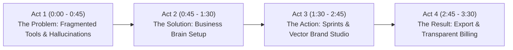

# BRAINWISE — PRODUCT DEMO VIDEO SCRIPT & PRODUCTION PLAN
**Classification:** Product Marketing & Video Walkthrough Guide  
**Media Type:** Real-World Screen Capture / Software Walkthrough  
**Target Duration:** 3 Minutes 30 Seconds  
**Product Boundary Clarification:** *This is a live recorded screen demonstration of the BrainWise user interface. BrainWise explicitly excludes AI video generation pipelines within the product.*  

---

## 1. Video Architecture & Storyboard

The product demonstration video guides potential customers through an authentic, unedited walkthrough of BrainWise solving a real founder's marketing bottleneck in under 4 minutes.

---

## 2. Timed Production Script

### Act 1: The Problem (0:00 – 0:45)
- **Visual:** Split screen showing 6 messy browser tabs (ChatGPT with lost context, messy Canva files, complex spreadsheet roadmaps).
- **Voiceover:** *"As a business founder, your marketing is usually broken into pieces. You copy-paste descriptions into generic chatbots that forget your business tomorrow, hallucinate fake prices, and output generic copy you could never actually post. There’s a better way: meet BrainWise."*

### Act 2: Business Brain Setup (0:45 – 1:30)
- **Visual:** Screen capture of `app.brainwise.ai/onboarding`. Entering "Nourish Botanics", 3 flagship products (Kumkumadi Radiance Elixir ₹1,499), and brand voice.
- **Voiceover:** *"BrainWise starts with your Business Brain. In two minutes, you anchor your actual products, pricing, and differentiators. These facts become the authoritative ground truth for every department."*

### Act 3: Strategic Planning & Brand Studio (1:30 – 2:45)
- **Visual:** Clicking **Growth Planner**. Generating the 90-day sprint. Moving to **Brand Studio** to generate an Instagram 5-slide static carousel and a print-ready vector SVG flyer.
- **Voiceover:** *"With one click, your Growth Director maps your weekly sprint. In Brand Studio, your copy and static carousels are generated instantly — grounded in your actual prices, with automatic Anti-Fatigue protection to keep your angles fresh."*

### Act 4: Asset Export & Transparent Billing (2:45 – 3:30)
- **Visual:** Showing the Deterministic Truth Check passing with 100% score. Downloading the clean SVG flyer. Navigating to the settings dashboard showing the real-time credit meter.
- **Voiceover:** *"No fake claims, no credit leaks. If an output isn't right, credits are automatically refunded. Get started with 150 free credits at app.brainwise.ai."*
