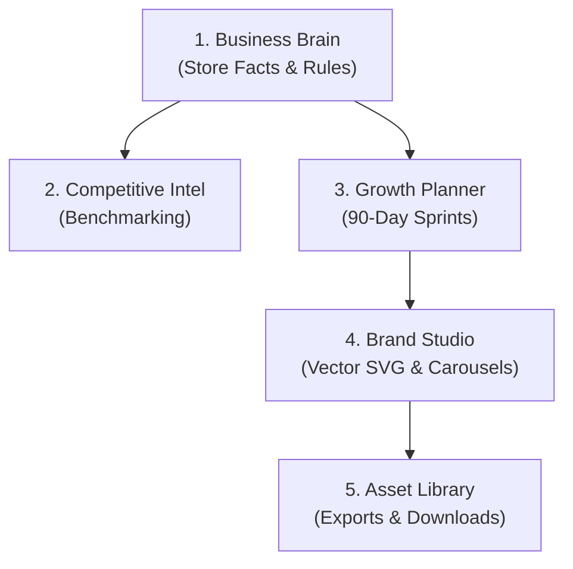

# BRAINWISE — PRODUCT USER DOCUMENTATION & KNOWLEDGE BASE
**Classification:** Customer Documentation & Support Manual  
**Authority:** Phase 12.9 Product Documentation  
**Product Version:** 1.0.0 Production  

---

## 1. Getting Started Guide

### 1.1 Account Setup & Workspace Creation
1. Navigate to [`https://app.brainwise.ai/signup`](https://app.brainwise.ai/signup).
2. Register with your work email or Google Workspace account.
3. Verify your email via the automated 6-digit confirmation link.
4. Enter your organization or workspace name (e.g., *"Acme Botanics"*).
5. You are immediately granted **150 complimentary welcome credits** to test the platform.

### 1.2 Populating Your Business Brain
Your **Business Brain** is the central foundation of BrainWise:
- **Flagship Products & Services:** Add at least 1–3 core offerings with actual prices (e.g., *"₹1,499"*).
- **Target Audience:** Describe your ideal customer demographics and specific pain points.
- **Brand Voice:** Select your tone (e.g., *"Mindful, authentic, clinical"* or *"Bold, technical, direct"*).
- **Explicit Founder Exclusions:** Add any claims you strictly prohibit (e.g., *"Never claim 100% cure"*).

---

## 2. Department Manual & Best Practices

### 2.1 Growth Planner
- **Weekly Marketing Sprints:** Breaks high-level business goals into weekly actionable tasks.
- **Anti-Fatigue Safeguard:** Automatically prevents using the same marketing angle more than 3 times.

### 2.2 Brand Studio (Strict Zero-Video Policy)
- **Vector SVG Collateral:** Export high-resolution, infinitely scalable vector logos, business cards, and print flyers.
- **Multi-Slide Static Carousels:** Generate 3- to 7-slide Instagram and LinkedIn educational carousels with formatted slide titles, body copy, and visual accent styling.
- **Deterministic Truth Check:** Every generation passes through an automated factual verification layer. If an unverified price is detected, the system auto-remediates it or refunds your credits.

### 2.3 Asset Library & Exports
- All generated collateral is automatically saved in your private cloud bucket.
- Download assets as raw SVG markup, copy text payloads to your clipboard, or export print-ready PDFs.

---

## 3. Credit Economy & Billing Policy

- **Credit Deduction Rules:** Credits are only deducted when initiating new AI generations. Viewing existing reports, browsing dashboards, or exporting saved assets is **100% free forever**.
- **Credit Consumption Rates:**
  - Standard Social Post / Ad Copy: 5 Credits
  - Market Trend Analysis: 5 Credits
  - Competitor Gap Analysis: 15 Credits
  - Multi-Slide Static Carousel (5 slides): 15 Credits
  - 90-Day Growth Strategic Plan: 20 Credits
  - Comprehensive Executive Research Dossier: 25 Credits
- **Two-Phase Credit Protection:** Credits are held in a pending reserve during generation. If an AI error occurs or a Truth Check rejects an output, your reserved credits are automatically released with zero net charge.
- **Rollover:** Unused subscription credits roll over up to your plan's maximum threshold. Purchased top-up credits **never expire**.

---

## 4. Account Deletion & Right to be Forgotten

In accordance with Section 12 of the Digital Personal Data Protection Act 2023:
1. Navigate to **Settings > Privacy & Compliance**.
2. Click **Request Permanent Account Deletion**.
3. Confirm deletion via email verification.
4. Your workspaces, Business Brain data, and uploaded assets in Cloud Storage will be permanently purged within 48 hours. Historical GST invoices are anonymized and retained in cold storage for statutory audit compliance.
