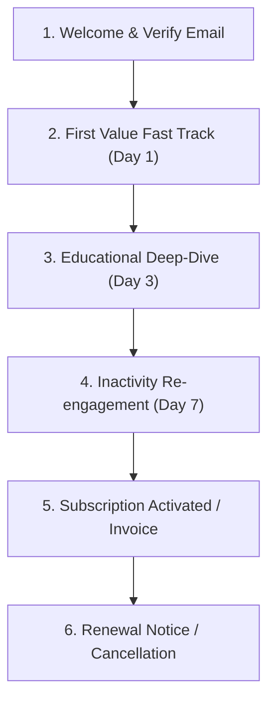

# BRAINWISE — CUSTOMER EMAIL COMMUNICATION TEMPLATES
**Classification:** Transactional Communications & Customer Retention  
**Authority:** Phase 12.9 Email Operations  
**Compliance Standard:** CAN-SPAM, Indian DPDPA 2023 & GDPR Consent Standards  

---

## 1. Overview of Lifecycle Email Sequences

All customer emails are dispatched via the authenticated transactional email engine using validated SPF, DKIM, and DMARC credentials on `brainwise.ai`. Every marketing or retention email includes a mandatory one-click unsubscribe mechanism.



---

## 2. Complete Email Templates

### Template 1: Welcome & Email Verification
- **Trigger:** Immediate upon sign-up.
- **Subject:** Verify your email address for BrainWise  
```text
Welcome to BrainWise, {{contact_first_name}}!

Thank you for creating an account for {{business_name}}.

To activate your workspace and access your 150 complimentary credits, please confirm your email address by clicking below:

👉 Verify Email Address: {{verification_url}}

If you did not sign up for BrainWise, please ignore this email.

— The BrainWise Engineering Team
```

---

### Template 2: First-Value Fast Track (Day 1)
- **Trigger:** T+2 hours after verification if no asset has been generated.
- **Subject:** Quick tip: Generate your first marketing asset for {{business_name}}  
```text
Hi {{contact_first_name}},

Your BrainWise workspace is ready. Here are three quick ways to see immediate value in under 5 minutes:

1. Brand Studio: Generate a 5-slide educational Instagram carousel tailored to your products.
2. Growth Planner: Map out your top 3 marketing tasks for this week.
3. Competitive Intel: Run a rapid gap analysis against your top competitors.

👉 Start in Brand Studio: https://app.brainwise.ai/app/brand-studio

Need any assistance? Simply reply to this email to speak directly with our team.
```

---

### Template 3: Subscription Confirmation & GST Tax Receipt
- **Trigger:** Upon successful Cashfree payment webhook.
- **Subject:** Receipt for your BrainWise {{plan_name}} Subscription (Invoice #{{invoice_id}})  
```text
Hi {{contact_first_name}},

Thank you for subscribing to the BrainWise {{plan_name}} Plan!

Payment Details:
- Amount Paid: ₹{{amount_paid}} (including 18% GST)
- Invoice Number: {{invoice_id}}
- Billing Cycle: {{billing_cycle}}
- Monthly Credits Granted: {{credits_granted}} Credits
- Next Billing Date: {{next_billing_date}}

Your official GST Tax Invoice is attached to this email as a PDF. You can also view and download past receipts anytime from Settings > Billing.

👉 Open Workspace: https://app.brainwise.ai
```

---

### Template 4: Renewal Reminder (7 Days Prior)
- **Trigger:** 7 days before automated monthly/annual renewal.
- **Subject:** Upcoming renewal for your BrainWise {{plan_name}} Subscription  
```text
Hi {{contact_first_name}},

This is a courtesy reminder that your BrainWise {{plan_name}} subscription will renew on {{renewal_date}} for ₹{{amount_due}} (inclusive of taxes).

Your monthly allowance of {{credits_granted}} credits will refresh on that date. Any unused purchased credits will remain safely in your balance.

If you wish to update your payment method or adjust your plan, you can manage your subscription at any time:
👉 Manage Subscription: https://app.brainwise.ai/app/settings
```

---

### Template 5: Cancellation Confirmation
- **Trigger:** Immediate upon user initiating subscription cancellation.
- **Subject:** Confirmation: Your BrainWise subscription has been cancelled  
```text
Hi {{contact_first_name}},

Your {{plan_name}} subscription for {{business_name}} has been cancelled as requested. You will not be charged again.

You will retain full access to your remaining credits and features until the end of your current billing period on {{period_end_date}}. After that date, your workspace will transition to the Free Explorer tier.

Would you be open to sharing one thing we could have done better? Simply reply to this email with your feedback — we read and respond to every note.

— Vishesh Kakar, Founder
```
