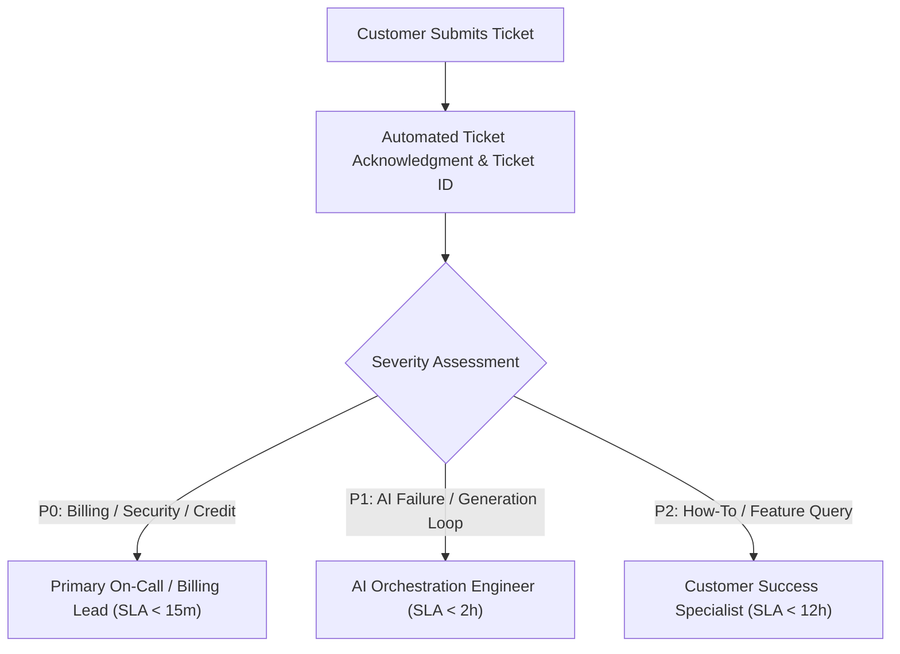

# BRAINWISE — SUPPORT OPERATIONS & INCIDENT TRIAGE GUIDE
**Classification:** Customer Operations & Technical Support Manual  
**Authority:** Phase 12.9 Support Desk Operations  
**Support Email:** `support@brainwise.ai`  

---

## 1. Support Channels & Intake Workflows

BrainWise provides two primary support touchpoints for paying customers and trial users:
1. **In-App Support Ticket Modal:** Located directly in **Settings > Help & Support**.
2. **Dedicated Support Inbox:** Routed to `support@brainwise.ai` monitored via Zendesk/Freshdesk.

---

## 2. Severity Classification & Response SLA

| Ticket Tier | Trigger Examples | Initial Response SLA | Target Resolution SLA | Escalation Owner |
| :--- | :--- | :---: | :---: | :--- |
| **P0 (Critical)** | Payment charged but credits not delivered, account locked, suspected data breach. | **< 15 Minutes** | **< 2 Hours** | SRE Lead & Founder |
| **P1 (High)** | Repeated AI generation failures, Truth Check false positive blocking valid copy, PDF export broken. | **< 2 Hours** | **< 6 Hours** | Senior Backend Lead |
| **P2 (Normal)** | Invoice GSTIN correction, how-to question regarding Brand Studio, font styling question. | **< 8 Hours** | **< 24 Hours** | Customer Success Team |
| **P3 (Low)** | Feature suggestion, minor cosmetic alignment in dashboard, general praise. | **< 24 Hours** | **Product Backlog** | Product Manager |

---

## 3. Standard Operating Procedures (SOPs)

### SOP 1: Customer Credit Refund Request
- **Eligibility:** If an AI generation failed to deliver value due to system error, timeout, or Truth Check rejection and credits were erroneously debited.
- **Resolution:**
  1. Verify the transaction in Firestore `workspaces/{workspaceId}/creditAccount/root/ledger`.
  2. Open the Admin Billing Panel or run `creditEngine.adjustCredits()`.
  3. Grant compensatory promotional credits equal to 100% of the failed operation amount + 10% goodwill bonus.
  4. Dispatch resolution notice to customer: *"Your 20 credits have been restored to your balance."*

### SOP 2: GSTIN / Company Tax Invoice Correction
- **Eligibility:** Customer signed up with personal details and needs business GSTIN added to historical invoices.
- **Resolution:**
  1. Update `taxId` and `companyName` under `workspaces/{workspaceId}/billingProfile`.
  2. Re-render the HTML/PDF tax invoice via `invoiceService.ts`.
  3. Email the updated PDF receipt with sequential number intact.

### SOP 3: Permanent Customer Account Purge (Right to be Forgotten)
- **Eligibility:** Customer requests complete data deletion under DPDPA Section 12.
- **Resolution:**
  1. Verify authorization via customer registered email.
  2. Cancel active Cashfree recurring subscription.
  3. Execute automated purge pipeline purging Firestore collections and Cloud Storage objects.
  4. Confirm deletion completion within 48 hours.
