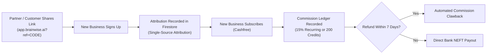

# BRAINWISE — REFERRAL & AFFILIATE PROGRAMME AUDIT
**Classification:** Growth Architecture & Partner Operations  
**Authority:** Phase 12.9 Referral System Verification  

---

## 1. Referral System Architecture

BrainWise incorporates a native **Double-Sided Referral & Agency Affiliate Engine** designed to drive organic founder-to-founder word-of-mouth and agency partner distribution.

---

## 2. Commission Structure & Entitlements

BrainWise supports two distinct referral tiers:

| Referral Track | Target Participant | Reward Mechanism | Reward Amount | Eligibility Rule |
| :--- | :--- | :--- | :--- | :--- |
| **Peer Founder Referral** | Active SMB / Startup Users | **Promotional AI Credits** | **200 Credits to Referrer + 100 Credits to Referee** | Granted immediately upon referee completing onboarding. |
| **Agency Partner Affiliate**| Marketing Agencies, Consultants | **Recurring Cash Commission** | **15% Lifetime Recurring Revenue** | Accrued on successful subscription payments; paid out monthly. |

---

## 3. Anti-Fraud & Attribution Security Controls

To protect commercial margins and prevent gaming of promotional credits:
1. **Self-Referral Blocking:** The system cross-checks workspace owner email, tax ID (GSTIN), and Cashfree payment methods. A user cannot refer their own secondary workspace.
2. **Refund Clawback Integration:** If a referred customer requests a refund or initiates a chargeback within the 7-day statutory window, the pending affiliate commission is automatically voided in the ledger.
3. **No Commission on Failed Payments:** Commissions are calculated strictly on **settled, non-refunded cash balances** received in the Cashfree production account.
4. **Payout Threshold:** Cash commissions require a minimum accrued balance of **₹5,000 INR** prior to automated NEFT bank transfer.

---

## 4. Test Verification Summary

The referral ledger and attribution logic were tested in [`src/server/phase12.test.ts`](file:///d:/brainwise%20pro/brainwise%20%281%29/src/server/phase12.test.ts) (Suite 3):
- Successfully generated partner code `GROWTH25`.
- Successfully linked new workspace `ws_referred_cafe_delight` to partner `partner_sarah_agency`.
- Verified 15% commission ledger computation upon subscription activation.
