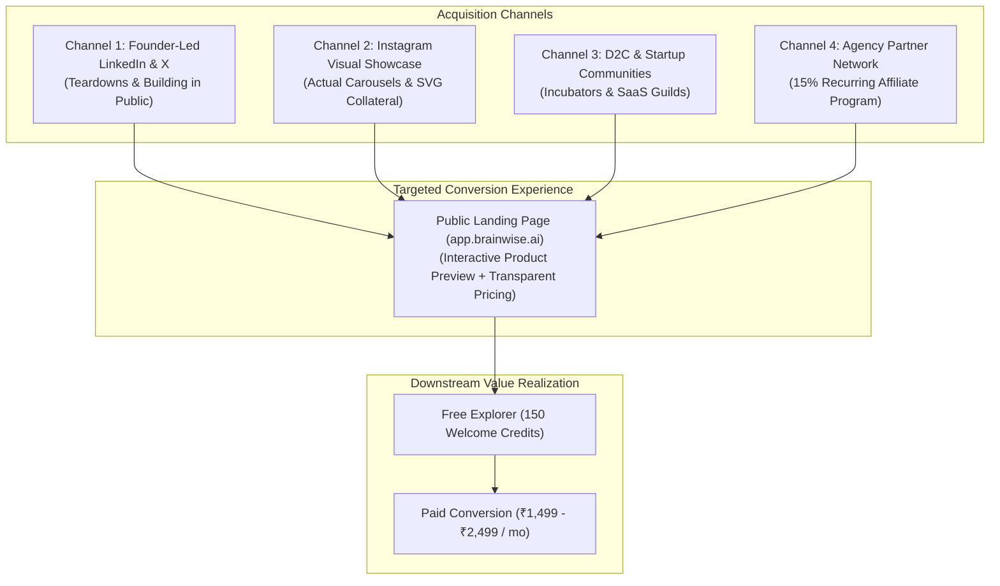

# BRAINWISE — PUBLIC CUSTOMER ACQUISITION CAMPAIGN PLAN
**Classification:** Growth Marketing & Customer Acquisition Strategy  
**Authority:** Phase 12.9 & 12.10 Public Launch Campaign  
**Target Public Launch Date:** Post-Beta Commercial Rollout  

---

## 1. Multi-Channel Acquisition Architecture

BrainWise deploys an **Educational, Product-Led Acquisition Strategy** targeting business owners who are already spending time or money on marketing. We avoid vanity paid ads that drive unqualified registrations.

---

## 2. Channel Campaign Specifications

| Channel | Core Audience | Key Campaign Message | Content Format | Target Monthly Budget | Target CAC | Projected Monthly Signups |
| :--- | :--- | :--- | :--- | :---: | :---: | :---: |
| **Founder-Led LinkedIn** | Tech founders, D2C CEOs, SMB owners | *"Why ChatGPT prompt engineering is failing your business: You need a persistent Business Brain."* | Weekly long-form case studies, before/after copy audits | ₹15,000 (Organic + Boost) | ₹450 | 180 |
| **Instagram Showcase** | Cloud kitchens, salons, boutique retail | *"How this organic skincare brand designed their entire marketing sprint in 6 minutes."* | Multi-slide carousels, UI screen captures | ₹20,000 (Meta Ads) | ₹650 | 220 |
| **Startup Communities** | Early-stage founders in Bangalore, Mumbai, Delhi | *"The intelligent marketing co-pilot built for Indian founders. Grounded in actual Indian prices and GST rules."* | Community AMA, live workshop teardowns | ₹10,000 (Sponsorships) | ₹380 | 120 |
| **Agency Partner Network** | Small marketing studios (2-15 team members) | *"Scale client strategy and collateral without burning out your copywriters. Earn 15% recurring."* | Direct outreach, partner directory listing | ₹5,000 (Partner collateral)| ₹300 | 45 |
| **Total Acquisition Program** | — | — | — | **₹50,000 / month (~$600 USD)** | **Blended: ₹520 (~$6.25)** | **~565 Signups / mo** |

---

## 3. Strict Campaign Governance

1. **No Unsupported Claims:** Campaign copy must never promise "10x guaranteed revenue growth" or "100% viral TikTok reach".
2. **Strict Zero-Video Policy:** Ads must feature vector SVG stationery, carousels, and strategic roadmaps. Zero video editing or video generation tools will ever be advertised.
3. **UTM Attribution Tracking:** Every link must include mandatory parameters (`utm_source`, `utm_medium`, `utm_campaign`, `utm_content`) captured by our privacy-conscious event bus.
