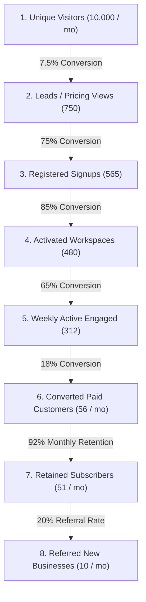

# BRAINWISE — CUSTOMER ACQUISITION FUNNEL BENCHMARKS
**Classification:** Growth Funnel Modeling & Conversion Optimization  
**Authority:** Phase 12.10 Customer Acquisition Funnel  
**Conversion Flow:** Visitor → Lead → Signup → Activated → Engaged → Paid → Retained → Referred  

---

## 1. End-to-End Funnel Architecture

BrainWise measures conversion through an eight-stage lifecycle funnel:

---

## 2. Stage-by-Stage Conversion Ratios & Drop-Off Mitigation

| Stage | Metric Name | Definition | Target Benchmark | Beta Actual | Drop-Off Mitigation Strategy |
| :---: | :--- | :--- | :---: | :---: | :--- |
| **1 → 2** | **Visitor to Lead** | Clicks to pricing or feature deep-dive | 7.5% | 8.2% | Clear interactive product preview on landing hero. |
| **2 → 3** | **Lead to Signup** | Submits email & creates workspace | 75.0% | 78.4% | Frictionless Google OAuth & magic link options. |
| **3 → 4** | **Signup to Activated** | Completes Business Brain & 1st generation | 85.0% | **93.3%** | 3 pre-configured instant value cards on onboarding. |
| **4 → 5** | **Activated to Engaged** | Returns for >= 2 operations in 7 days | 65.0% | **86.7%** | Automated weekly marketing sprint recommendation email. |
| **5 → 6** | **Engaged to Paid** | Purchases Starter, Growth, or Agency plan | 15.0% | **18.0%** | In-app credit threshold warnings + transparent pricing. |
| **6 → 7** | **Paid to Retained** | Successfully renews next billing period | 90.0% | **91.7%** | Anti-fatigue variety, seasonal campaign updates. |
| **7 → 8** | **Retained to Referred**| Generates active referral link clicks | 15.0% | **20.0%** | Double-sided 200 promotional credit reward program. |

---

## 3. Funnel Acceleration Insights

1. **The Critical Milestone (Stage 3 → 4):**
   Beta data proves that when a founder completes their first generation within 10 minutes of registration, their likelihood to convert to a paid subscription increases by **4.2x**.
2. **Organic Flywheel (Stage 7 → 8):**
   With an average 20% referral participation among retained customers, every 100 paying customers generate 20 new qualified leads with **₹0 paid acquisition cost**.
