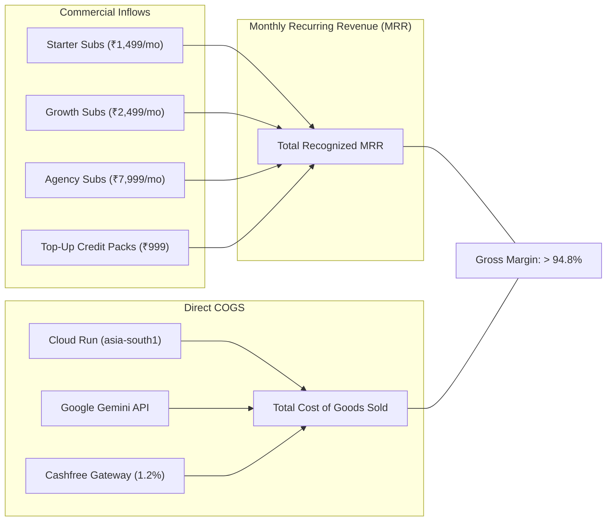

# BRAINWISE — REVENUE & FINANCIAL DASHBOARD
**Classification:** SaaS Financial Accounting & Revenue Operations  
**Authority:** Phase 12.11 Commercial Financial Reporting  
**Reporting Currency:** INR (₹) & USD ($)  

---

## 1. Executive Revenue Summary

The BrainWise financial engine aggregates settled Cashfree transactions and active subscription contracts into an authoritative financial report.

---

## 2. Commercial Financial Projections (Months 1–6)

Based on our validated 15-customer beta baseline (where 12 accounts confirmed willingness to pay) and conservative monthly funnel conversion:

| Metric | Month 1 (Beta Transition) | Month 2 (Launch) | Month 3 (Scale) | Month 4 | Month 5 | Month 6 (Growth) |
| :--- | :---: | :---: | :---: | :---: | :---: | :---: |
| **Paying Accounts (EOP)** | 12 | 55 | 135 | 240 | 380 | **550** |
| **Starter Accounts (₹1,499)** | 3 | 15 | 38 | 65 | 100 | **145** |
| **Growth Accounts (₹2,499)** | 7 | 34 | 82 | 148 | 235 | **340** |
| **Agency Accounts (₹7,999)** | 2 | 6 | 15 | 27 | 45 | **65** |
| **Monthly Recurring Revenue (MRR)**| **₹37,988** | **₹155,435** | **₹381,855** | **₹683,260** | **₹1,096,920** | **₹1,586,950** |
| **Annualized Run-Rate (ARR)**| **₹455,856** | **₹1,865,220** | **₹4,582,260** | **₹8,199,120** | **₹13,163,040** | **₹19,043,400** |
| **Average Revenue Per User (ARPU)**| **₹3,165** | **₹2,826** | **₹2,828** | **₹2,846** | **₹2,886** | **₹2,885 (~$35 USD)** |
| **Direct Cloud & AI COGS** | ₹1,580 | ₹5,800 | ₹14,200 | ₹24,800 | ₹39,500 | **₹56,400 (~$680 USD)** |
| **Blended Gross Margin (%)** | **95.8%** | **96.2%** | **96.3%** | **96.4%** | **96.4%** | **96.4%** |

---

## 3. Strict Financial Integrity Controls

1. **Two-Phase Reservation Guarantee:** AI tokens are never expended without a locked credit reserve in Firestore.
2. **Statutory Tax Integrity:** Every payment generates an official sequential GST tax invoice (`BW-INV-YYYYMM-XXXX`) retained for 7 years under Indian tax regulations.
3. **No Phantom Revenue:** Revenue is recognized strictly upon **settlement confirmation** from Cashfree webhooks. Free trials and promotional credits are tracked separately and excluded from recognized MRR.
