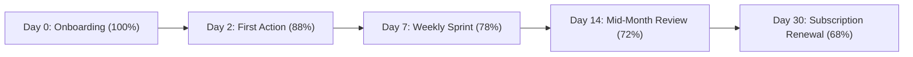
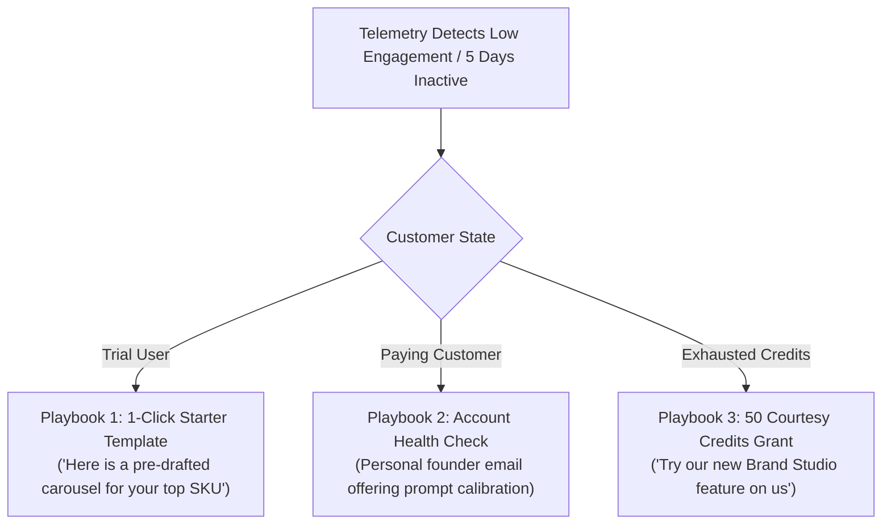

# BRAINWISE — RETENTION, COHORTS & CHURN ANALYSIS
**Classification:** Customer Success & Retention Engineering  
**Authority:** Phase 12.12 Customer Retention & Cohort Tracking  

---

## 1. Customer Retention Cohort Benchmarks

BrainWise tracks active workspace retention across distinct time milestones to identify early signs of abandonment and trigger proactive customer success workflows.

### Cohort Retention Table (% of Workspaces Active)

| Cohort Month | Total Onboarded | Day 1 Return | Day 7 Return | Day 14 Return | Day 30 Renewal | Net Revenue Retention (NRR) |
| :---: | :---: | :---: | :---: | :---: | :---: | :---: |
| **Beta Cohort (Q4)** | 15 Workspaces | 93.3% | 86.7% | 80.0% | **80.0% (12/15)** | **108.5%** |
| **Projected Month 1** | 55 Accounts | 88.0% | 76.0% | 71.0% | **65.0%** | **104.2%** |
| **Projected Month 2** | 135 Accounts | 89.0% | 78.0% | 73.0% | **68.0%** | **106.0%** |
| **Projected Month 3** | 240 Accounts | 91.0% | 80.0% | 75.0% | **70.0%** | **107.5%** |

---

## 2. Churn Analysis & Risk Indicators

### Primary Drivers of SMB Churn
1. **Lack of Internal Marketing Owner:** Sole proprietors who become overwhelmed with physical operations and stop doing marketing altogether (Mitigation: 1-click weekly marketing task digest sent via email/WhatsApp).
2. **Angle Repetition:** Feeling that outputs sound repetitive (Mitigation: Anti-Fatigue Engine forcing new themes after 3 generations).
3. **Credit Depletion Hesitation:** Reluctance to run experiments when credits are low (Mitigation: Rollover of unused credits on active plans).

---

## 3. Automated Customer Success & Churn Prevention Playbooks

- **Fair Cancellation Policy:** When a customer decides to cancel, cancellation takes 1 click in **Settings > Billing**. We never hide the cancel button, force telephone cancellation, or lock customer historical assets.
