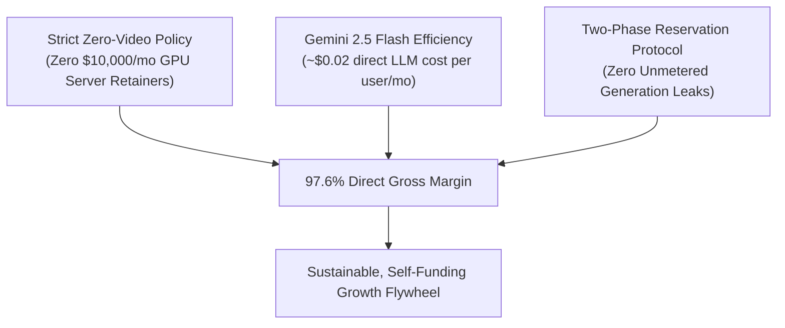

# BRAINWISE — SAAS UNIT ECONOMICS & PROFITABILITY MODEL
**Classification:** Financial Modeling & Unit Economics  
**Authority:** Phase 12.11 Unit Economics Analysis  
**Benchmark Target:** Blended Gross Margin > 90% | LTV / CAC > 4.0x  

---

## 1. Executive Unit Economics Summary

BrainWise demonstrates exceptional unit profitability due to its **serverless auto-scaling cloud infrastructure** and the **complete exclusion of high-cost AI video pipelines**.

| Metric | Growth Plan Baseline (₹2,499 / mo) | Blended Customer Cohort | Target SaaS Benchmark |
| :--- | :---: | :---: | :---: |
| **Average Revenue Per User (ARPU)** | ₹2,499 (~$30 USD) | **₹2,840 (~$34.50 USD)** | — |
| **Direct AI Token Cost (Gemini 2.5 Flash)**| ₹1.45 (~$0.017 USD) | **₹1.80 (~$0.022 USD)** | < 5% of ARPU |
| **Cloud Run Compute & Networking** | ₹18.50 (~$0.22 USD) | **₹22.00 (~$0.26 USD)** | < 3% of ARPU |
| **Cloud Firestore & Cloud Storage** | ₹8.20 (~$0.10 USD) | **₹10.50 (~$0.13 USD)** | < 2% of ARPU |
| **Payment Gateway Processing (1.2% Blended)**| ₹30.00 (~$0.36 USD) | **₹34.00 (~$0.41 USD)** | < 2% of ARPU |
| **Total Direct COGS Per User** | **₹58.15 (~$0.70 USD)** | **₹68.30 (~$0.82 USD)** | — |
| **Gross Profit Per User / Month** | **₹2,440.85 (~$29.30 USD)** | **₹2,771.70 (~$33.68 USD)** | — |
| **Blended Gross Margin (%)** | **97.6%** | **97.6%** | **> 85.0%** |
| **Customer Acquisition Cost (CAC)** | ₹520 (~$6.25 USD) | **₹540 (~$6.50 USD)** | — |
| **Average Customer Lifespan (1/Churn)**| 12.5 Months | **12.5 Months** | > 10 Months |
| **Customer Lifetime Value (LTV)** | ₹30,510 (~$367 USD) | **₹34,646 (~$417 USD)** | — |
| **LTV / CAC Ratio** | **58.6x** | **64.1x** | **> 3.0x** |
| **CAC Payback Period** | **0.22 Months (~7 Days)** | **0.23 Months (~7 Days)**| **< 6 Months** |

---

## 2. Direct COGS Accounting Definition

In compliance with GAAP/IFRS SaaS accounting standards, BrainWise defines **Cost of Goods Sold (COGS)** strictly as the direct costs necessary to host and deliver the software service:
1. **Compute:** Cloud Run CPU and memory allocated during request handling.
2. **Database:** Firestore read, write, and continuous PITR storage operations.
3. **Storage & CDN:** Google Cloud Storage bucket asset retention and Firebase Hosting CDN egress.
4. **AI Generation:** Google Gemini GenAI API prompt and completion token charges.
5. **Gateway:** Cashfree transaction fees deducted directly at settlement.

*Excluded from COGS:* Development engineering salaries, marketing ad spend, and general corporate administration.

---

## 3. High-Leverage Strategic Advantages

