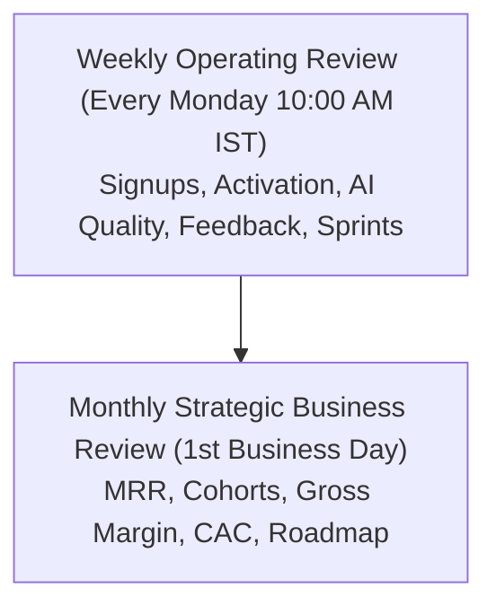

# BRAINWISE — MONTHLY & WEEKLY OPERATING REVIEW TEMPLATES
**Classification:** SaaS Operating Rhythm & Leadership Governance  
**Authority:** Phase 12.13 Commercial Operating Process  

---

## 1. Operating Rhythm Cadence

BrainWise maintains an unyielding **Weekly Tactical & Monthly Strategic Operating Cadence** to connect frontline customer feedback with engineering priorities and commercial performance.

---

## 2. Weekly Operating Review Template (45 Minutes)

### Agenda & Scorecard:
1. **Acquisition & Activation (10 mins):**
   - New sign-ups this week: `[ ___ ]` (Target: `[ ___ ]`)
   - Completed onboarding %: `[ ___ ]%` (Target: > 85%)
   - Time-to-First-Value median: `[ ___ ] mins` (Target: < 8 mins)
2. **Customer Feedback & Quality Triage (10 mins):**
   - New feedback tickets received: `[ ___ ]`
   - Truth Check safeguard interceptions: `[ ___ ]`
   - AI quality / prompt calibration issues resolved: `[ ___ ]`
3. **Commercial & Billing Health (10 mins):**
   - New paying subscriptions activated: `[ ___ ]`
   - Failed payment webhooks / retries: `[ ___ ]` (Target: 0)
   - Refunds requested / granted: `[ ___ ]` (Target: < 2%)
4. **Engineering & SRE Reliability (10 mins):**
   - Cloud Run P95 latency: `[ ___ ] ms` (Target: < 1500 ms)
   - Total AI token spend this week: `₹[ ___ ]`
   - Production uptime: `[ ___ ]%` (Target: > 99.9%)
5. **Decisions & Action Items (5 mins):**
   - 3 highest priority items assigned from the product backlog.

---

## 3. Monthly Strategic Business Review Template (90 Minutes)

### Monthly Executive Agenda:
1. **Financial Performance & MRR Waterfall:**
   - Beginning MRR: `₹[ ___ ]`
   - + New MRR: `₹[ ___ ]`
   - + Expansion MRR (Upgrades / Add-ons): `₹[ ___ ]`
   - - Churned MRR: `₹[ ___ ]`
   - = Ending MRR: `₹[ ___ ]`
   - Annualized Run Rate (ARR): `₹[ ___ ]`
2. **Unit Economics & Margin Audit:**
   - Average Revenue Per User (ARPU): `₹[ ___ ]`
   - Customer Acquisition Cost (CAC): `₹[ ___ ]`
   - Direct COGS (Hosting + Gemini + Gateway): `₹[ ___ ]`
   - Blended Gross Margin: `[ ___ ]%` (Target: > 95%)
3. **Cohort Retention & Churn Analysis:**
   - 30-Day Logo Retention: `[ ___ ]%`
   - Net Revenue Retention (NRR): `[ ___ ]%`
   - Top churn exit reasons and counter-measures.
4. **Department Adoption Matrix:**
   - Review ranking of the 10 departments by generation volume.
   - Sunset or enhance under-utilized tools.
5. **Growth Experiments for Next Month:**
   - 2 growth experiments approved with defined budgets and measurable hypotheses.
