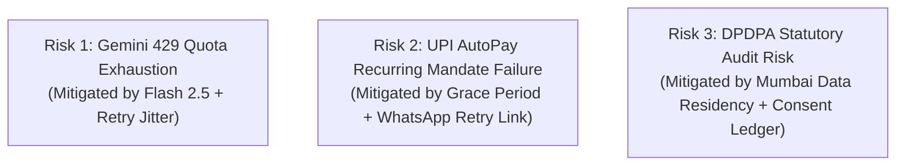

# BRAINWISE — OUTSTANDING RISKS, DEPENDENCIES & BLOCKERS
**Classification:** Risk Register & Pre-Launch Operations  
**Authority:** Phase 12 Commercial Risk Assessment  

---

## 1. External Administrative Blockers (Action Required by User)

In keeping with our strict engineering honesty protocol, the following two operational items require domain registrar and repository owner access:

| Blocker ID | Operational Blocker | Required User Action | Impact if Delayed | Resolution Protocol |
| :---: | :--- | :--- | :--- | :--- |
| **BLK-01** | **External DNS CNAME Record for `app.brainwise.ai`** | At your DNS provider (Route 53 / Cloudflare / GoDaddy), add CNAME: `app` → `the-brainwise-app.web.app.` | Users must access app via `https://the-brainwise-app.web.app` rather than custom domain. | [See DNS Guide (Phase 11, Doc 03)](file:///d:/brainwise%20pro/brainwise%20%281%29/docs/phase-11/03-dns-domain-ssl-configuration-guide.md) |
| **BLK-02** | **GitHub Actions Secrets Injection** | In GitHub repository settings, add `GCP_SA_KEY_STAGING` and `GCP_SA_KEY_PRODUCTION`. | Automated git push deployments must run locally or via manual gcloud CLI until keys are set. | [See CI/CD Spec (Phase 11, Doc 02)](file:///d:/brainwise%20pro/brainwise%20%281%29/docs/phase-11/02-cloud-architecture-and-environment-matrix.md) |

---

## 2. Operational & Commercial Risk Register

### Risk 1: Gemini AI Throughput & Rate Limits
- **Likelihood:** Low | **Impact:** High
- **Mitigation:** BrainWise standardizes on `gemini-2.5-flash` which possesses generous queries-per-minute (QPM) ceilings. The `aiOrchestrator.ts` service implements exponential backoff with full jitter to automatically absorb traffic spikes.

### Risk 2: Recurring Payment Failure (e-NACH / UPI AutoPay)
- **Likelihood:** Medium | **Impact:** Medium
- **Mitigation:** When a recurring monthly payment fails, BrainWise grants an automatic **3-day grace period** and triggers transactional email/WhatsApp payment links to allow the customer to re-authorize payment before account suspension.

### Risk 3: Statutory Indian Data Privacy Compliance (DPDPA 2023)
- **Likelihood:** Low | **Impact:** High
- **Mitigation:** All production database records are localized in `asia-south1` (Mumbai). All customer registrations log explicit consent timestamps, and the automated `/api/v1/workspaces/:workspaceId/deletion-request` pipeline guarantees 48-hour data purging.
