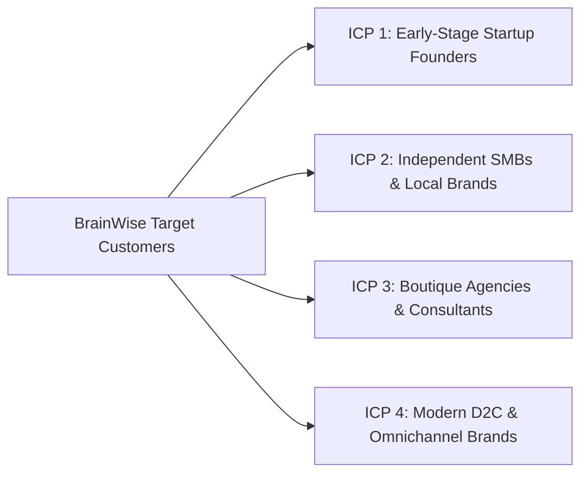

# BrainWise Phase 2 — 01: Product Overview & Strategic Foundation

**Document ID:** `docs/phase-2/01-product-overview.md`  
**Version:** `2.0.0`  
**Date:** November 19, 2026  
**Auditor:** Chief Product Officer (CPO) & Senior SaaS Product Manager  
**Status:** APPROVED & BINDING  

---

## 1. Product Vision & Mission

### 1.1 Vision
To become the definitive **AI Business Intelligence & Growth Partner** for growing enterprises, replacing fragmented marketing agencies, disjointed AI point tools, and scattered spreadsheets with an integrated, persistent strategic brain that understands the company as deeply as its founders.

### 1.2 Mission
Empower founders, entrepreneurs, and marketing operators to make disciplined, evidence-based marketing decisions, maintain a distinctive brand identity, conduct rigorous competitor surveillance, and execute multi-channel growth campaigns—without requiring dedicated agency retainers or specialized design teams.

### 1.3 Core Product Thesis: An Intelligent Partner, Not a Content Vending Machine
The market is saturated with generic "AI copywriters" and template websites that generate superficial, repetitive marketing text. BrainWise is architecturally differentiated by its **persistent Business Brain**:
- It maintains long-term company memory, ground-truth pricing, verified customer personas, and strategic constraints.
- Every generation across all 14 departments references this single source of truth.
- It employs a **Deterministic Truth Engine** and **Anti-Fatigue Memory** to prevent hallucinations and stale marketing repetition.

---

## 2. Target Customer Profiles (Ideal Customer Personas)



### ICP 1: Early-Stage Startup Founders & Solo Entrepreneurs
- **Company Stage:** Pre-seed to Series A (1–10 employees).
- **Core Pain Point:** Limited capital for full-time marketing hires or agency retainers ($3,000–$10,000/mo). Need to validate business models, size addressable markets (TAM/SAM/SOM), and articulate brand positioning.
- **BrainWise Value:** Rapid market validation dossiers, pitch deck brand guidelines, and 30/60/90-day growth roadmaps grounded in real unit economics.

### ICP 2: Independent SMBs & Modern Local Businesses
- **Company Stage:** Active operational businesses (e.g. specialty coffee roasteries, clinics, boutique fitness, design studios, professional services).
- **Core Pain Point:** "I know I need to market consistently, but I run out of time and don't know what angles actually convert."
- **BrainWise Value:** Automated social carousels, promotional posters, brand stationery, and competitor pricing surveillance.

### ICP 3: Boutique Marketing Agencies & Freelance Strategists
- **Company Stage:** 1–15 team members managing 5–30 client accounts.
- **Core Pain Point:** Time-consuming manual competitor research, repetitive brand deck creation, and reporting overhead.
- **BrainWise Value:** Multi-tenant workspaces, white-label executive export reports, and automated competitor gap matrices.

### ICP 4: D2C & Omnichannel Retail Brands
- **Company Stage:** $10k–$200k monthly GMV.
- **Core Pain Point:** Ad fatigue, rising CAC across Meta/Google, and maintaining visual consistency across packaging, print collateral, and social media.
- **BrainWise Value:** Anti-fatigue angle tracking, print-ready collateral generation, and promotional calendar orchestration.

---

## 3. Strict Product Boundary: Absolute Video Exclusion

> [!CAUTION]
> ### MANDATORY PRODUCT RESTRICTION — STRICTLY NO VIDEO CONTENT
> 
> In accordance with the executive mandate, **BrainWise explicitly excludes all video capabilities**.
> 
> **The following are strictly banned across all PRD specifications, technical architectures, database schemas, APIs, AI registries, and credit models:**
> 1. **NO AI video generation** (text-to-video, image-to-video, speech-to-video).
> 2. **NO AI Reel or TikTok video generation.**
> 3. **NO video editing, rendering, or composition pipelines.**
> 4. **NO Remotion, FFmpeg video workers, or headless Chromium video renderers.**
> 5. **NO self-hosted or third-party video models** (Wan 2.2, LTX-Video, Runway, Pika, Kling, Sora, Google Veo).
> 6. **NO video-related credit tiers or background video queues.**
> 
> **BrainWise is exclusively dedicated to:**
> - Business intelligence, market research, and competitor analysis.
> - Brand identity, vector typography, and static visual collateral (posters, flyers, cards, packaging).
> - Written content, social media carousels, captions, and ad copy.
> - Marketing strategy, calendar orchestration, and analytics reporting.

---

## 4. The 14-Department Product Structure

The BrainWise platform is organized into 14 distinct, interconnected departments:

```
┌────────────────────────────────────────────────────────────────────────┐
│                        BRAINWISE ECOSYSTEM                             │
├────────────────────────────────┬───────────────────────────────────────┤
│ 1. Identity & Workspaces       │ 8. Competitor Intelligence            │
│ 2. Intelligent Onboarding      │ 9. Market Research & Trends           │
│ 3. Persistent Business Brain   │ 10. AI Marketing Advisor              │
│ 4. AI Brand Studio             │ 11. Marketing Calendar & Tasks        │
│ 5. Marketing Strategy & Plans  │ 12. Analytics & Reporting             │
│ 6. AI Content Studio (Static)  │ 13. Subscription, Credits & Billing   │
│ 7. Social Media Management     │ 14. Administration & Platform Ops     │
└────────────────────────────────┴───────────────────────────────────────┘
```

1. **Department 1: User Account & Workspace Management**  
   Multi-tenant organization management, authentication, role-based access control (Owner, Admin, Member, Viewer), and session security.
2. **Department 2: Business Onboarding**  
   Intelligent multi-step onboarding wizard with document upload extraction, minimizing form fatigue.
3. **Department 3: Business Brain**  
   The authoritative persistent knowledge store. Tracks verified products, pricing, ICPs, brand positioning, and provenance (`USER_CONFIRMED`, `AI_INFERRED`, `DERIVED_FROM_DOC`).
4. **Department 4: AI Brand Studio**  
   Creates and manages static visual identities: logo concepts, color palettes, typography scales, brand voice, visiting cards, flyers, posters, and product packaging.
5. **Department 5: Marketing Strategy and Planning**  
   Comprehensive marketing audits, positioning strategies, channel recommendations, and 30/60/90-day execution roadmaps.
6. **Department 6: AI Content Studio (Static & Written)**  
   Generates static multi-slide carousels, Instagram posts, LinkedIn articles, ad copy packs, and seasonal promotional announcements.
7. **Department 7: Social Media Management**  
   OAuth account connections (Instagram, Facebook, LinkedIn, X), scheduled post queues, direct API publishing, and status webhooks.
8. **Department 8: Competitor Intelligence**  
   Tracks competitor websites, pricing matrices, positioning maps, and public marketing moves without unauthorized scraping.
9. **Department 9: Market Research and Trend Intelligence**  
   Industry research reports, TAM/SAM/SOM market sizing, consumer sentiment signals, and seasonal trend calendars.
10. **Department 10: AI Marketing Advisor**  
    Proactive executive strategic advisor providing prioritized daily actions, conversion optimization tips, and counter-moves.
11. **Department 11: Marketing Calendar and Task Management**  
    Interactive calendar uniting scheduled campaigns, content drafts, approval workflows, and sprint tasks.
12. **Department 12: Analytics and Reporting**  
    Consolidates social publishing metrics, revenue funnels (MRR, CAC, LTV), cohort retention, and print-ready executive PDF reports.
13. **Department 13: Subscription, Credits and Billing**  
    Server-side transactional credit wallet, plan tiers, Cashfree/Stripe checkout, webhooks, and GST tax invoicing.
14. **Department 14: Administration and Platform Operations**  
    Super-admin portal for user management, credit overrides, token consumption monitoring, provider latency tracking, and SRE audit logs.
