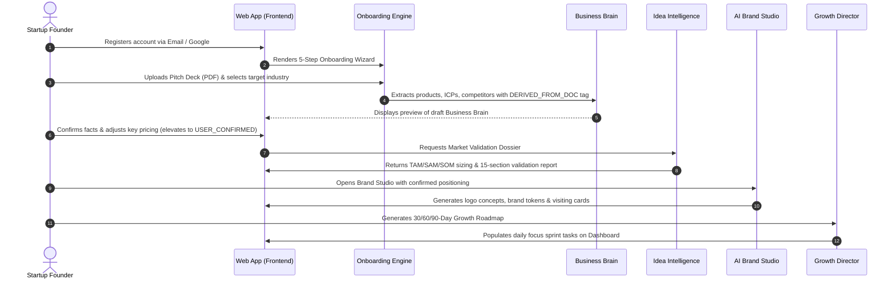
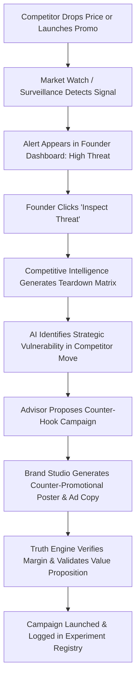

# BrainWise Phase 2 — 03: User Journeys & Cross-Department Workflows

**Document ID:** `docs/phase-2/03-user-journeys-and-workflows.md`  
**Version:** `2.0.0`  
**Date:** November 19, 2026  
**Auditor:** Senior SaaS Product Manager & Lead UX Architect  
**Status:** APPROVED & BINDING  

---

## 1. Executive Summary

This document details the primary, role-based user journeys and cross-department workflows within BrainWise. It traces how information originates in the **Business Brain**, flows through intelligence, strategy, and creative execution, and culminates in measurable marketing performance.

**Mandatory Rule:** In accordance with product restrictions, all workflows operate exclusively on written copy, brand identity, static collateral, and marketing strategy. No video workflows exist.

---

## 2. Core User Journey 1: The New Founder Launch Journey



### Detailed Steps:
1. **Registration & Welcome:** Founder signs up with email/password or Google SSO; receives 6-digit code or instant verified token.
2. **Document Ingestion:** Founder drops their pitch deck or business plan PDF into the onboarding dropzone.
3. **Structured Extraction:** Gemini 2.5 Flash parses company identity, products, pricing models, and competitors in <3 seconds.
4. **Founder Confirmation:** The founder reviews extracted facts on a single ceramic review screen, confirming accuracy with 1 click.
5. **Dossier & Brand Synthesis:** BrainWise automatically generates the initial Market Validation Dossier and locks the Brand Studio color palette and typography ladder.
6. **Executive Dashboard Activation:** The founder lands on the Executive Dashboard with prioritized Day 1–30 growth sprints ready to execute.

---

## 3. Core User Journey 2: The Weekly Founder Marketing Sprint

```mermaid
sequenceDiagram
    autonumber
    actor Founder as Business Owner
    participant Dash as Executive Dashboard
    participant Adv as AI Marketing Advisor
    participant Content as AI Content Studio
    participant Truth as Truth Engine
    participant Social as Social Publishing Worker
    participant Cal as Marketing Calendar

    Founder->>Dash: Logs in for weekly Monday sprint review
    Dash->>Adv: Retrieves active prioritized recommendations
    Adv-->>Dash: Displays: "Promote 3-pack tasting kit; competitors lack trial tiers"
    Founder->>Dash: Clicks "Execute Now"
    Dash->>Content: Opens Social Studio with pre-filled prompt & Brain context
    Content->>Truth: Generates 5-slide carousel & verifies pricing ($18–$26/mo)
    Truth-->>Content: Passes truth check (100% Grounded Score)
    Content-->>Founder: Displays carousel preview, ready-to-post caption & hashtags
    Founder->>Social: Schedules for Thursday 10:00 AM on Instagram
    Social->>Cal: Adds scheduled post badge to Marketing Calendar
    Social-->>Founder: Confirms queue status (Cloud Task scheduled)
```

### Detailed Steps:
1. **Monday Morning Review:** Founder views their 3 prioritized strategic recommendations on the Dashboard.
2. **1-Click Execution:** Clicking "Execute Now" transfers context seamlessly to the Content Studio without retyping prompts.
3. **Automated Truth Guard:** The Deterministic Truth Engine scans generated copy against confirmed pricing in the Business Brain, preventing fabricated claims.
4. **Multi-Channel Scheduling:** Founder selects Thursday 10:00 AM; Cloud Tasks enqueues the job to publish directly to Instagram and LinkedIn.
5. **Unified Visibility:** The Marketing Calendar immediately reflects the scheduled creative alongside weekly tasks.

---

## 4. Core User Journey 3: The Competitor Defense Journey



### Detailed Steps:
1. **Signal Detection:** Market Watch records a competitor marketing shift (e.g. competitor introduces deep discount).
2. **Threat Assessment:** Dashboard flags the move with a categorized threat level (`High`, `Medium`, `Low`).
3. **Vulnerability Analysis:** Competitive Intelligence audits the competitor's unit economics and identifies their weakness (e.g. slow delivery, rigid multi-month commitments).
4. **Counter-Hook Synthesis:** Brand Studio formulates a counter-promotional campaign emphasizing the founder's verified advantage (e.g. 48-hour roast freshness).
5. **Experiment Tracking:** The counter-move is automatically logged as a hypothesis test in the `growthExperiments` ledger to measure customer acquisition impact.

---

## 5. Cross-Department Data Flow Matrix

| Source Department | Emitted Data / Event | Consuming Departments | How Context is Utilized |
|---|---|---|---|
| **Business Brain** | Product pricing, value prop, ICPs, exclusions | All Departments (4, 5, 6, 8, 9, 10, 12) | Forms mandatory grounding context for all prompts and truth verification passes. |
| **Idea Intelligence** | Market sizing, customer pain points, research dossier | Brand Studio, Growth Director, Analytics | Seeds target audience messaging and sets benchmark TAM/SAM/SOM goals. |
| **Competitor Intelligence** | Competitor price bands, positioning coordinates, gaps | Marketing Advisor, Brand Studio, Content Studio | Generates differentiation hooks and counter-campaign angles. |
| **AI Content Studio** | Creative assets, captions, hashtags | Social Media Management, Marketing Calendar | Supplies approved static assets to scheduling queue and calendar. |
| **Social Media Management**| Published post URLs, publishing timestamps | Analytics & Reporting, Marketing Calendar | Feeds live distribution data into marketing performance dashboards. |
| **Growth Director** | Sprint tasks, roadmap milestones, experiment results | Executive Dashboard, Marketing Advisor | Informs daily focus checklists and updates anti-fatigue memory. |

---

## 6. Critical Edge Cases & Failure Recovery Workflows

### Edge Case 1: Credit Exhaustion Mid-Workflow
- **Scenario:** A founder initiates a 7-slide carousel generation but holds only 2 credits (4 required).
- **System Behaviour:**
  1. Frontend intercepts request before submission; displays friendly modal: *"This generation requires 4 credits. Your current balance is 2 credits."*
  2. Offers 1-click credit top-up pack ($15 for 100 credits) or upgrade to Growth Pro.
  3. No partial job is created; no provider costs are incurred.

### Edge Case 2: Social Media OAuth Token Revocation / Expiry
- **Scenario:** A founder schedules an Instagram post for Friday, but their Facebook account password changed on Wednesday, revoking the OAuth token.
- **System Behaviour:**
  1. The pre-publish validation worker detects the expired token 2 hours prior to scheduled execution.
  2. Dispatches high-priority in-app notification and email alert: *"Action required: Reconnect your Instagram account to ensure Friday's scheduled post publishes."*
  3. Status in Marketing Calendar switches to `Needs Re-auth` (amber) with direct 1-click reconnect button.
  4. If unreconnected at execution time, post transitions to `Failed: Token Expired` rather than silent disappearance.

### Edge Case 3: Contradictory Founder Facts in Business Brain
- **Scenario:** Founder manually edits a product price to `$29`, but an uploaded pitch deck states `$19`.
- **System Behaviour:**
  1. The `conflictResolver.ts` module detects the discrepancy between `USER_CONFIRMED` and `DERIVED_FROM_DOC`.
  2. **Strict Authority Hierarchy:** `USER_CONFIRMED` explicitly overrides all document derivations and AI inferences.
  3. Truth Check immediately switches ground truth to `$29`; all downstream prompts and truth checks enforce `$29`.
