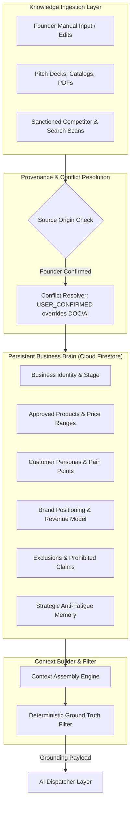
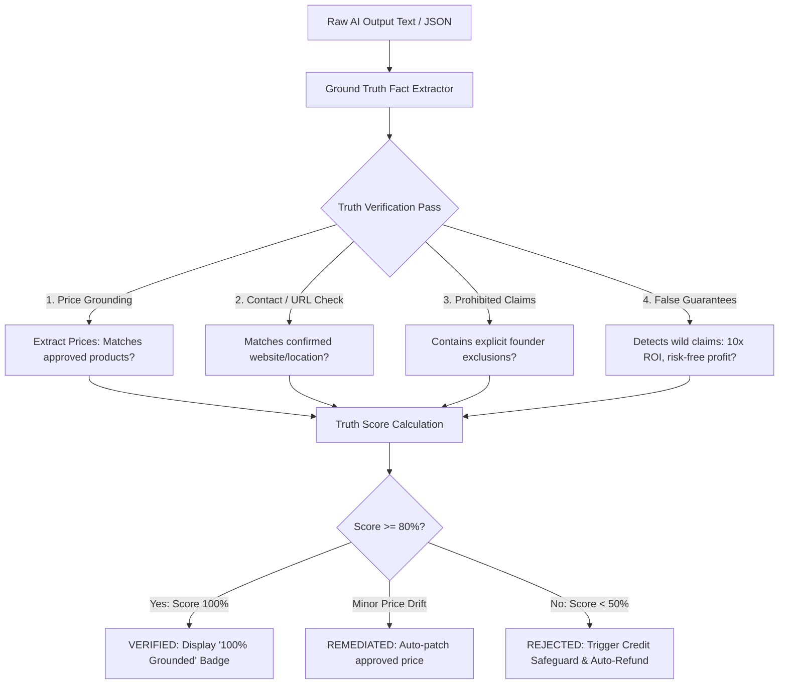

# BrainWise Phase 2 — 05: AI Orchestration & Business Brain Architecture

**Document ID:** `docs/phase-2/05-ai-orchestration-and-business-brain.md`  
**Version:** `2.0.0`  
**Date:** November 19, 2026  
**Auditor:** AI Systems Architect & Lead Software Engineer  
**Status:** APPROVED & BINDING  

---

## 1. Executive Summary

This specification defines the core intelligence layer of BrainWise: the **persistent Business Brain**, the **centralized AI Orchestrator**, the **Deterministic Truth Engine**, and the **Anti-Fatigue Memory Engine**.

Unlike generic wrappers that dump unvetted context into monolithic LLM prompts, BrainWise implements a deterministic, multi-stage pipeline that guarantees fact provenance, eliminates hallucinations, prevents marketing angle fatigue, and routes requests to the most cost-effective model.

**Explicit Scope Mandate:** All AI video generation, video models, and video pipelines are strictly excluded.

---

## 2. Business Brain Technical Specification



### 2.1 The Fact Provenance Contract
Every piece of factual data in the Business Brain is tagged with an immutable provenance record:

```typescript
export type ProvenanceSource = 
  | 'USER_CONFIRMED'     // Highest authority: explicitly confirmed by founder
  | 'DERIVED_FROM_DOC'   // High confidence: extracted from verified uploaded PDF/Doc
  | 'AI_INFERRED'        // Moderate: proposed by AI, awaiting founder confirmation
  | 'SYSTEM_DEFAULT';    // Baseline placeholder

export interface FactProvenanceItem {
  fieldKey: string;
  source: ProvenanceSource;
  confidence: number;     // 0.0 to 1.0
  verifiedAt?: string;
  lastConfirmedBy?: string;
  notes?: string;
}
```

### 2.2 Authority & Conflict Resolution Hierarchy
When facts from different sources conflict (e.g. an uploaded deck states price is `$19` but the founder enters `$29`):
1. **Rule 1 (Absolute Founder Primacy):** `USER_CONFIRMED` facts strictly overwrite any `DERIVED_FROM_DOC` or `AI_INFERRED` facts.
2. **Rule 2 (No Unconfirmed Hallucinations):** Unconfirmed AI guesses can never overwrite document-derived or user-confirmed data.
3. **Rule 3 (Strict Grounding):** Downstream generation prompts only treat `USER_CONFIRMED` and `DERIVED_FROM_DOC` as authoritative truth.

### 2.3 Evaluation of Vector Search / Embeddings
> **Architectural Decision:** BrainWise **DOES NOT** require a separate vector database (e.g. Pinecone, Weaviate, or Milvus).
>
> **Rationale:** 
> 1. With Gemini 2.5's **1,000,000+ token context window**, an entire company's profile, product catalog, customer personas, competitor teardowns, and recent campaign history can be passed in under 15,000 tokens (<1.5% of capacity).
> 2. Structured Firestore queries retrieve exact documents in <25ms at zero additional infrastructure cost.
> 3. Eliminating vector infrastructure saves ~$70–$200/month per tenant in database hosting and vector indexing overhead, while eliminating semantic search retrieval errors.

---

## 3. Centralized AI Service Layer & Model Registry

```
┌────────────────────────────────────────────────────────────────────────┐
│                        CENTRALIZED AI DISPATCHER                       │
├────────────────────────────────────────────────────────────────────────┤
│  1. Auth & Workspace Check    │  5. Context Assembly & Anti-Fatigue    │
│  2. Credit Reservation        │  6. Provider Execution with Timeout    │
│  3. Model Capability Routing  │  7. Deterministic Truth Check Pass     │
│  4. Prompt Template Hydration │  8. Atomic Credit Settlement & Output  │
└────────────────────────────────────────────────────────────────────────┘
```

### 3.1 Model Registry & Capability Routing

| Capability Tier | Primary Model | Backup Model | Intended Workloads | Unit Pricing (Input / Output) |
|---|---|---|---|---|
| **Fast Structured Text & SVG** | **Google Gemini 2.5 Flash** | Gemini 1.5 Flash | Social carousels, SVG collateral, ad copy, document extraction, advisor tips | $0.075 / $0.30 per 1M tokens |
| **Deep Reasoning & Strategy** | **Google Gemini 2.5 Pro** | Gemini 1.5 Pro | TAM/SAM/SOM market sizing, 90-day roadmaps, deep competitor teardowns | $1.25 / $5.00 per 1M tokens |
| **Static Visual Textures** | **Google Imagen 3** | Fallback CSS SVG | High-resolution static editorial textures, packaging backgrounds | $0.030 per image |
| **Video Production** | **NONE (EXCLUDED)** | **NONE** | **STRICTLY EXCLUDED BY PRODUCT RESTRICTION** | **$0.00 (EXCLUDED)** |

---

## 4. Deterministic Truth Engine (`truthCheck.ts`)

To eliminate AI hallucinations in production, all generated deliverables must pass through the **Deterministic Truth Engine** before credit deduction and user display.



### 4.1 Verification Modules:
1. **Price Grounding:** Extracts numeric price mentions (e.g. `$19`, `₹1,499`) using regex. Compares against confirmed products in `businessBrain.products`.
2. **Exclusion Enforcement:** Tests copy against founder-defined prohibited claims (e.g. "Never claim 100% organic", "Do not mention deep discounts").
3. **Remediation & Safeguard:** Minor price drift is auto-patched with the verified price. Critical claim violations reject the output and trigger an immediate **zero-waste credit refund** with an audit notice.

---

## 5. Anti-Fatigue Strategic Memory (`strategicMemory.ts`)

### 5.1 The Marketing Saturation Problem
Generic AI marketing tools repeat the same 2–3 taglines and angles over and over (e.g. repeatedly claiming "Convenient & affordable").

### 5.2 Anti-Fatigue Engine Architecture:
1. **Ledger:** Every creative generated logs its strategic angle, theme, and timestamp into `strategicMemory.usedAngles`.
2. **Fatigue Thresholding:** When a theme reaches **3 uses** within 30 days, it is flagged as `fatiguedThemes`.
3. **Dynamic Prompt Injection:**
   The AI Orchestrator injects strict negative constraints into all generation calls:
   ```text
   ANTI-FATIGUE WARNING: The following themes have high saturation and must NOT be repeated:
   • "Freshness & Quality" (Used 3x)
   Explore fresh, novel strategic angles such as "Brewing Ritual" or "Origin Traceability".
   ```
4. **Cooldown Decay:** After 30 days without usage, themes automatically cool down and re-enter the eligible rotation.
