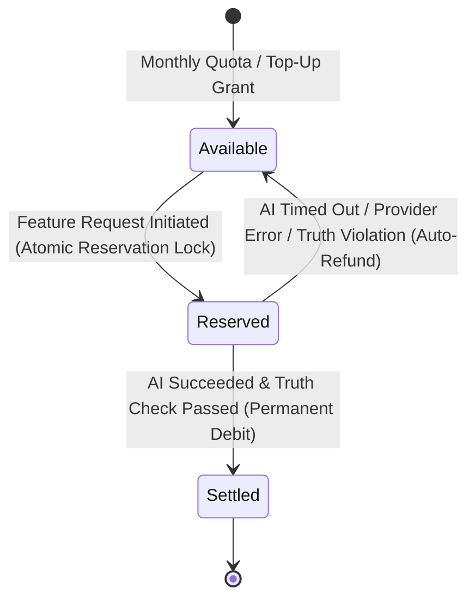
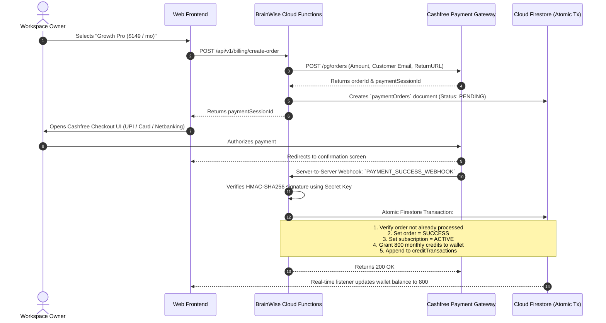

# BrainWise Phase 2 — 08: Credit Management & Payment Architecture

**Document ID:** `docs/phase-2/08-credit-and-billing-architecture.md`  
**Version:** `2.0.0`  
**Date:** November 19, 2026  
**Auditor:** FinOps Architect, Backend Architect, & Security Engineer  
**Status:** APPROVED & BINDING  

---

## 1. Architectural Philosophy: Financial Integrity

The credit wallet and billing subsystem is designed as an **immutable, double-entry financial ledger**. 

### Core Architectural Rules:
1. **Never Trust the Client:** Credit balances are never calculated, verified, or debited by browser code. Every generation requires an atomic server-side reservation before the AI provider is called.
2. **Strict Zero-Waste Policy:** If an AI upstream request fails, times out, or fails the Deterministic Truth Check, reserved credits are **automatically refunded** to the tenant's wallet with zero manual customer support required.
3. **Webhook Verification Over Browser Redirects:** Subscription activations and credit allocations occur exclusively through cryptographically verified server-to-server payment webhooks.
4. **Zero Video Credits:** No video models, rendering workers, or video credit tiers exist in the credit matrix.

---

## 2. Server-Side Credit Lifecycle & State Machine

### 2.1 The Two-Phase Reservation Protocol
1. **Phase 1: Atomic Reservation (`holdCredits`)**
   - Executed inside a Cloud Firestore transaction.
   - Checks: `wallet.balance - wallet.reserved >= requiredCredits`.
   - Increments `wallet.reserved` by `requiredCredits`.
   - Creates a pending record in `creditReservations` with a 120-second timeout lock and idempotency key.
2. **Phase 2A: Successful Settlement (`commitCredits`)**
   - Executed after generation succeeds and passes `truthCheck`.
   - Decrements `wallet.balance` and `wallet.reserved` by `requiredCredits`.
   - Appends an immutable record to `creditTransactions` ledger.
   - Deletes the temporary reservation lock.
3. **Phase 2B: Automatic Rollback (`refundCredits`)**
   - Triggered automatically if Gemini times out, returns malformed JSON, or generates ungrounded pricing violations.
   - Decrements `wallet.reserved` back to 0. Balance remains untouched.
   - Appends an audit note to `creditTransactions` (`REFUND_SAFEGUARD`).

---

## 3. The BrainWise Credit Matrix & Unit Economics

| Feature / Operation | Feature ID | AI Model / Provider | Typical Input / Output Tokens | Estimated Provider Cost | Proposed Credit Charge | Realized Gross Margin |
|---|---|---|---|---|---|---|
| **Social Carousel (5 Slides)** | `FEAT-CNT-001` | Gemini 2.5 Flash | 2,500 in / 1,800 out | $0.0007 | **4 Credits** ($0.04) | **98.2%** |
| **Single Slide Remix** | `FEAT-CNT-001` | Gemini 2.5 Flash | 1,800 in / 400 out | $0.0003 | **1 Credit** ($0.01) | **97.0%** |
| **Brand Collateral (SVG)** | `FEAT-BRD-001` | Gemini 2.5 Flash + SVG | 2,000 in / 2,200 out | $0.0008 | **5 Credits** ($0.05) | **98.4%** |
| **Competitor Teardown** | `FEAT-CMP-001` | Tavily Search + Gemini Flash | 1 Search + 3k tokens | $0.0056 | **3 Credits** ($0.03) | **81.3%** |
| **Market Dossier (TAM/SAM/SOM)**| `FEAT-RES-001` | Gemini 2.5 Pro | 4,000 in / 2,800 out | $0.0190 | **8 Credits** ($0.08) | **76.2%** |
| **90-Day Growth Roadmap** | `FEAT-STR-001` | Gemini 2.5 Pro | 4,500 in / 3,000 out | $0.0206 | **10 Credits** ($0.10) | **79.4%** |
| **Executive Performance Memo**| `FEAT-ANL-001` | Gemini 2.5 Flash | 1,500 in / 1,000 out | $0.0004 | **2 Credits** ($0.02) | **98.0%** |
| **Document Ingestion (Onboarding)**| `FEAT-ONB-001`| Gemini 2.5 Flash | 8,000 in / 1,200 out | $0.0010 | **0 Credits** (Subsidized) | N/A (CAC) |
| **Task / Calendar Management** | `FEAT-CAL-001` | None (Software CRUD) | N/A | $0.0000 | **0 Credits** | 100% |

---

## 4. Payment Gateway Integration Architecture (Cashfree & Stripe)

### 4.1 Cashfree Webhook Security Specification
1. **Signature Header:** `x-webhook-signature` containing base64 HMAC-SHA256 hash.
2. **Verification Payload:** Constructed from `timestamp + rawBody`.
3. **Secret Storage:** Managed strictly via Google Cloud Secret Manager (`CASHFREE_CLIENT_SECRET`).
4. **Idempotency Guard:** Every payment order is processed inside an atomic transaction that checks if `paymentOrders[orderId].status === 'SUCCESS'`. Duplicate webhooks return `200 OK` immediately without double-crediting.

### 4.2 Automated GST Tax Invoicing
For Indian business compliance:
- Every successful payment triggers automated generation of an official GST-compliant tax invoice PDF.
- Calculates 18% IGST (inter-state) or 9% CGST + 9% SGST (intra-state) based on customer state.
- Stored permanently in `gs://[bucket]/workspaces/:id/invoices/` and emailed to the account owner.
