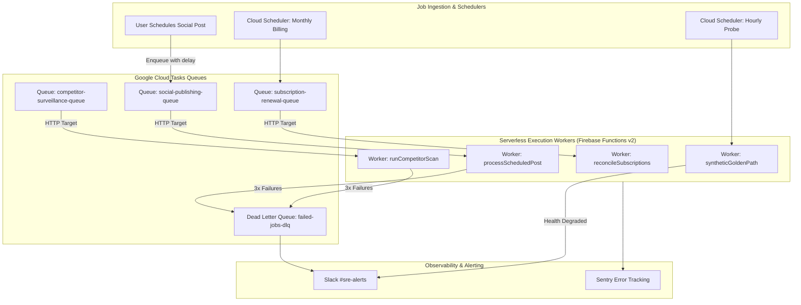

# BrainWise Phase 2 — 10: Background Jobs & Observability Architecture

**Document ID:** `docs/phase-2/10-background-jobs-and-monitoring.md`  
**Version:** `2.0.0`  
**Date:** November 19, 2026  
**Auditor:** Principal SRE & Cloud Infrastructure Architect  
**Status:** APPROVED & BINDING  

---

## 1. Executive Summary

This specification defines the asynchronous job execution engine, cron scheduling, and end-to-end observability architecture for BrainWise.

By utilizing **Google Cloud Tasks** for point-in-time deferred jobs and **Google Cloud Scheduler** for recurring maintenance, BrainWise avoids maintaining expensive persistent worker servers while guaranteeing 99.9% publishing accuracy, zero missed renewals, and real-time failure alerting.

---

## 2. Synchronous vs Asynchronous Operational Boundaries

| Operation | Execution Model | Execution Service | SLA / Timeout |
|---|---|---|---|
| **Fact CRUD & Provenance Confirmation** | Synchronous | Cloud Functions (Express) | <150ms |
| **Social Carousel & Post Generation** | Synchronous | Cloud Functions + Gemini Flash | <3.0s |
| **Market Validation Dossier Synthesis** | Synchronous | Cloud Functions + Gemini Pro | <4.5s |
| **Onboarding Pitch Deck Extraction** | Synchronous (Streamed) | Cloud Functions + Gemini Flash | <4.0s |
| **Scheduled Social Media Publishing** | **Asynchronous** | **Cloud Tasks $\to$ Cloud Function** | Scheduled Time $\pm 45$s |
| **Weekly Competitor Website Surveillance**| **Asynchronous** | **Cloud Tasks $\to$ Tavily Worker** | <60s per tenant |
| **Monthly Subscription Quota Renewal** | **Asynchronous** | **Cloud Scheduler $\to$ Billing Function** | Executed 00:00 UTC |
| **SRE Synthetic Golden Path Probe** | **Asynchronous** | **Cloud Scheduler $\to$ Probe Function** | Executed every 1 hour |

---

## 3. Background Job Architecture: Cloud Tasks & Cloud Scheduler



---

## 4. Recurring Cron Jobs Register

### 4.1 Monthly Subscription Quota Renewal (`renewCreditQuotas`)
- **Schedule:** `0 0 * * *` (Daily at midnight UTC).
- **Function:** Queries `subscriptions` where `status === 'active'` and `currentPeriodEnd <= now()`.
- **Action:** Grants fresh monthly credit quota (e.g. 800 credits for Growth Pro) to `creditWallet` and creates an audit transaction.

### 4.2 Stale Credit Reservation Sweeper (`reconcileStaleReservations`)
- **Schedule:** `*/10 * * * *` (Every 10 minutes).
- **Function:** Scans `creditReservations` where `createdAt < now() - 120s`.
- **Action:** If an AI request crashed without settling or refunding, this safety sweeper automatically unlocks the reserved credits and logs an automatic recovery.

### 4.3 SRE Synthetic Golden Path Probe (`syntheticGoldenPathJob`)
- **Schedule:** `0 * * * *` (Every hour on the hour).
- **Function:** Executes a complete synthetic end-to-end test run using a dedicated sandbox workspace:
  1. Hydrates mock Business Brain.
  2. Generates a 3-slide social carousel via Gemini 2.5 Flash.
  3. Executes Deterministic Truth Check.
  4. Asserts 100% schema compliance and latency <4,000ms.
- **Alerting:** If the probe fails, an immediate P1 alert is dispatched to Slack `#sre-alerts` and PagerDuty before real users experience degraded performance.

---

## 5. Observability, Logging & Alerting

### 5.1 Structured Logging Standards
All Cloud Functions log in JSON format compatible with Google Cloud Logging:
```json
{
  "severity": "INFO",
  "component": "AiOrchestrationService",
  "workspaceId": "ws_12345",
  "featureId": "FEAT-CNT-001",
  "model": "gemini-2.5-flash",
  "inputTokens": 2420,
  "outputTokens": 1840,
  "costUsd": 0.00073,
  "latencyMs": 1820,
  "truthScore": 100,
  "status": "SUCCESS"
}
```

### 5.2 Alerting Thresholds
1. **Critical P1 (Immediate PagerDuty / Call):**
   - Error rate on `/api/v1/*` exceeds 5% for >5 minutes.
   - Synthetic Golden Path probe fails 2 consecutive runs.
   - Cashfree webhook failure rate exceeds 1%.
2. **Warning P2 (Slack `#dev-alerts`):**
   - Gemini API upstream latency P95 exceeds 8 seconds.
   - Cloud Tasks DLQ receives a failed post publishing job.
