# BrainWise Phase 2 — 12: System Architecture Diagrams & Technical Specifications

**Document ID:** `docs/phase-2/12-system-architecture-diagrams.md`  
**Version:** `2.0.0`  
**Date:** November 19, 2026  
**Auditor:** Principal Software Architect & Lead Systems Engineer  
**Status:** APPROVED & BINDING  

---

## 1. Executive Summary

This document consolidates the **12 authoritative architectural diagrams** for the BrainWise platform. Every diagram is accompanied by a technical narrative explaining components, trust boundaries, state transitions, and error recovery protocols.

**Mandatory Scope Reminder:** In accordance with product restrictions, all video components, rendering microservices, and video pipelines are strictly excluded from all architecture diagrams.

---

## 2. Diagram 1: Overall System Architecture

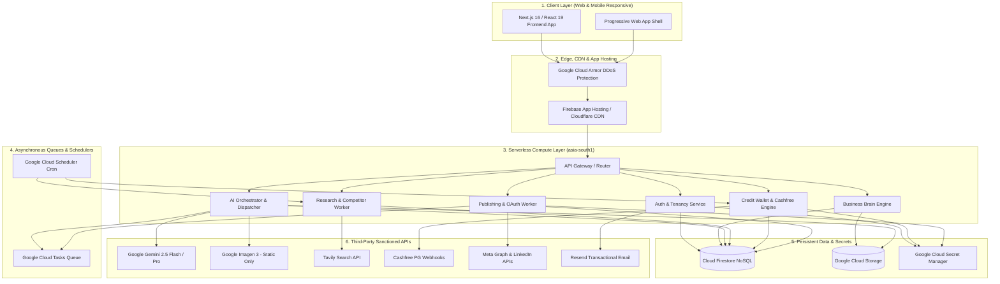

### Architectural Narrative: Diagram 1
- **Client Tier:** React 19 single-page application with modular typography, responsive across 7 breakpoints.
- **Edge Security:** Google Cloud Armor and Cloudflare provide DDoS mitigation, TLS 1.3 termination, and edge caching for static assets.
- **Serverless Compute:** Firebase Cloud Functions Gen 2 running in Mumbai (`asia-south1`) on Node 22 automatically scale from 0 to 1,000 instances.
- **Persistence:** Cloud Firestore provides logical multi-tenancy and real-time synchronization; Google Cloud Storage stores private documents and rendered static assets with signed URL protection.

---

## 3. Diagram 2: Frontend-to-Backend Communication Flow

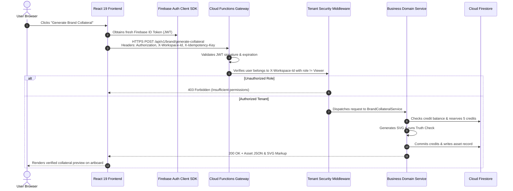

### Architectural Narrative: Diagram 2
Every user mutation is bound to an active workspace ID and cryptographically validated via Firebase Auth JWT. Role-Based Access Control is enforced server-side before any credit deduction or AI model execution occurs.

---

## 4. Diagram 3: Authentication & Workspace Authorization Flow

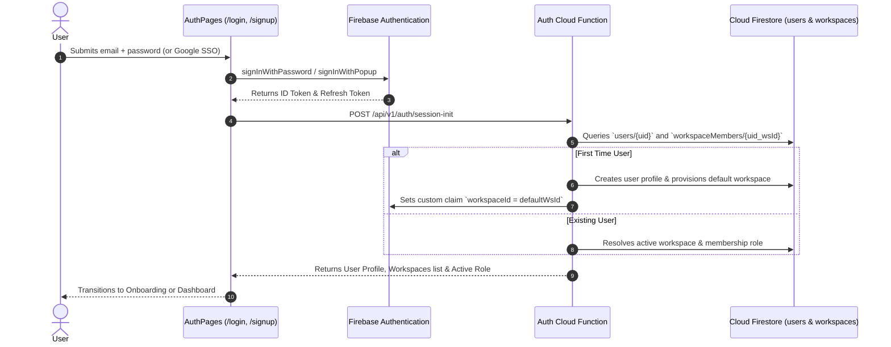

### Architectural Narrative: Diagram 3
Authentication utilizes Firebase Auth for industry-standard credential storage. Tenant scoping is achieved through Custom Claims embedded within the JWT token, ensuring that client requests cannot spoof workspace IDs.

---

## 5. Diagram 4: Business Brain Ingestion & Data Flow

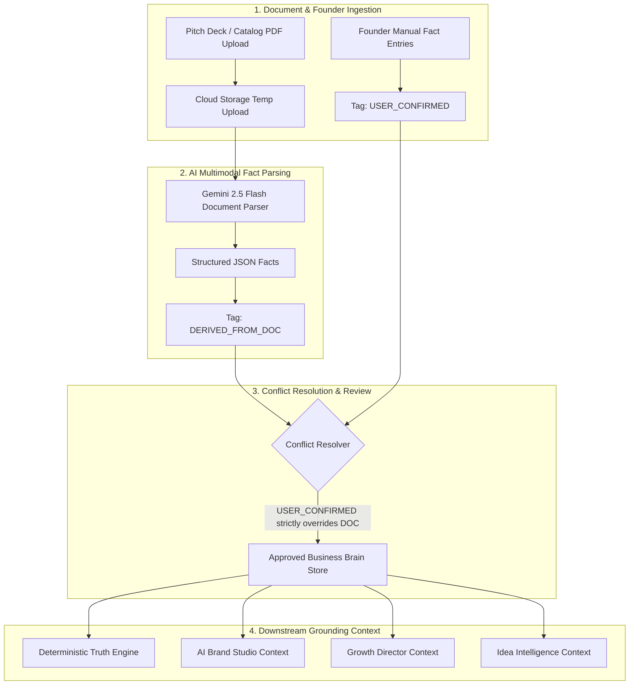

### Architectural Narrative: Diagram 4
The Business Brain maintains a strict authority hierarchy: facts confirmed directly by the founder take precedence over AI extractions from uploaded pitch decks or catalogs. All downstream generation engines retrieve their prompt context from this sanitized store.

---

## 6. Diagram 5: Centralized AI Orchestration Pipeline

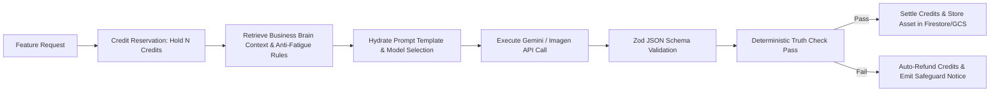

### Architectural Narrative: Diagram 5
Every AI call follows an 8-stage pipeline: credits are held in pending status before the model is called, structured output is validated via Zod schemas, and copy is verified against ground-truth facts. Credits are settled only upon verified completion.

---

## 7. Diagram 6: Competitor & Market Research Engine

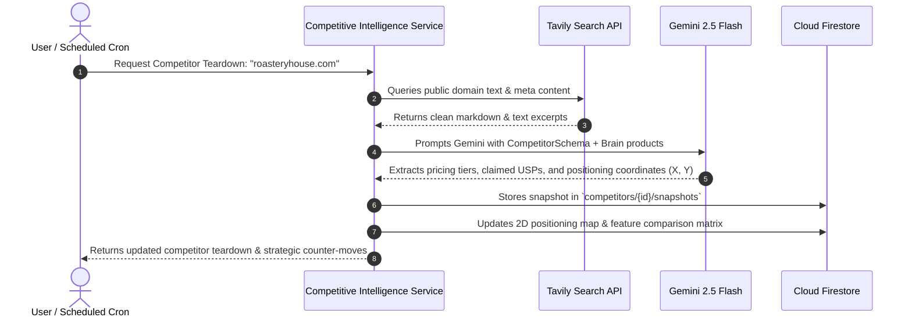

### Architectural Narrative: Diagram 6
Public competitor analysis avoids fragile scraping by utilizing the Tavily Search API for clean, legal text extraction. Gemini formats the data into structured positioning coordinates and gap analyses.

---

## 8. Diagram 7: Server-Side Credit Ledger & State Machine

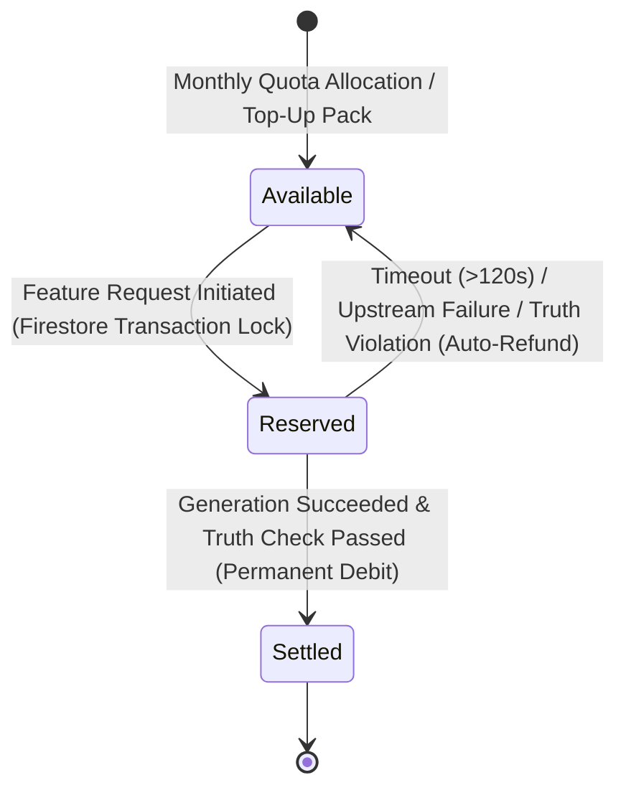

### Architectural Narrative: Diagram 7
Credit balances are managed inside atomic Firestore transactions. A two-phase commit protocol reserves credits prior to API calls and auto-refunds them immediately if errors or truth violations occur.

---

## 9. Diagram 8: Payment & Subscription Lifecycle (Cashfree & Stripe)

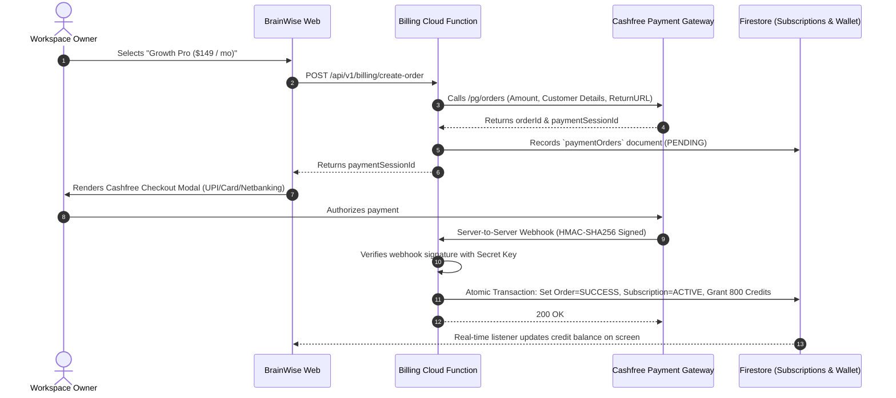

### Architectural Narrative: Diagram 8
Payment confirmation relies strictly on cryptographically verified server-to-server webhooks using HMAC-SHA256 signatures. In-browser redirects serve purely as UX transitions.

---

## 10. Diagram 9: Background Job Queue (Cloud Tasks & Schedulers)

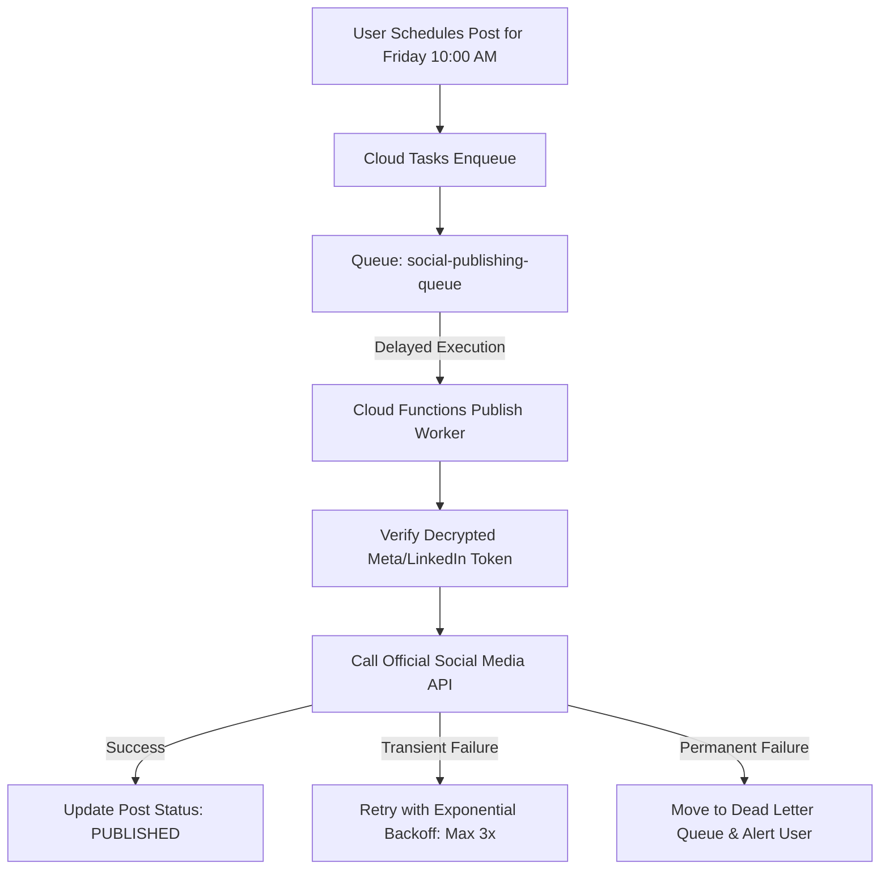

### Architectural Narrative: Diagram 9
Point-in-time scheduled social publishing and recurring competitor surveillance run on Google Cloud Tasks, guaranteeing exact-time execution without persistent background worker processes.

---

## 11. Diagram 10: Social Media Integrations & Publishing

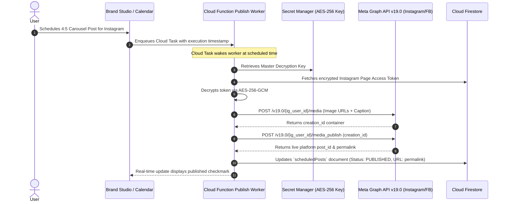

### Architectural Narrative: Diagram 10
Social integrations connect exclusively via official platform APIs (Meta Graph API v19.0 and LinkedIn Marketing API). Tokens are encrypted with AES-256-GCM and decrypted only in memory during publish execution.

---

## 12. Diagram 11: Analytics Aggregation & Reporting Engine

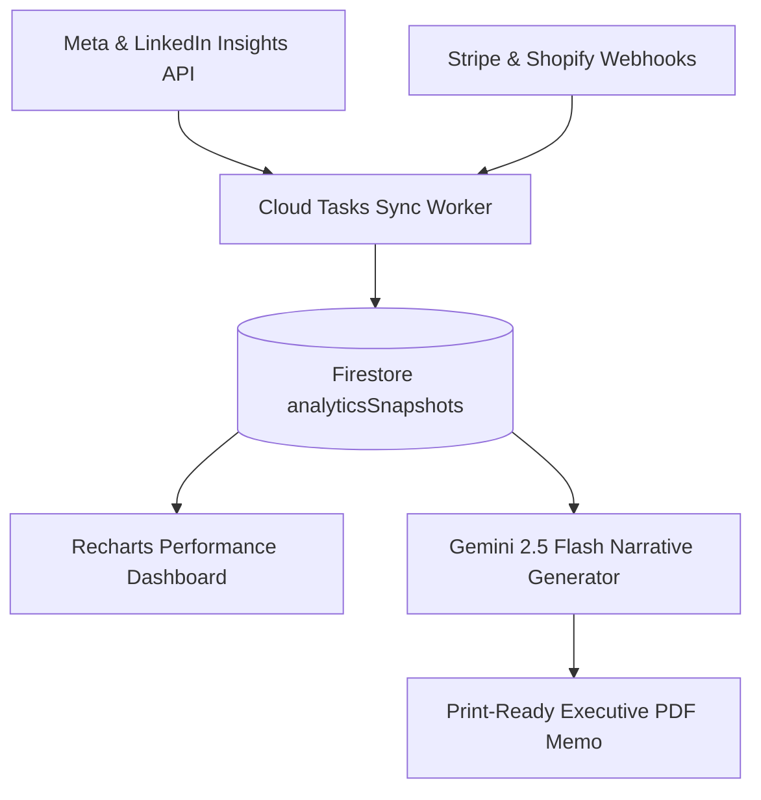

### Architectural Narrative: Diagram 11
Metrics are ingested from official APIs into normalized daily snapshots. The Recharts dashboard visualizes trends while Gemini 2.5 Flash provides executive narrative analysis grounded strictly in confirmed numbers.

---

## 13. Diagram 12: Firestore Data Architecture & Collection Relationships

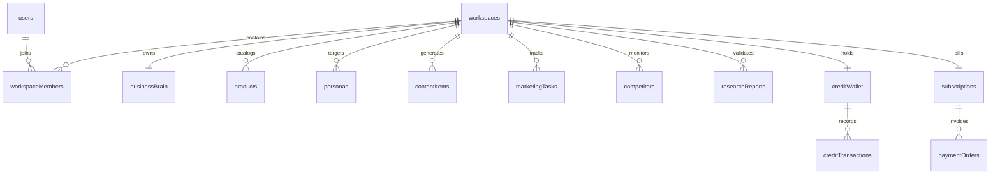

### Architectural Narrative: Diagram 12
The entity-relationship model enforces strict multi-tenancy: every core business object is encapsulated within a parent `workspaces` document boundary, preventing cross-tenant access and simplifying cascade deletions.
